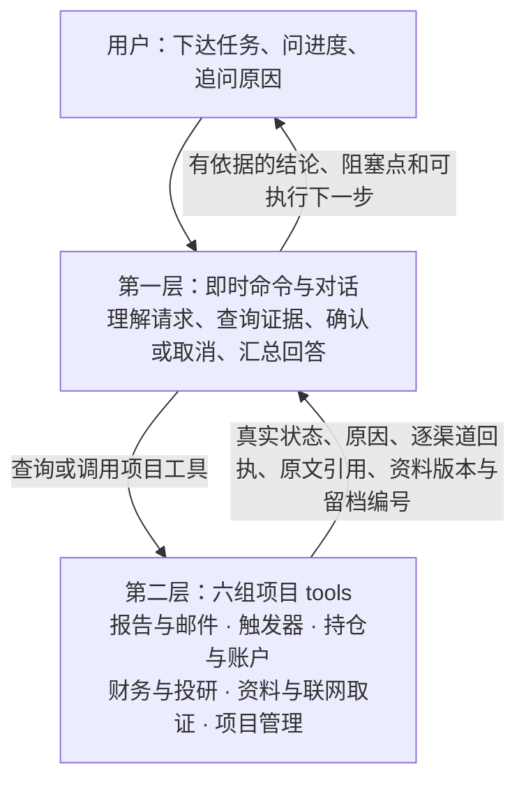
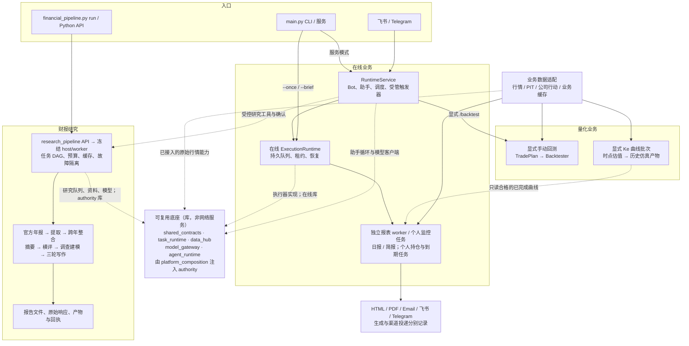
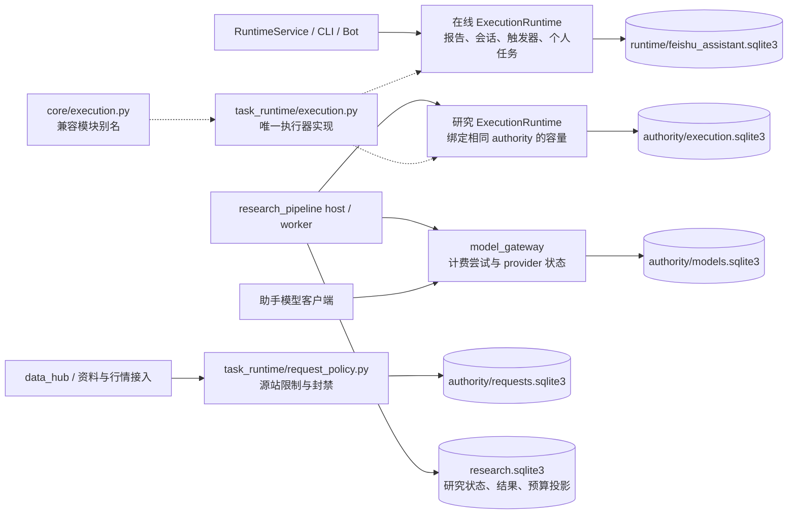
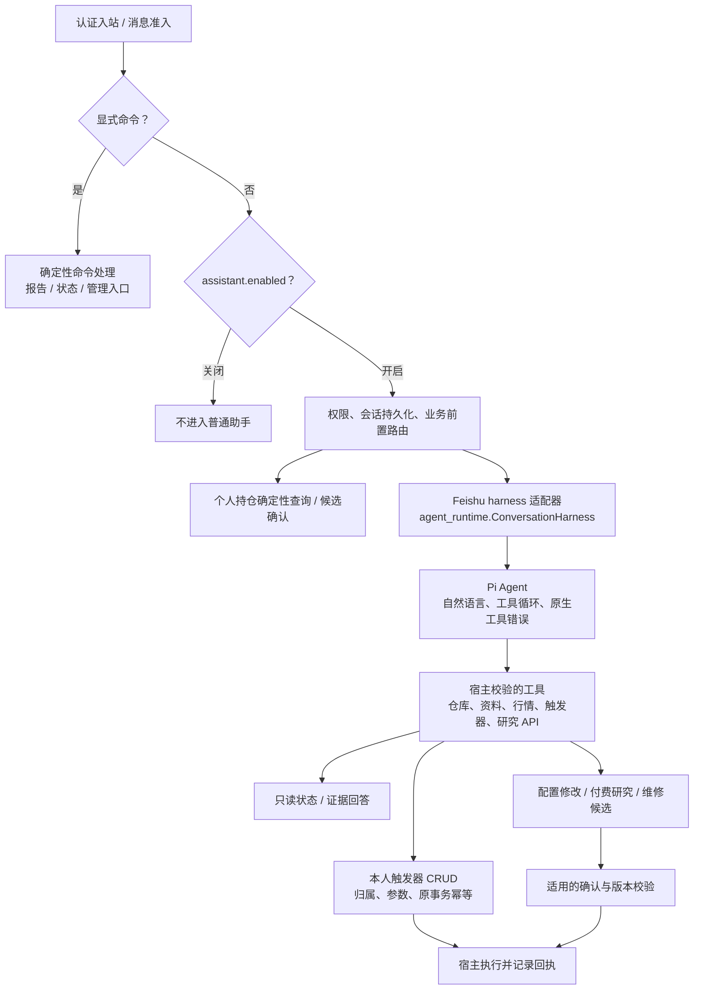
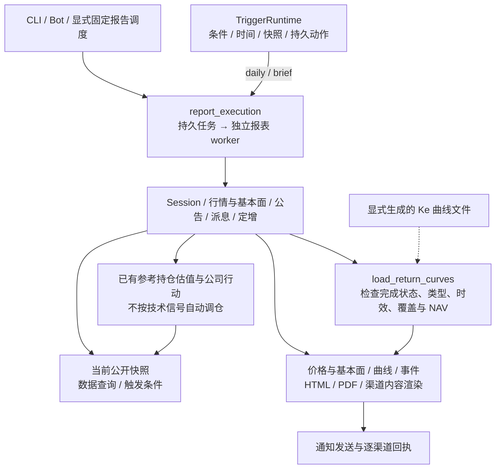
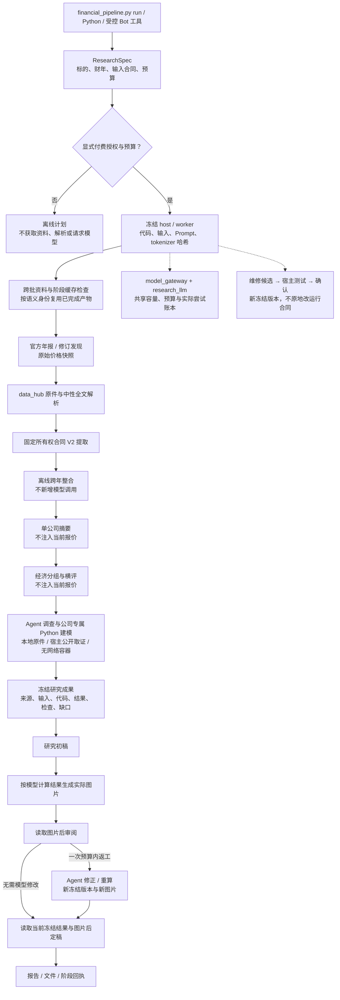
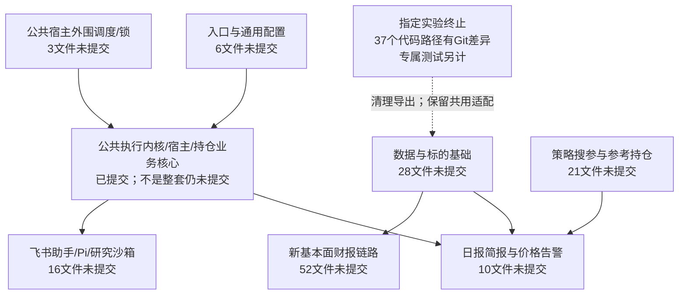

# 全项目架构总览

## 2026-11-09 两层接口与机器人可见性方案

**状态（2026-11-12）：ec10f452 已推送并部署。DS 原生搜索与跨会话原文读取、G05 退役、邮件附件归档、管理入口收敛及精确相对触发时间均已上线；生产隔离回归 871 项通过，新触发器 #16 的完整 26 标的日报、邮件收件及飞书回执已验。** 下方历史运行图保留各自日期；最新版本、证据及仍未覆盖的飞书入站/PDF 正文解析边界见[补缺记录](development/project_tools_gaps_20261112.md)。这里的“两层”是机器人面向项目的接口分层，不是把数据库、任务执行器、Pi 或通知实现物理压成两个类。

原功能离线回归发现并修复报告配置快照、引用坐标和参数契约问题，并继续修复 G03/G04；证据与验收边界见 [离线回归记录](development/offline_regression_20261109.md)。

### 两层职责

1. **即时命令与对话**：帮助、能力查询、任务定位、进度、确认、取消及快捷入口。自然语言与斜杠只是两种输入形式，最后调用相同的项目工具。`/daily` 可以立即返回真实入队回执，但不等于日报已完成或邮件已送达。确认/取消继续使用现有控制入口，不经模型排队绕行。
2. **项目专用 tools**：拥有业务读写逻辑及实际证据，下文六组各自提供能发现、能读、能解释、能执行的接口。耗时动作仍由原有 worker 执行；需要确认的动作仍用原有 ProposalStore。触发器明确操作的现有直接执行规则不因此改成统一多轮确认。

两层之间需要双向关系：机器人能向系统下达操作，也能从同一项目工具读到操作发生后的真实结果。不能用会话历史、源码描述或“已入队”回答实际任务是否成功。

不新增通用大路由器、镜像数据库、状态机或后台同步任务。现有 SQLite、配置、worker、报告归档等留在项目工具内部；状态直接从原有权威记录投影。项目工具可以按领域组织多个清楚的类型化接口，不要压成一个支持任意字符串/任意SQL的大工具。

### 已确认的六组工具边界

六组是稳定的业务归属，不是强行把现有函数压成六个万能函数，也不要求新建六套服务。模型直接调用明确的操作函数，无须先调用“选择工具组”。具体函数名优先保留现有名称，避免为了分组制造兼容别名。

| 工具组 | 负责的查询与操作 | 实现基础及需要补齐的部分 |
|---|---|---|
| 报告与邮件 | 申请完整daily/brief；查执行、历史正文、附件与逐渠道回执 | 复用`core/report_execution.py`、`BusinessDataTools`的报告读取和通知归档。新增薄的`assistant/report_tools.py`承担入队及报告详情；将`service._data_tools_for`中的报告投影移入，不复制。保持全部启用渠道联发，无新增单渠道报告入口 |
| 触发器 | 创建、修改、停用、查条件评估和执行历史 | 保留`assistant/trigger_tools.py`与`triggers`；通过现有action.run_id关联报告详情。保留受管daily/brief及预留optimize合同，不恢复个人提醒或旧条件通知分支 |
| 持仓与账户 | 个人持仓、交易、历史事实、参考组合查询与操作 | 保留`assistant/personal_tools.py`和账户store；将参考组合业务从`commands/handlers.py`移到已有组合业务模块后供两入口调用。个人账户与参考组合保持各自数据语义，G02继续复用ProposalStore |
| 财务与投研 | 结构化指标、覆盖与口径查询；研究、回测、进度、产物 | 保留`assistant/research.py`及`research_pipeline/tools.py`。统一外部入口，不合并旧ResearchRunner与正式pipeline的底层任务库；保留各自任务类型和原始ID。先纠正“只读”schema与实际自动补数行为不符的问题 |
| 资料与联网取证 | 原文发现、正文检索、读取、获取、解析、留档和版本比较 | 在`assistant/data_tools.py`、`web_search.py`和`DatasetCatalog`上扩展；复用DataHub及`data_hub/public_web.py`。不为一次联网查证构造整套ResearchWorkspace/研究任务。邮件业务查询由报告组负责，通用读文件/检索实现共用 |
| 项目管理 | 实际能力清单、跨业务任务概览、运行状态、有效配置、源码/文档解释及已有配置操作 | 新增薄的`assistant/project_tools.py`聚合现有store与`read_service_status`；保留`ConfigurationTools`及仓库/文档读取器。它只负责查询聚合和既有配置管理，不拥有各业务的执行状态，不附带任意shell或自动部署能力 |

查询职责按问题确定：问“营收是什么口径”由财务与投研解释数据，资料组提供原文；问“这份报告发了吗”由报告组解释投递，项目管理只帮助定位任务。读取同一文件可以复用实现，业务解释只能有一个归属。

### 具体实现方式

**入口收敛。** `FeishuAssistant`保留会话、模型循环、工具审计及确认控制；业务函数逐组迁出其`_call_tool`和`_data_tools_for`。在现有组合位置用普通静态映射关联工具名、schema、处理函数和现有capability检查，工具展示与实际调用使用同一份有效清单；不引入插件注册框架或新的权限系统。服务端传入已认证sender/chat/root与本次请求标识，模型参数不能覆盖身份。工具分组本身不授予数据权限。

**快捷命令收敛。** 飞书/Telegram保留解析和即时反馈，随后直接调用相同的领域业务函数。先迁移日报/简报，再迁移配置和参考组合；每组完成就删该组`bot_command → slash文本 → parse → dispatch`往返和handler直写。`/help`、确认/取消保留即时路径；既有通道和操作的授权、确认规则不因入口收敛而被绕过。G01的执行前持久边界保留，不能把它移动到副作用之后。

**报告链路。** `submit_report()`已返回run或run_id，但`handlers._run_main()`把结果丢弃并返回bool；先改为领域工具保留真实run_id，消息格式化放回入口。新请求复用现有request_id去重，来源为服务器认证事件/已确认提案ID，不能每次重试生成新UUID。将关联run写入现有提案结果；入队不等于执行成功。触发器已经在事务中批量绑定action.run_id，必须保留`build_report_payload + store.submit(db=...)`路径，不能为复用工具而替换成事务外的普通submit。缺失历史关联仅报告缺口，不按时间或主题猜测，不重放历史动作。

**任务和运行可见性。** 项目工具按需读取ProposalStore、在线ExecutionStore、TriggerStore和研究store。返回带来源类型的原生ID、状态、阶段、更新时间、原因和已知关联；同一个提案与报告run作为关联节点展示，不算两次执行。列表提供分页及各数据源的覆盖/错误状态，详情仍由业务组读取。每个源先执行现有身份检查；无主历史记录、CLI研究和跨会话数据不能自动当公共数据，先证明既有授权范围再纳入。心跳过期必须明确标过期，源码HEAD不能冒充当前进程版本。

**资料查阅。** 保留`data_find/data_read`通用发现/读取，实现有界正文检索作为资料组的明确接口，复用现有文本解析和页码定位。先按已索引公司/期间/类型缩小范围，再扫描已有文本，返回游标、文件哈希、页码/行号和未覆盖原因；不每次全盘扫描，不隐藏PDF未解析和超限。初版无需向量库或新全文数据库；若实测规模需要索引，再在现有目录库中评估可重建的文本索引。

**联网与留档（本轮候选）。** 普通机器人与投研搜索统一使用 DeepSeek `/v1/tools/search` 和原有密钥，经既有 `AuthorityHTTP` 限流、禁止认证请求重定向；删除 Bing/DDG 搜索页解析与 provider 选择，保存原始 JSON。来源原文仍通过 `fetch_public` 逐跳公网检查并取得原件；读取选中来源时用DataHub保存原件并取得稳定资料ID。复用公共抓取/解析函数，不复制研究框架；如有重复的中性取证代码，只抽到现有`data_hub`供双方使用。原件、解析、登记分别给出结果；登记失败仍保留已成功保存的原件及ID，后续修复登记无需重新下载。`DatasetCatalog.register_document_source`目前严格限定巨潮PDF，保持该约束；普通网页使用通用material登记，不伪造cninfo编号。

**读写语义。** 普通结构化读取使用`query_stock_fundamentals(..., _allow_backfill=False)`的既有分支；缺失时机器人按请求调用明确的获取能力。获取和缓存是取证操作，付费研究执行或账户/配置变更仍走既有规则。扫描件OCR必须暴露可能的模型调用与费用语义，不能藏在声称只读的工具中。保留已接受的自动补查体验，但让查询、获取和执行结果可区分并可审计。

**共同返回信息。** 业务结果继续保留自己的结构，只补齐原生ID/来源、数据时点、读取时点、覆盖缺口和引用；不为了统一返回格式重写所有结果对象。保留`denied / unavailable / not_found / failed / unknown`区别；渠道回执用已定义安全字段投影，地址/凭证仍脱敏。现有ProposalStore负责确认生命周期，现有ExecutionStore负责执行生命周期，资料库负责原件版本。

### 实施批次与删除范围

各批次都在接入、验证后切换调用方并删除对应旧实现。取消独立I5删除批次，不将重复入口留到最后集中清理。下表保留各批范围，实施结果见后面的本地记录。

| 批次 | 修改与复用位置 | 本批完成标准 |
|---|---|---|
| I1 可见性断点 | `assistant/data_tools.py`、`service.py`工具清单/授权、`project_tools.py`能力查询 | 修email回执误删；拆开research门控；能力回答来自实际工具表。无权限路径不泄漏数据，非research会话可使用本来获准的仓库/项目工具 |
| I2 报告与项目追踪 | `report_tools.py`、`project_tools.py`、`command_tools.py`、`commands/handlers.py`及现有提案结果 | `/daily`与对话报告调用同一业务函数，回执携带真实run_id，可追到阶段、失败原因和渠道结果；删除报告分支中丢ID的bool桥接和文本往返；保留触发器原子入队路径 |
| I3 已有资料可查 | `data_tools.py`、`dataset_catalog.py`、报告读取与财务查询适配 | 邮件、财报和结构化产物能按内容定位并引用；补齐跨文件正文检索、分页和未解析提示；将“读取会补数”改成明确的获取路径，无暗中研究执行 |
| I4 联网证据闭环 | `web_search.py`、`data_hub/public_web.py`、`materials.py`及目录登记 | 搜索、读原文、保存、登记、换会话读取完整走通；替换普通搜索的独立直连抓取；保持缓存时点、新旧版本、失败与部分成功证据 |

旧提案处理沿用现有过期/恢复流程：能按原合同完成的使用同一业务函数；无法验证原预览的明确拒绝并要求重新预览。保留历史提案和回执，不能把旧字符串提案无条件升级为新的写操作。

### 分支验收标记

补充原关键路径审计；以下为本设计的验收路径，当前测试结果见本地实现记录。受控测试用隔离store和模拟外部服务；线上验收另记具体版本、真实产物与逐渠道证据。

| 标记 | 必须区分的路径 | 验收重点 |
|---|---|---|
| V01 工具与身份 | 已开放/未开放；本人/他人；有效/缺失上下文 | schema与调用权限一致；模型不能通过参数扩大身份范围 |
| V02 查询覆盖 | 找到/无记录/部分扫描/未解析/损坏/无权限 | 完整性和错误有证据；不能把没扫到当成不存在 |
| V03 报告请求 | 首次/重复/入队失败/提交后中断 | 原生run_id和去重；维持G01恢复边界，不重复外发 |
| V04 任务关联 | 已关联/历史缺ID/同一run多动作/源不可用 | 不猜关联，不重复计数，不将部分源成功当全项目完整 |
| V05 投递结果 | 全渠道成功/单渠道失败/结果未知/归档存在但无回执 | 邮件字段保留；SMTP接受与收件箱送达分开，不自动补发未知结果 |
| V06 资料获取 | 缓存/明确刷新/正文变化/重定向拒绝/源站失败 | 保留时点与旧版本，搜索摘要不冒充原文，取证继续受现有源站约束 |
| V07 留档 | 原件失败/解析失败/登记失败/完全成功 | 分步报告实际状态；新会话仅凭资料ID可读；登记失败不重复抓取已存原件 |
| V08 写入与确认 | 查询/取证/提案/确认/过期/状态冲突/执行中断 | 各操作效果准确声明，G02旧确认旁路不复活，未知副作用不自动重试 |

复用回归入口：`tests/test_business_data_tools.py`、`tests/test_dataset_catalog.py`、`tests/interactive/test_assistant_web_search.py`、`test_assistant_routing.py`、`test_assistant_command_tools.py`、`test_trigger_tools.py`、`tests/test_runtime_service.py`及G01/G02用例。每批加针对业务行为的反例，运行`tests/validation/`和受影响模块；最终再用真实对话验证机器人是否自行选工具、读取原文、正确关联并给出引用。没有真实运行与投递证据时不宣称生产通过。

### 实施前的可见性核对

以下保留2026-11-09实施前的源码证据；具体修复见下方本地实现记录，不代表生产状态。

| 范围 | 已有可见能力 | 当前缺口或限制 |
|---|---|---|
| 提案/任务 | `query_tasks` | 仅当前chat/sender的actions，列表最近10条，不是全项目执行任务；`service.py:2363` |
| 报告执行 | `data_find(executions)` → `data_read(report_run:...)` | 能读取执行status/stage/reason/result，但与提案、触发事件、归档没有一站式关联；每类最多1000条；`service.py:819` |
| 邮件回执 | 原始执行result有逐渠道投递明细 | **已复现数据丢失**：`data_tools.py:53,152` 的通用敏感字段规则匹配email，删除`result.deliveries.email`对象；其他渠道对象仍保留，且没有针对该删除的coverage提示 |
| 触发器 | `trigger_manage list/get` | 已能解释逐动作和逐渠道结果，不能把它说成完全不可见；范围受既有owner约束；`trigger_tools.py:773,1046` |
| 研究 | `research_pipeline_tasks/status/logs/artifacts` | 有状态、费用、缺口和产物，但只在原会话本人范围；旧ResearchRunner任务走另一提案查询入口；`research_pipeline/tools.py:19,123` |
| 项目知识 | 仓库/文档检索工具 | 仓库检索排除data、logs、reports、docs/development；能读代码不能证明能看运行现场；`repository.py:28,55` |
| 工具权限 | capabilities 决定工具schema | **已复现受限profile分叉**：`capabilities={'repository'}`只暴露data_find/data_read；仓库、配置、query_tasks等工具被research总开关一起截掉。生产默认None未必命中此分支；`service.py:1665` |
| 服务现场 | 服务已有心跳、execution.health、运行版本等数据源 | 当前对话schema没有专门的项目运行概览工具；须显式接入只读投影，不能依赖源码推断当前服务状态 |

合成回执复现：将`email: failed/smtp_rejected`与`feishu: sent`同时交给真实`paginate_rows`，返回只剩feishu，`coverage_gaps=[]`。此缺陷现已在本地修复：逐渠道安全回执保留，地址、凭证及原始provider文本仍隐藏。

### 机器人应该具备的可见性

| 用户问什么 | 项目工具必须返回什么 | 证据来源 |
|---|---|---|
| 你能管什么？当前哪里不可用？ | 工具能力、可读/可操作范围、不可用原因 | 实际注册工具与授权，不用静态自我介绍 |
| 今天有哪些任务、哪些卡住了？ | 有权限的提案、触发动作、报告和研究任务；当前阶段、最近更新时间、阻塞原因 | 原有actions、execution_runs、trigger_actions、研究任务库 |
| 为什么这个触发器没发邮件？ | 条件是否命中、动作是否创建、关联run、数据就绪程度、逐渠道回执、可确认的失败点 | 触发评估 → 动作 → 报告run → deliveries；缺任一段明确说明 |
| 给我看这次报告/研究结果 | 对应任务的实际产物及来源时点 | 归档/产物清单；不能用当前快照冒充历史正文 |
| 现在跑的是哪个版本，配置是什么？ | 当前运行版本、心跳、worker/队列健康、脱敏后的有效配置 | 运行清单和已有状态文件；不展示密钥 |
| 为什么机器人和系统说的不一样？ | 同一业务记录的状态与更新时间、引用的证据ID、可见范围/覆盖缺口 | 与执行侧相同的权威数据，不另外复制状态 |

系统公共运行信息与私人资料必须区分：项目运行状态在既有管理员授权范围内可见，个人持仓/私人研究保留现有身份约束。`无权限`、`工具未开放`、`没有记录`、`查询失败`、`结果未知`分别返回，不能统称“查不到”。这不要求再造权限系统。

### 历史资料、联网取证与留档（已确认需求）

机器人必须同时掌握项目正在做什么、过去做过什么、掌握哪些资料，以及哪些问题需要联网补充证据。资料能力仍属于第二层项目工具，不新增第三层知识服务或独立镜像库。用户问到具体公司、财务口径或事件时，由机器人自行定位已有资料、阅读相关原文、按需补查并保存证据；用户不必先知道文件路径、批次ID或工具名。

| 资料范围 | 用户应能完成的查询 | 当前代码基础与缺口 |
|---|---|---|
| 系统历史邮件 | 按日期、公司、主题和正文关键词找到当时的邮件正文、可用附件及投递回执；比较两次报告 | `EmailNotifier`保存HTML正文；`data_find/data_read`能发现和读取已索引归档。正文副本不是完整邮箱或送达证明，附件与run的关联需核验；不据此声称能读外部邮箱全部历史 |
| 缓存财报和公告 | 找原始PDF、已解析文本、财务附注及页码；区分初版、更正和重述版 | `DatasetCatalog`、`CninfoReportService`、`DataHub`已有登记、解析与读取基础；`search_report_text`目前仅接受已登记巨潮报告ID，不能代表所有市场和缓存都支持全文检索 |
| 结构化投研数据 | 查指定公司、期间、指标、预测、假设和研究结论，并追溯到原始资料 | 已有`query_research_data`、`query_stock_fundamentals`、结构化文件读取器和研究产物接口；必须显示实际批次/版本、币种单位、合并范围、实际值/预测值、缺失和失败状态，字段没有就明确缺失 |
| 联网资料 | 搜索会计口径变更、新闻、资产重组等；打开原始来源，读取上下文，再形成结论 | 普通对话`search_web`只返回搜索标题/链接/摘要，不抓取目标原文或持久归档；研究流程`ResearchWorkspace.search_public/fetch_source`已有搜索原页和目标资料留存能力，需复用其底层能力接入对话，不要求为一次资料查询启动整套研究作业 |
| 归档再次使用 | 换一次对话仍能找到此前证据，复核结论；资料更新时查看前后版本 | 复用原始资料的DataHub、现有目录索引及研究产物记录；补足发现入口和关联字段。资料原件留在权威存储，索引可重建；不能只在会话记录中保存链接或摘要 |

**查询和留档约定：**

- 先查已有资料；明确要求“最新”或已有证据不足时联网核对。已有缓存必须报告原始获取时点，不能把本次读取时间当成资料更新时间。重复读取不自动重新提取财报、运行模型或重发邮件。
- 联网查询包含搜索发现、读取来源、保存实际使用的证据和登记检索入口。复用`DataHub.ensure_original/register_original`等既有能力；首次获取的数据写入持久资料目录后登记，不能只登记会被清理的临时路径。已保留的原件不重复复制，内容变化保存新版本并保留旧版。
- 留档记录至少能表达：资料ID、标题、来源URL/发布方、涉及公司或主题、发布时间（未知则标注未知）、适用/生效时点（如有）、抓取时间、内容哈希、原始文件和解析版本、引用页码/段落、关联查询/研究/报告。结论和原始证据分别保存并相互引用，不覆盖原文；通过现有记录扩展必要字段，不另造一套业务状态机。
- 只有原件成功保存且可通过资料ID再次读取，才能报告“已留档”。下载、解析或登记失败分别说明；只拿到搜索摘要就标记摘要，拿不到正文不能声称已核对原文。读取范围或扫描上限导致不完整时明确返回缺口。
- 会计口径变更必须区分准则变更、会计政策/估计变更、差错更正、合并范围变化；比较采用前后的口径、适用期间和是否重述，不能直接拼接不可比指标。重组事项区分传闻、公告、批准、交割、终止及各自日期，新闻报道不能替代已完成事实。优先核对公司、交易所、监管机构和准则发布机构原文，并保留相互矛盾的来源。
- 外部网页、财报和邮件中的文字只作为资料，不改变工具权限或执行指令。普通检索取证的留档属于本次查询；付费研究执行、配置修改和外发仍走各自既有操作规则。按现有授权限定历史邮件和私人投研可见范围。

**本地源码核对位置：** `src/notification/email_notifier.py`（正文归档与SMTP回执）、`src/interactive/assistant/data_tools.py`（索引发现/有界读取）、`src/data/dataset_catalog.py`（数据与文档索引）、`src/interactive/assistant/web_search.py`（对话搜索摘要）、`src/research_pipeline/investigation.py`（联网搜索与原文取证）、`src/data_hub/materials.py`（原件、哈希、版本与解析）。`data_find.query`用于目录发现；本地新增`data_search`查已有正文，巨潮专属查询继续保留其来源约束并复用同一正文投影。

**增加场景验收：** 找到上周某公司邮件并引用当时正文及真实投递状态；从缓存财报定位会计变更附注页；读取某批结构化指标并解释口径/重述差异；联网核对重组进展并返回原文引用和留档编号；新会话在不重新联网时找回已归档证据。另覆盖失效网页、仅有摘要、原文未解析、归档写入失败、资料更新/矛盾、无权限、索引未覆盖的情况，不把“工具返回成功”当成上述场景通过。

最新真实场景结果见[两层工具验收](development/visibility_acceptance_20261109.md)：包括真实模型自行调用、现有邮件/财报、公开原件留档、换会话读取，以及发现问题的修复前后证据。外部搜索与生产投递不能凭本地回归计数视为通过。

### 2026-11-12 候选补齐及机器人可见范围

- 定时/条件报告只由 `trigger_manage → TriggerRuntime → reports.daily/brief` 执行；删除固定日报/简报注册、回调与旧报告条件筛选。旧 YAML 保留作历史查询，不能通过配置工具或旧提案重启。数据采集时钟、显式手动完整报告仍保留。
- 相对计划使用 `schedule.after_seconds`，基于平台消息时间计算并保留秒/微秒；平台时间缺失或无效时复用已有持久 turn 创建时间。模型不用自行取整日期，重复处理同一 turn 不延后截止时间。`prefix` 只属于 catalog，list 仅接受 state。
- `watchlist_manage`、`reference_portfolio`、`configuration_save` 直接调用现有业务模块和 ProposalStore；删除对应 Bot 字符串往返，保留即时斜杠入口的权限/确认边界。`bot_command` 只保留帮助/模式/旧调度只读查询和回测。
- 新邮件附件保存实际 MIME 解码字节及固定 SHA256，报告 run 通过 `report_artifact:<run_id>:<sha256>` 关联；机器人经当前 owner/chat 校验后读取。附件位于隐藏归档目录，公开资料目录不能发现或读出。无解析时说明缺口，不隐式调用模型/OCR。旧报告无附件或无哈希不能反推历史 PDF，不能重发补造。
- 可查询“是否投递”“PDF 是否生成”“归档是否完整”三种不同事实。SMTP 接受不证明收件箱收到；PDF 失败但 HTML 已发送时保留 SMTP sent，报告为 partial；归档失败不改写已发送事实。
- 已有历史 HTML 邮件仍沿用原资料库可见范围，本轮的附件权限验证不等于历史正文已全量改为私有。SGX 行情缺失、Ke 缓存过期、既有财报未解析仍按资料缺口呈现，不被工具或测试通过掩盖。

### 历史本地实现记录（I1–I4，后已发布52eaaa0）

| 批次 | 已接入能力 | 同批删除/替换 |
|---|---|---|
| I1 可见性 | 六组实际能力清单、独立capability过滤、服务心跳/构建与队列状态、保留email逐渠道回执 | 删除research总开关截断后续工具的分支；替换会误删email渠道对象的通用投影；默认profile也拒绝未注册工具 |
| I2 任务追踪 | report_request/get/find、稳定request_id、本人/会话绑定、提案→run关联、按来源分页任务查询、报告明确路径对应归档资料ID | 删除_run_main布尔桥接；bot_command不再接受daily/brief，旧报告字符串提案拒绝执行；即时slash直接共用ReportTools，触发器原子入队保持原样 |
| I3 已有资料 | data_search有界正文搜索、同源行页引用、未解析/视觉页/超限等缺口；结构化查询与显式补取分开 | HTML/缓存正文读取抽到现有data层共用，删除助手内重复函数；删除对话预查按关键词暗中补数分支，fetch_stock_fundamentals显式获取 |
| I4 联网留档 | search_web保存搜索页、fetch_web_source保存原件及已有本地解析、通用material引用登记、跨会话读取、新旧版本来源保留 | 删除普通搜索独立requests直连和旧解析器；复用public_web限流/公网检查、DataHub、DatasetCatalog，未建新队列/业务库/后台同步 |

异常边界：已入队但提交回执丢失时，只按原request_id读取队列，找回关联或保留unknown/interrupted；不重新提交。重启后提案详情仍能按同一request_id找回run。归档存在不证明投递成功；无主历史run不自动开放给任意会话。正文、附件或来源关联没有明确证据时返回缺口，不按日期/主题猜测。

配置、个人持仓和正式研究保留已有业务模块与确认规则；本轮没有重写其执行底座。G01/G02本地修复继续保留。测试使用真实隔离SQLite/资料库及模拟外部传输；未发送真实报告、未调用真实搜索或付费模型，不能声称生产或真实模型问答验收完成。

本地验收完成（各组有重叠，不相加）：

| 验收范围 | 结果 | 原始回执 |
|---|---|---|
| 共享入口、能力授权、G01/G02、研究、通知与validation | 301 passed，1 skipped | `.tmp/two_layer_final/results.xml` |
| 正文检索、目录、联网归档、报告工具、实际Pi桥与DataHub | 266 passed，1 skipped | `.tmp/two_layer_final_delta/results.xml` |
| 报告自然语言预览与旧命令路由最终复验 | 38 passed | `.tmp/two_layer_report_conversation/after.xml` |
| 共享对话、真实报告入队边界与validation最终复验 | 51 passed | `.tmp/two_layer_final_boundaries/results.xml` |
| 触发/研究真实Store分页、身份隔离与研究修复观测 | 25 passed，1 skipped | 工具终端输出；未生成XML，临时目录不是验收日志 |

最后增量还修复两处实际链路问题：报告预览已成功但被研究检索门槛阻断，现复用既有命令回执判定；研究列表空身份能匹配归属不完整的旧记录，现与详情同样拒绝，触发列表也校验有效会话。自然语言报告回归的修复前失败保存在`.tmp/two_layer_report_conversation/before.xml`。新资料工具已加入实际Pi检索集合，正文搜索引用进入原有来源审计。

Ruff及`git diff --check`通过。中间的读取上限、权限错误文字回归已修复；半秒期限测试在并发运行时曾失败，最终DataHub整组复验通过。跳过原因保留在XML/终端输出，不视为已验收。源码哈希及各组统计保存于`.tmp/two_layer_final/acceptance.json`。真实外网、真实模型自主选工具、生产触发及真实渠道投递尚未验收；本轮没有提交、推送、部署或外发。

---

历史生产核对日期：2026-11-03。v1.23.2 / `1075195` 的触发器耗尽自动失效补丁已推送并部署，隔离验收通过后更新 6 个公共文件，逐文件核验 870 项公共文件，并确认运行进程版本、心跳和飞书接收入口状态。私有配置、固定调度与策略状态保持原值，触发动作与投递历史保留；允许已耗尽规则正常转为 done。发布回执位于生产 `data/deployments/trigger_lifecycle_v1_23_2_20261103_1075195/`。未新增立即报告入口、真实模型调用或测试消息。历史环境及本机配置快照保留在文末，与当前状态分开。

系统目前是**模块化单体，使用多个工作进程与 SQLite 持久化**。服务宿主负责在线任务，财报研究使用冻结版本的 host/worker。五个可复用包已经存在于源码中；共享实现不等于共享全部队列、业务库或配置。

当前业务图按2026-11-04本地清理后的源码更新，本轮为本地源码清理，不代表已经部署。Pi会话删减的历史部署证据及文末带日期的环境表保留当时含义，不能当作当前运行配置。

- [全项目总图](#全项目总图)
- [公共运行层放大图](#公共运行层放大图)
- [数据与状态归属](#数据与状态归属)
- [飞书开关与对话路由](#飞书开关与对话路由)
- [告警链路放大图](#告警链路放大图)
- [手动回测与历史产物](#手动回测与历史产物)
- [财报研究链路放大图](#财报研究链路放大图)
- [当前配置与实现边界](#当前配置与实现边界)
- [模块与源码导航](#模块与源码导航)
- [本机与线上环境对照（历史）](#本机与线上环境对照)

## 图例

- 实线表示调用、调度或数据流，不表示所有入口都会执行每条分支。
- 虚线表示配置、可选消费、显式交接或依赖；不表示自动触发。
- 框是职责边界；只有标明进程的节点才表示进程边界。数据库归属以下表为准。
- 配置表区分本机兼容快照与已核验的生产配置；源码能力、配置开启和运行成功分别判断。

## 全项目总图

研究报告没有自动接入策略晋升或真实券商下单。财报文件交付与通知发送是两个步骤。总图中的底座是库边界，未引入网络微服务或外部消息队列。

## 公共运行层放大图

在线实例与研究实例使用同一套持久执行器代码，但没有合并成一个数据库。财报任务及其模型维修在同一 authority 的 `research_llm` 容量中竞争，配置上限 20 不是每批次各 20，也不是实际运行并发的观测值。策略搜索进程已删除；研究模型容量不用于搜索。

## 数据与状态归属

| 状态 | 权威归属 | 边界 |
|---|---|---|
| 在线入站、会话与任务队列 | `<storage.data_dir>/runtime/feishu_assistant.sqlite3` | 默认 `data/runtime/`；profile 可隔离 |
| 研究任务容量、claim、lease | `<authority>/execution.sqlite3` | 研究启动后绑定；同 authority 跨批共享 |
| 源站请求限制与阻断 | `<authority>/requests.sqlite3` | 不是业务财报库 |
| 模型请求、attempt、响应、实际用量 | `<authority>/models.sqlite3` | 费用权威账本；研究侧预算/费用记录是关联投影 |
| 原始资料、版本、索引与解析 | `<authority>/materials/<scope_id>/` | SHA 与来源身份；全文与预览分开，scope 控制资料域 |
| 研究业务状态及阶段结果 | 研究 store 的 `research.sqlite3` 与运行目录 | 保存合同、预算、产物、冻结代码及回执 |
| 个人持仓、账户版本、历史与 outbox | `personal_monitor` 业务 store | 保留独立业务合同，不等同在线执行队列 |
| 行情/PIT/公司行动与业务缓存 | `data`、`instruments` 及各适配器 | 仍有业务专用缓存，未全部迁入 data_hub |
| 历史搜索产物与参考账户绑定 | 现存历史文件与参考账户 store | 历史只读；不再发布、晋升或激活新候选 |
| Ke 展示输入 | `report.return_curve_artifact` | 只读取完成、类型正确、覆盖与时效合格的曲线 |

`authority_for()` 的选择顺序为显式 root → `storage.authority_root` → `TRADE_EYES_AUTHORITY_ROOT` → `<project>/data/shared_platform`。相对 root 按项目目录解析；`AuthorityRef` 要求绝对路径。scope 隔离资料目录，不自动给共享任务和账本新建一套库。底座不反向导入业务组合层。

## 飞书开关与对话路由

`src/agent_runtime/harness.py` 是 Pi 的有界模型/工具 RPC 适配，不再保留 Python native 会话循环；飞书适配器注入现有 bridge 与业务工具。删除触发器文本快路及正向授权词白名单，保留认证身份、归属、参数来源与版本校验。工具异常经原有 error 回包成为 Pi 工具错误，失败文案不覆盖最终回答；成功事实仍以真实回执为准。研究检索要求读取原有成功回执，触发器保存后不再因“跌破”等路由提示追加资料检索。财报调查复用维修已采用的宿主 Pi 桥入口，原模型预算和业务冻结合同不变；共享文字消息上限采用既有研究请求的 48 MiB，工具批量不再额外限为 8 项，实际执行仍受宿主预算约束。

只沿用既有文字历史，不新增 Pi 会话存储或恢复协议；上次完整执行现场丢失时明确要求重发完整条件。会话错误仅走现有助手回复，逐轮 Health 卡片取消，执行失败记录及服务级告警保留。

## 告警链路放大图

TriggerRuntime 只派发已有日报/简报任务，optimize 仅预留、不执行；当前在宿主注册报告且存在飞书 Bot 时装配。旧技术条件告警、报告扫描/策略回测、按信号自动调仓和旧展示开关已移除；技术指标仍供受管条件使用，已有参考持仓的估值、公司行动与手工管理保留。曲线只接收 `ke_threshold_allocation` / `ke-return-curves/1` 的合格产物，缺失或无效不会回退成旧技术图表。历史仿真曲线不修改真实账户。已核验的生产固定日报、启动日报和固定简报关闭；本地固定报告调度能力保留，定时优化已移除。

日报/简报沿用现有价格与基本面表、合格 Ke 曲线；缺失 ROE 仅渲染有效 PB/PE×100 并标 `(估)`。三市场曲线在邮件/PDF 合成一图，Bot 保留文字替代。事件使用同一共享构建器，类别 → 市场 → 标的 → 发布日期排序，合并例行披露并保留全部原文链接；默认展示两个自然月，Bot 可设 1–24，待派息分红与未解禁事项不受此期限裁剪。

## 手动回测与历史产物

优化器整套功能已删除，包括搜索/Solver、Gate、候选/晋升/激活、资源进程、恢复锁、专属通知及 CLI/Bot 入口。受管动作 `optimize` 仅保留类型兼容，不执行。历史运行文件通过既有数据工具只读查询，不作为新搜索的恢复现场。

保留 `config/optimizer_constraints.yaml` 及 loader 的历史名称，仅提供执行/WF/基准/profile 合同；`search.workflow` 只剩两个 PB 脚本使用的显式手动 WF 适配，不包含搜索驱动器。

手动 `/backtest`、策略合同、TradePlan、Backtester 和公司行为记账保留。日报/简报继续读取独立完成的 Ke 曲线和原业务数据；完整报告生成器、统一研究与 Pi 对话链路不因此替换。

## 财报研究链路放大图

`financial_pipeline.py run` 已能通过 `research_pipeline` 编排完整流程；原 `extract/context/summary/stage3` 分阶段命令保留为显式兼容入口，不能再把它们画成唯一运行方式。未授权的离线计划不会偷偷启动付费工作。

新研究默认先调查建模，三轮写作读取冻结成果。既有有效报告继续复用；显式重新研究建立新版本。图表来自实际计算结果，沙箱或证据不足保留 partial；本次代码已部署，但执行成功与真实研究质量验收仍分开；本次未新增付费三轮研究。实现见[调查建模](../src/research_pipeline/investigation.py)与[离线计算沙箱](../src/research_pipeline/model_sandbox.py)。

`extract --subagent --subagent-native` 是可选本地 Codex transport，只有显式选择时才需要 CLI 和账号；当前生产未安装或启用。普通服务、日报及 API 财报链路不依赖 Codex。

材料身份、阶段语义和已有 attempt 决定缓存与恢复行为；部分完成、失败或发送结果未知不是自动补发授权。公司局部失败可形成 partial，预算、账本或完整性问题阻止新的付费派发。Pi 维修与研究任务共享容量，但维修不能自行改业务 Prompt 或提升预算。详见[研究启动指南](guide/research_pipeline.md)和[平台使用指南](guide/reusable_platform.md)。

## 当前配置与实现边界

2026-11-04 本地源码已移除优化器；`optimizer.markets`、Solver/Gate/自动搜索窗口配置和激活入口不再是当前支持项。显式回测执行合同、参考账户估值及历史产物读取保留。以下两张表是带日期的旧环境证据，不能按其中的搜索参数重建当前功能。

### 历史配置与核验快照

| 本机兼容快照 | 2026-11-01 文件配置 / 代码行为（不代表当前生产） |
|---|---|
| 报告展示 | 技术信号关闭；`returns_only`；曲线路径 `data/strategy_returns/ke_24m.json`，最大年龄 7 天 |
| 固定调度 | 文件列有 09:50 / 14:30 简报，跳过周末；日报 19:00、Asia/Shanghai。`daily_enabled` 未显式设置，代码默认 true；`optimize_enabled` 未显式设置，默认 false |
| 飞书 | Bot enabled；assistant 未显式启用，默认关闭；普通循环默认 native，资料检索策略仍强制 Pi |
| A 股搜参 | technical_ensemble / local_genetic / standard / a_share_84m |
| 港股搜参 | regime_pullback / simulated_annealing / standard / hk_84m |
| 美股搜参 | percentile / random / exploratory / us_84m |
| 快照边界 | 以上为旧本机 YAML / 代码快照，不能覆盖下表的生产核验 |

| 生产核验项 | 2026-11-03 / v1.23.0 |
|---|---|
| 代码 | ae48293；870 项公共代码/运行资产逐文件匹配，进程构建已验证 |
| 固定调度 | 注册列表为空；固定日报、启动日报和固定简报关闭，定时优化关闭 |
| 报告 | technical_signals.enabled: false；returns_only；沿用既有日报/简报链路 |
| 飞书助手 | enabled；Pi；deepseek-flash；服务与传输心跳就绪 |
| 状态保护 | 私有配置、触发历史及策略状态保持原值；数据库不回卷 |
| 研究边界 | 离线 Docker 协议已验证；未执行新的付费研究；Codex native 未安装/启用 |

- **既有持仓和历史产物保留。** 本轮不回卷参考账户，也不删除历史搜索文件；当前代码不再生成或激活候选。
- **执行器已统一实现，状态尚按域分开。** 不把两个 SQLite 队列画成同一个，不把研究费用投影当成第二份权威账单。
- **旧研究专用入口已删除。** `src/fundamental_quant` 四个历史适配模块及其CLI/Bot入口、旧周通知和孤立纵向配置已从本地源码删除，不保留占位执行器。历史文件、tokenizer和通用工具可读的公开导出保留；新研究编排及仍有消费者的手工财报/研究交接脚本保留。本轮为本地源码清理，不代表已经部署。
- **保留的适配器仍有消费者。** `fundamental_embedding` 保留数据、行业及 PB/CAPM 等适配；已退役 MOE、旧评分和旧 Ke 实验不属于现行研究。助手的手工回测沙箱仍在，不能与旧 fundamental_quant 一起视为删除。

## 模块与源码导航

| 范围 | 源码入口 | 职责 |
|---|---|---|
| 业务组合与身份 | [platform_composition](../src/platform_composition.py)、[shared_contracts](../src/shared_contracts/authority.py) | 项目默认值与显式 authority |
| 公共执行器 | [task_runtime](../src/task_runtime/execution.py)、[request_policy](../src/task_runtime/request_policy.py) | 队列、容量、恢复及源站限制 |
| 资料底座 | [data_hub](../src/data_hub) | 原件、解析、索引、行情原始值 |
| 模型底座 | [model_gateway](../src/model_gateway) | 请求、响应、尝试与用量账本 |
| Agent 底座 | [agent_runtime](../src/agent_runtime/harness.py)、[飞书适配器](../src/interactive/assistant/harness.py) | Pi RPC 桥、预算边界与宿主业务校验 |
| 在线宿主与报告 | [RuntimeService](../src/core/runtime_service.py)、[report_execution](../src/core/report_execution.py)、[main.py](../main.py) | 生命周期、调度、报表 worker 与业务组合 |
| 受管触发器 | [triggers](../src/triggers) | 条件、时间、快照、动作、投递回执 |
| 个人监控 | [personal_monitor](../src/personal_monitor) | 持仓、提醒、版本、历史、业务 outbox |
| 数据接入 | [data](../src/data)、[instruments](../src/instruments) | 行情、PIT、公司行动、财务推导与缓存 |
| 策略与仿真 | [strategy](../src/strategy)、[backtest](../src/backtest)、[ref_portfolio](../src/core/ref_portfolio.py) | TradePlan、成交、现金流及绑定账户 |
| 手动回测 | [backtest](../src/backtest)、[strategy](../src/strategy) | 显式策略计划、成交和评价；无搜索与激活 |
| Ke 展示 | [return_curves](../src/strategy/return_curves.py)、[report_policy](../src/notification/report_policy.py) | 已完成曲线验收与价格/基本面展示合同 |
| 统一研究 | [research_pipeline](../src/research_pipeline)、[CLI](../scripts/financial_pipeline.py) | DAG、冻结执行、预算、缓存、修复和状态 |
| 财报阶段合同 | [fundamental_data](../src/fundamental_data)、[财报指南](guide/financial_pipeline.md)、[正式研究](guide/research_report.md) | 提取、对齐、摘要、横评与三轮产物 |
| 保留的数据适配 | [fundamental_embedding](../src/fundamental_embedding)、[旧研究退役记录](development/research_retirement_20261024.md) | 仍有消费者的数据合同；旧FQ专用代码已删除，历史文件保留 |
| 输出与运维 | [notification](../src/notification)、[ci_cd_deploy](../ci_cd_deploy.py)、[tests](../tests) | 渲染、渠道投递、发布与核验 |

## 状态和文档维护

本图不固化 PID、实时进度、API 余额或运行批次费用。运行事实从相应任务库、心跳、launch/status、冻结清单与回执核对。新增入口、迁移状态库、改变消费者或退役模块时，应同步修改箭头与本页归属表；设计方案不能自动视为已落地或已部署。

以下附录仅保存原时点证据。后续 2026-10-30 23:34 文件与心跳核查见[在线离线差异收尾](development/source_parity_cleanup_20261030.md)；历史结论不得覆盖本页 2026-11-03 的源码与部署边界。

## 本机与线上环境对照

此表为修复前环境快照，修复候选未部署。快照日期：2026-10-29。线上于 **09:03（Asia/Shanghai）** 经 SSH 只读核对配置、关键源码和既有对话审计；本机读取当前主配置及源码。下表不是全量源码同步证明，也不代表新发送了一条消息完成端到端验收。

| 项目 | 2026-10-29 本机主配置 / 源码 | 线上已核对配置 / 源码 |
|---|---|---|
| 飞书助手开关 | 未显式配置，默认 `enabled: false` | `enabled: true` |
| 对话循环后端 | 未显式配置，默认 `native`；助手关闭时不运行 | `harness_backend: pi` |
| 普通对话模型 | 默认 `deepseek-flash`；未因源码存在就运行 | `deepseek-flash` |
| thinking | 模型客户端发送 `enabled`，强度默认 `high`；仅在实际模型路径生效 | 模型客户端发送 `enabled`，配置强度 `high` |
| 最大模型调用轮数 | 默认 6 | 配置 16 |
| 最大工具调用次数 | 默认 48 | 配置 48 |
| 通用 Pi 桥 | 代码保留；助手启用后的研究候选强制选 Pi，当前主配置仍关闭助手 | 已选作飞书助手后端，尚未替换本轮问答修复 |
| 关键文件版本 | 09:03时 `harness.py`、`settings.py` 与线上哈希相同；之后本轮修改了本机 harness/service，候选未部署 | 保留09:03所读版本，不能用本机候选解释现行线上行为 |
| 本机财报研究 | 显式批次脚本，不接 Pi；旧研究专用接入已退役 | 本轮未完整核对线上财报研究模块，不能将本机退役结论外推 |
| 本机测试任务 | `TradeEyesPersonalMonitorTest` 已主动停用 | 不代表生产助手停用；本次生产服务为 active/running |

差异来源：10 月 28 日公共层发布是限定 38 文件的生产覆盖，保留线上其他业务补丁与配置；没有整体同步本机的研究/优化实验，也没有拿本机关闭的助手配置覆盖线上。因此架构需要同时记录代码能力、配置条件和环境版本，不能只画一条无条件的“飞书 → Pi → 研究”。

上述配置摘录、关键源码 SHA-256 及版本差异的脱敏快照保存于 `.tmp/feishu_quality_audit_20261029/architecture_snapshot.json`。原对话证据单独保留，不复制到文档。历史审计能证明此前出现过多轮调用和直接回复两种路径；不能由某个历史结果保证当前每次回答都会检索或思考。

## 清理前未提交改动与架构模块对照（历史快照）

本节固定记录2026-10-30 19:48的清理前状态，不代表当前仍未提交的文件。后续清理与提交结果见[清理记录](development/workspace_cleanup_20261030.md)。

盘点时间：北京时间2026-10-30 19:48；基准为本机 `master` 的 `9b3f6ee2afa464aa1d5410d5ba3275c0abce183b`。最近合并已包含公共执行层、版本标识与多市场公告等提交，本节只列该HEAD之后的工作区差异，不把已经提交的功能再次算作“未提交”。无暂存文件，本次不提交、不推送、不部署。以下数量固定为快照时点；原件下载会继续增加数据文件，结束复核时新增项仅为原件PDF，功能/配置/测试/文档清单未变。

Git共列出23,712个变化路径：140个已跟踪修改、44个已跟踪删除、23,528个未跟踪文件。其中文件层面的代码/配置/测试/文档共538个，另外23,174个在`data/`、`.runtime/`和`tmp/`。后者以资料、运行/验收结果、测试临时目录和本地依赖为主，不能按源码一并提交。

以下按路径主职责归类，每个文件只计一次；`main.py`、优化配置、测试和文档实际可能包含跨模块改动，表格不是可直接整文件提交的分组。M为已跟踪修改，D为已跟踪删除，新为未跟踪文件；文件数不等于测试用例数、代码行数或生产进程数。

| 架构模块/主归属 | 文件数 | M | D | 新 | 当前改动范围 |
|---|---:|---:|---:|---:|---|
| 入口与通用配置 | 6 | 6 | 0 | 0 | main.py等跨模块入口、依赖和通用配置；同文件可能含多个主题，不能按整文件混提交。 |
| 文档与项目说明 | 99 | 19 | 0 | 80 | 架构、指南、合同、历史审计和项目记录；含文档目录下的验收产物。 |
| 运维与审计工具 | 8 | 2 | 0 | 6 | 数据快照上传/下载、迁移、费用与部署/核对工具；不自动等同于生产未部署业务。 |
| 策略搜参与参考持仓 | 21 | 20 | 1 | 0 | 策略配置与晋升、评价/验证、参考持仓、回测修复、保留的PB/期权研究与benchmark。 |
| 新基本面链路 | 52 | 1 | 0 | 51 | 财报提取、跨年整合、摘要/横评/三轮研究、披露结构、Prompt与版本配置；保留历史Prompt不等于默认使用。 |
| 数据与标的基础 | 28 | 18 | 0 | 10 | 采集/目录/下载与披露、交易日/行情时间、逐时点数据及行业/估值共用适配。 |
| 实验终止 | 37 | 2 | 35 | 0 | 指定旧估值/行业评分/消融、MOE及Ke的已跟踪删除；共享包导出清理。原未跟踪文件删除不会显示D。 |
| 日报简报与告警 | 10 | 9 | 0 | 1 | 通知正文/图表/模板、盘中行情与价格条件；不是未提交整个公共报表执行器。 |
| 公共宿主外围 | 3 | 3 | 0 | 0 | 进程锁、调度和历史调度迁移的剩余改动；ExecutionRuntime/RuntimeService核心已提交。 |
| 飞书助手与研究沙箱 | 16 | 8 | 0 | 8 | Pi/检索路由、命令及Telegram适配、沙箱Docker/部署辅助；通用SDK/持久队列核心已提交。 |
| 测试与夹具 | 232 | 52 | 8 | 172 | 跨模块测试、夹具、被退役测试删除；不把夹具文件数当用例数。 |
| 本机持仓验收配套 | 6 | 0 | 0 | 6 | 验收脚本、隔离配置模板和性能包；个人监控业务核心及薄入口已提交。 |
| 历史研究材料包 | 20 | 0 | 0 | 20 | skills/fundamental-research静态材料20文件；当前源码未发现引用，不属于已确认新财报执行闭包。 |

已提交且当前无工作区差异的核心包括：`src/core/execution.py`、`execution_health.py`、`runtime_service.py`、`report_execution.py`、`report_cli.py`、`src/interactive/ingress.py`、`src/personal_monitor/`及`personal_monitor_runtime.py`。这表示相对本机HEAD已提交，不等同于它们刚刚重新完成线上验收。

几个需要明确的边界：

- **新基本面不是全部未提交。** 固定三轮研究入口和共用摘要执行器已有提交；未跟踪的大头是提取/整合/横评入口、披露处理实现、配置和版本化Prompt。历史Prompt版本保留，不代表默认配置仍用旧版。
- **实验删除数与Git的D数不同。** 上次清理共删除27入口/17实现/16专属测试，其中部分文件原本未跟踪，删除后不会出现在`git status`。本次仅统计Git实际报告的差异。
- **历史研究材料单列。** `skills/fundamental-research/`有20个未跟踪静态文件；初步产品源码检查未发现调用；后续清理查到一个测试仍读取其中方法原文，现已将原文迁至`docs/design/company_summary_question_origins.md`并改测试依赖，旧20文件已删除。
- **公共层与个人监控的验收配套另计。** 脚本和配置模板仍有未跟踪文件，不能由此声称公共执行内核或持仓业务尚未提交。
- **不以未提交推断未部署。** 先前采用过限定文件发布/生产补丁；本节没有逐文件重新核对生产，不能仅看本机Git状态断言线上是否存在某个改动。

完整逐文件清单保存在本机`.tmp/uncommitted_architecture_20261030/modules.json`，原始Git状态及差异统计分别为`status.json`、`numstat.txt`。大批产物文件不复制进正文；可据清单逐模块审阅，但不得直接`git add .`混入数据或未审改动。

### 2026-10-30 本地优先源码合并

所选本地业务与生产9m评价节点已按修改块合并，历史经过见[源码合并范围和当时证据](development/local_preferred_merge_scope_20261030.md)。11月1日删除旧研究实现后，该时点保留4个历史只读文件，以及14个仍有调用的基本面数据/估值工具；此前“55个争议旧文件保留”的决定不再适用。真实生产状态仍以之后部署核验为准；本次源码清理未推送或部署。
