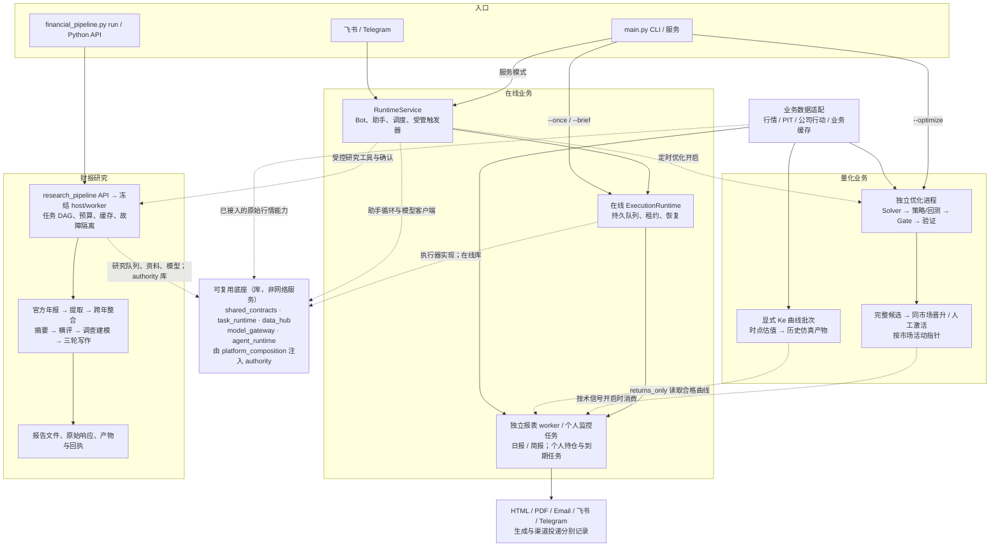
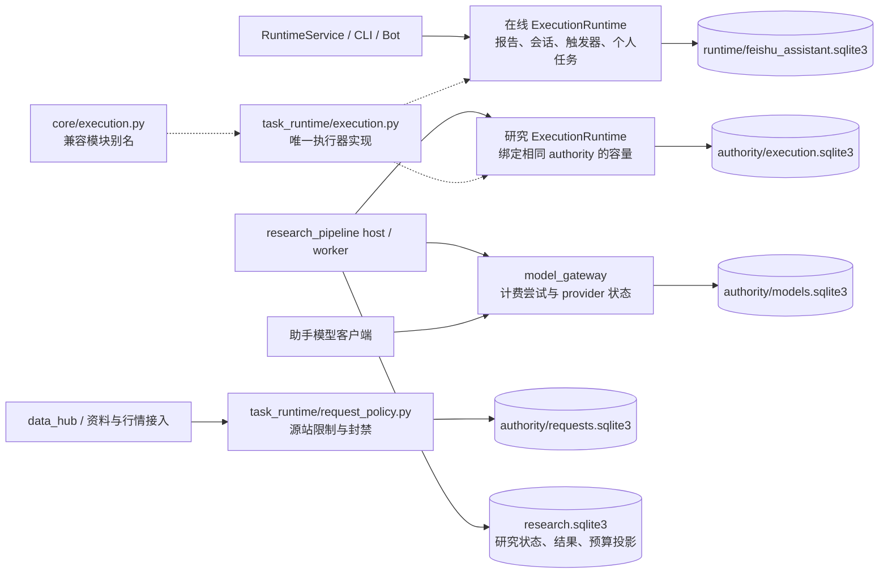
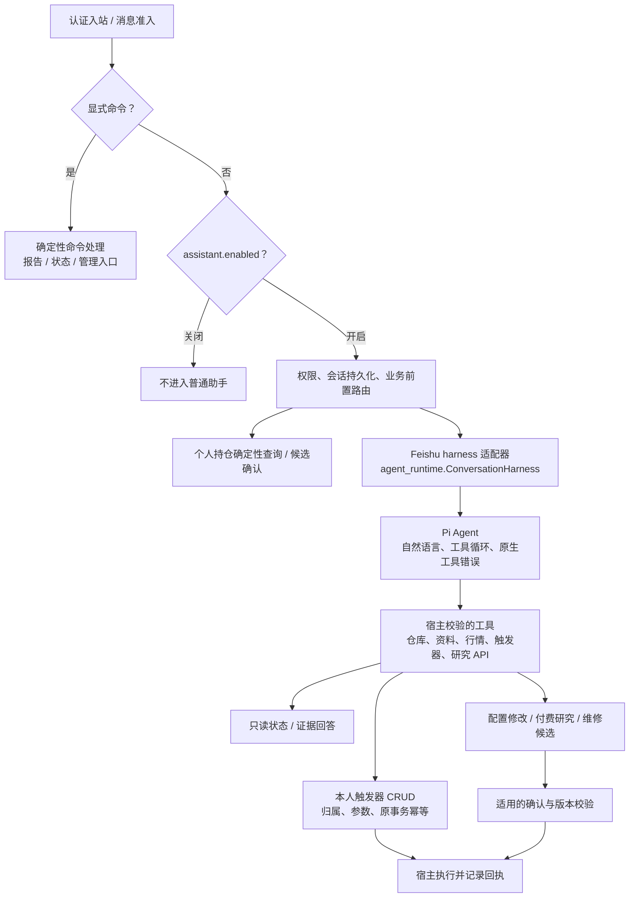
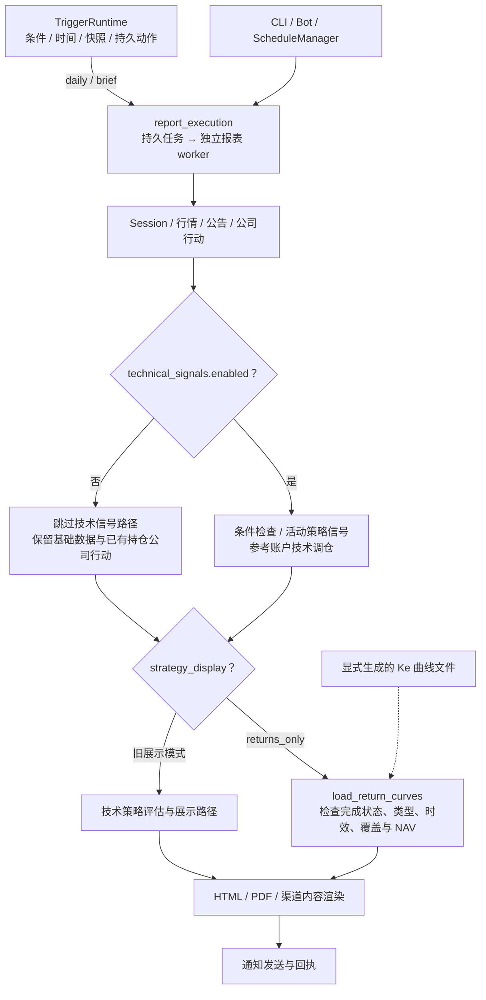
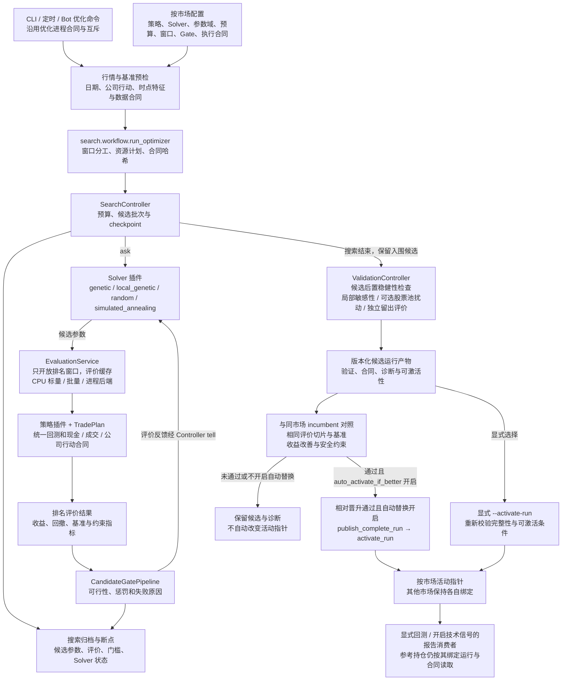
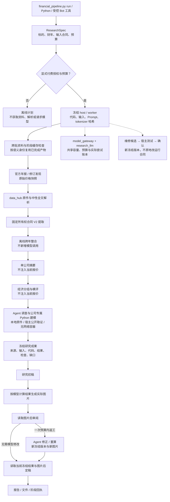
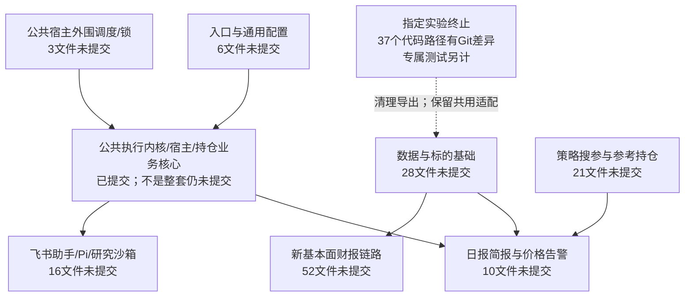

# 全项目架构总览

核对日期：2026-11-03。v1.23.2 / `1075195` 的触发器耗尽自动失效补丁已推送并部署，隔离验收通过后更新 6 个公共文件，逐文件核验 870 项公共文件，并确认运行进程版本、心跳和飞书接收入口状态。私有配置、固定调度与策略状态保持原值，触发动作与投递历史保留；允许已耗尽规则正常转为 done。发布回执位于生产 `data/deployments/trigger_lifecycle_v1_23_2_20261103_1075195/`。未新增立即报告入口、真实模型调用或测试消息。历史环境及本机配置快照保留在文末，与当前状态分开。

系统目前是**模块化单体，使用多个工作进程与 SQLite 持久化**。服务宿主负责在线任务，搜参使用独立优化进程，财报研究使用冻结版本的 host/worker。五个可复用包已经存在于源码中；共享实现不等于共享全部队列、业务库或配置。

下方对话图描述已发布的 Pi 会话删减。文末带日期的环境表保留当时快照，不能当作当前运行配置。

- [全项目总图](#全项目总图)
- [公共运行层放大图](#公共运行层放大图)
- [数据与状态归属](#数据与状态归属)
- [飞书开关与对话路由](#飞书开关与对话路由)
- [告警链路放大图](#告警链路放大图)
- [搜参子系统放大图](#搜参子系统放大图)
- [财报研究链路放大图](#财报研究链路放大图)
- [当前配置与实现边界](#当前配置与实现边界)
- [模块与源码导航](#模块与源码导航)
- [本机与线上环境对照（历史）](#本机与线上环境对照)

## 图例

- 实线表示调用、调度或数据流，不表示所有入口都会执行每条分支。
- 虚线表示配置、可选消费、显式交接或依赖；不表示自动触发。
- 框是职责边界；只有标明进程的节点才表示进程边界。数据库归属以下表为准。
- 配置表区分本机兼容快照与已核验的生产配置；源码能力、配置开启和运行成功分别判断。

## 全项目总图

研究报告没有自动接入策略晋升或真实券商下单。财报文件交付与通知发送是两个步骤。总图中的底座是库边界，未引入网络微服务或外部消息队列。

## 公共运行层放大图

在线实例与研究实例使用同一套持久执行器代码，但没有合并成一个数据库。财报任务及其模型维修在同一 authority 的 `research_llm` 容量中竞争，配置上限 20 不是每批次各 20，也不是实际运行并发的观测值。搜参的 CPU 预算、进程数与批大小另由搜索资源计划管理。

## 数据与状态归属

| 状态 | 权威归属 | 边界 |
|---|---|---|
| 在线入站、会话与任务队列 | `<storage.data_dir>/runtime/feishu_assistant.sqlite3` | 默认 `data/runtime/`；profile 可隔离 |
| 研究任务容量、claim、lease | `<authority>/execution.sqlite3` | 研究启动后绑定；同 authority 跨批共享 |
| 源站请求限制与阻断 | `<authority>/requests.sqlite3` | 不是业务财报库 |
| 模型请求、attempt、响应、实际用量 | `<authority>/models.sqlite3` | 费用权威账本；研究侧预算/费用记录是关联投影 |
| 原始资料、版本、索引与解析 | `<authority>/materials/<scope_id>/` | SHA 与来源身份；全文与预览分开，scope 控制资料域 |
| 研究业务状态及阶段结果 | 研究 store 的 `research.sqlite3` 与运行目录 | 保存合同、预算、产物、冻结代码及回执 |
| 个人持仓、账户版本、历史与 outbox | `personal_monitor` 业务 store | 保留独立业务合同，不等同在线执行队列 |
| 行情/PIT/公司行动与业务缓存 | `data`、`instruments` 及各适配器 | 仍有业务专用缓存，未全部迁入 data_hub |
| 搜参候选与活动版本 | `search.artifacts` 管理的运行产物与市场指针 | 参考账户绑定既有运行与执行合同 |
| Ke 展示输入 | `report.return_curve_artifact` | 只读取完成、类型正确、覆盖与时效合格的曲线 |

`authority_for()` 的选择顺序为显式 root → `storage.authority_root` → `TRADE_EYES_AUTHORITY_ROOT` → `<project>/data/shared_platform`。相对 root 按项目目录解析；`AuthorityRef` 要求绝对路径。scope 隔离资料目录，不自动给共享任务和账本新建一套库。底座不反向导入业务组合层。

## 飞书开关与对话路由

`src/agent_runtime/harness.py` 是 Pi 的有界模型/工具 RPC 适配，不再保留 Python native 会话循环；飞书适配器注入现有 bridge 与业务工具。删除触发器文本快路及正向授权词白名单，保留认证身份、归属、参数来源与版本校验。工具异常经原有 error 回包成为 Pi 工具错误，失败文案不覆盖最终回答；成功事实仍以真实回执为准。研究检索要求读取原有成功回执，触发器保存后不再因“跌破”等路由提示追加资料检索。财报调查复用维修已采用的宿主 Pi 桥入口，原模型预算和业务冻结合同不变；共享文字消息上限采用既有研究请求的 48 MiB，工具批量不再额外限为 8 项，实际执行仍受宿主预算约束。

只沿用既有文字历史，不新增 Pi 会话存储或恢复协议；上次完整执行现场丢失时明确要求重发完整条件。会话错误仅走现有助手回复，逐轮 Health 卡片取消，执行失败记录及服务级告警保留。

## 告警链路放大图

TriggerRuntime 只派发已有日报/简报任务，optimize 仅预留、不执行；当前在宿主注册报告且存在飞书 Bot 时装配。持久触发器与旧技术条件扫描是独立路径。本机与本次生产报告均使用 `technical_signals.enabled: false`、`strategy_display: returns_only`；关闭技术扫描不等于关闭用户触发器、公告或全部报告。曲线只接收 `ke_threshold_allocation` / `ke-return-curves/1` 的合格产物，缺失或无效不会回退成旧技术图表。历史仿真曲线不修改真实账户。生产固定日报、启动日报和固定简报关闭，由触发器或手动入口运行；ScheduleManager 的显式固定调度能力仍在。

`returns_only` 的日报/简报沿用现有价格与基本面表、合格 Ke 曲线；缺失 ROE 仅渲染有效 PB/PE×100 并标 `(估)`。三市场曲线在邮件/PDF 合成一图，Bot 保留文字替代。事件使用同一共享构建器，类别 → 市场 → 标的 → 发布日期排序，合并例行披露并保留全部原文链接；默认展示两个自然月，Bot 可设 1–24，待派息分红与未解禁事项不受此期限裁剪。

## 搜参子系统放大图

- **搜参不是 LLM 调用池。** 并行度、批大小和后端由搜索资源规划与 Solver 能力决定，不能套用财报 API 的 20 路并发或美元预算。
- **参数搜索、策略、评价解耦。** Solver 用 `ask/tell` 提议参数与接收评价，不直接访问留出窗口、执行成交或决定通知；统一策略和 Backtester 负责候选的交易计划及评价合同。
- **门槛有不同层次。** 排名阶段的 `CandidateGatePipeline` 会影响可行性及分数；搜索完成后 `ValidationController` 才执行配置要求的后置稳健性和独立窗口评价，不能将这些结果反馈成 Solver 的训练窗口。
- **候选发布与活动切换分开。** 候选文件可保留而不替换活动参数。自动切换要求同市场相对晋升通过且配置允许；人工切换也调用 `activate_run` 重新检查产物合同和资格。当前实现允许已记录的相对晋升作为激活路径，否则检查绝对留出通过条件，不能画成两条路径都必须再叠加同一绝对收益门槛。
- **消费者只读取确定版本。** 开启技术信号时读取活动产物；已初始化参考持仓绑定运行、参数和执行合同，不因活动指针变化悄悄换成另一套策略。股票池扰动/benchmark 的诊断任务本身不激活结果。

核对入口：[run_optimizer](../src/search/workflow.py)、[SearchController](../src/search/controller.py)、[EvaluationService](../src/search/evaluator.py)、[Gate](../src/search/gates.py)、[ValidationController](../src/search/validation.py)、[相对晋升](../src/search/promotion.py)、[产物与激活](../src/search/artifacts.py)。

## 财报研究链路放大图

`financial_pipeline.py run` 已能通过 `research_pipeline` 编排完整流程；原 `extract/context/summary/stage3` 分阶段命令保留为显式兼容入口，不能再把它们画成唯一运行方式。未授权的离线计划不会偷偷启动付费工作。

新研究默认先调查建模，三轮写作读取冻结成果。既有有效报告继续复用；显式重新研究建立新版本。图表来自实际计算结果，沙箱或证据不足保留 partial；本次代码已部署，但执行成功与真实研究质量验收仍分开；本次未新增付费三轮研究。实现见[调查建模](../src/research_pipeline/investigation.py)与[离线计算沙箱](../src/research_pipeline/model_sandbox.py)。

`extract --subagent --subagent-native` 是可选本地 Codex transport，只有显式选择时才需要 CLI 和账号；当前生产未安装或启用。普通服务、日报及 API 财报链路不依赖 Codex。

材料身份、阶段语义和已有 attempt 决定缓存与恢复行为；部分完成、失败或发送结果未知不是自动补发授权。公司局部失败可形成 partial，预算、账本或完整性问题阻止新的付费派发。Pi 维修与研究任务共享容量，但维修不能自行改业务 Prompt 或提升预算。详见[研究启动指南](guide/research_pipeline.md)和[平台使用指南](guide/reusable_platform.md)。

## 当前配置与实现边界

| 本机兼容快照 | 2026-11-01 文件配置 / 代码行为（不代表当前生产） |
|---|---|
| 报告展示 | 技术信号关闭；`returns_only`；曲线路径 `data/strategy_returns/ke_24m.json`，最大年龄 7 天 |
| 固定调度 | 文件列有 09:50 / 14:30 简报，跳过周末；日报 19:00、Asia/Shanghai。`daily_enabled` 未显式设置，代码默认 true；`optimize_enabled` 未显式设置，默认 false |
| 飞书 | Bot enabled；assistant 未显式启用，默认关闭；普通循环默认 native，资料检索策略仍强制 Pi |
| A 股搜参 | technical_ensemble / local_genetic / standard / a_share_84m |
| 港股搜参 | regime_pullback / simulated_annealing / standard / hk_84m |
| 美股搜参 | percentile / random / exploratory / us_84m |
| 快照边界 | 以上为旧本机 YAML / 代码快照，不能覆盖下表的生产核验 |

| 生产核验项 | 2026-11-03 / v1.23.0 |
|---|---|
| 代码 | ae48293；870 项公共代码/运行资产逐文件匹配，进程构建已验证 |
| 固定调度 | 注册列表为空；固定日报、启动日报和固定简报关闭，定时优化关闭 |
| 报告 | technical_signals.enabled: false；returns_only；沿用既有日报/简报链路 |
| 飞书助手 | enabled；Pi；deepseek-flash；服务与传输心跳就绪 |
| 状态保护 | 私有配置、触发历史及策略状态保持原值；数据库不回卷 |
| 研究边界 | 离线 Docker 协议已验证；未执行新的付费研究；Codex native 未安装/启用 |

- **既有策略版本仍有效。** YAML 的搜索或执行参数变化，不直接使已绑定的旧策略、参数与执行合同失效；配置与冻结产物承担不同职责。
- **执行器已统一实现，状态尚按域分开。** 不把两个 SQLite 队列画成同一个，不把研究费用投影当成第二份权威账单。
- **旧研究退出执行链。** `fundamental_quant` 当前仅四个历史读取文件；旧运行/周报入口返回退役结果，不再调用模型。`legacy_service.py`、`legacy_reporting.py` 与旧手工研究脚本已从当前提交和生产代码中删除。
- **保留的适配器仍有消费者。** `fundamental_embedding` 保留数据、行业及 PB/CAPM 等适配；已退役 MOE、旧评分和旧 Ke 实验不属于现行研究。助手的手工回测沙箱仍在，不能与旧 fundamental_quant 一起视为删除。
- **仍有量化层依赖债务。** TradePlan、PortfolioTrace、EvaluationReport 位于 `strategy.api`；`backtest.api` 仍转导出，回测 engine 仍使用 `search.config`。目前 `shared_contracts` 提供 authority 合同，并未完成这些量化合同的下沉。

## 模块与源码导航

| 范围 | 源码入口 | 职责 |
|---|---|---|
| 业务组合与身份 | [platform_composition](../src/platform_composition.py)、[shared_contracts](../src/shared_contracts/authority.py) | 项目默认值与显式 authority |
| 公共执行器 | [task_runtime](../src/task_runtime/execution.py)、[request_policy](../src/task_runtime/request_policy.py) | 队列、容量、恢复及源站限制 |
| 资料底座 | [data_hub](../src/data_hub) | 原件、解析、索引、行情原始值 |
| 模型底座 | [model_gateway](../src/model_gateway) | 请求、响应、尝试与用量账本 |
| Agent 底座 | [agent_runtime](../src/agent_runtime/harness.py)、[飞书适配器](../src/interactive/assistant/harness.py) | Pi RPC 桥、预算边界与宿主业务校验 |
| 在线宿主与报告 | [RuntimeService](../src/core/runtime_service.py)、[report_execution](../src/core/report_execution.py)、[main.py](../main.py) | 生命周期、调度、报表 worker 与业务组合 |
| 受管触发器 | [triggers](../src/triggers) | 条件、时间、快照、动作、投递回执 |
| 个人监控 | [personal_monitor](../src/personal_monitor) | 持仓、提醒、版本、历史、业务 outbox |
| 数据接入 | [data](../src/data)、[instruments](../src/instruments) | 行情、PIT、公司行动、财务推导与缓存 |
| 策略与仿真 | [strategy](../src/strategy)、[backtest](../src/backtest)、[ref_portfolio](../src/core/ref_portfolio.py) | TradePlan、成交、现金流及绑定账户 |
| 搜参 | [search](../src/search)、[promotion](../src/search/promotion.py)、[artifacts](../src/search/artifacts.py) | Solver、评价、验证、晋升与版本 |
| Ke 展示 | [return_curves](../src/strategy/return_curves.py)、[report_policy](../src/notification/report_policy.py) | 已完成曲线验收与报告模式 |
| 统一研究 | [research_pipeline](../src/research_pipeline)、[CLI](../scripts/financial_pipeline.py) | DAG、冻结执行、预算、缓存、修复和状态 |
| 财报阶段合同 | [fundamental_data](../src/fundamental_data)、[财报指南](guide/financial_pipeline.md)、[正式研究](guide/research_report.md) | 提取、对齐、摘要、横评与三轮产物 |
| 历史与保留适配 | [fundamental_quant](../src/fundamental_quant)、[fundamental_embedding](../src/fundamental_embedding) | 只读历史和仍有消费者的数据适配 |
| 输出与运维 | [notification](../src/notification)、[ci_cd_deploy](../ci_cd_deploy.py)、[tests](../tests) | 渲染、渠道投递、发布与核验 |

## 状态和文档维护

本图不固化 PID、实时进度、API 余额或运行批次费用。运行事实从相应任务库、心跳、launch/status、冻结清单与回执核对。新增入口、迁移状态库、改变消费者或退役模块时，应同步修改箭头与本页归属表；设计方案不能自动视为已落地或已部署。

以下附录仅保存原时点证据。后续 2026-10-30 23:34 文件与心跳核查见[在线离线差异收尾](development/source_parity_cleanup_20261030.md)；历史结论不得覆盖本页 2026-11-03 的源码与部署边界。

## 本机与线上环境对照

此表为修复前环境快照，修复候选未部署。快照日期：2026-10-29。线上于 **09:03（Asia/Shanghai）** 经 SSH 只读核对配置、关键源码和既有对话审计；本机读取当前主配置及源码。下表不是全量源码同步证明，也不代表新发送了一条消息完成端到端验收。

| 项目 | 2026-10-29 本机主配置 / 源码 | 线上已核对配置 / 源码 |
|---|---|---|
| 飞书助手开关 | 未显式配置，默认 `enabled: false` | `enabled: true` |
| 对话循环后端 | 未显式配置，默认 `native`；助手关闭时不运行 | `harness_backend: pi` |
| 普通对话模型 | 默认 `deepseek-flash`；未因源码存在就运行 | `deepseek-flash` |
| thinking | 模型客户端发送 `enabled`，强度默认 `high`；仅在实际模型路径生效 | 模型客户端发送 `enabled`，配置强度 `high` |
| 最大模型调用轮数 | 默认 6 | 配置 16 |
| 最大工具调用次数 | 默认 48 | 配置 48 |
| 通用 Pi 桥 | 代码保留；助手启用后的研究候选强制选 Pi，当前主配置仍关闭助手 | 已选作飞书助手后端，尚未替换本轮问答修复 |
| 关键文件版本 | 09:03时 `harness.py`、`settings.py` 与线上哈希相同；之后本轮修改了本机 harness/service，候选未部署 | 保留09:03所读版本，不能用本机候选解释现行线上行为 |
| 本机财报研究 | 显式批次脚本，不接 Pi；旧研究专用接入已退役 | 本轮未完整核对线上财报研究模块，不能将本机退役结论外推 |
| 本机测试任务 | `TradeEyesPersonalMonitorTest` 已主动停用 | 不代表生产助手停用；本次生产服务为 active/running |

差异来源：10 月 28 日公共层发布是限定 38 文件的生产覆盖，保留线上其他业务补丁与配置；没有整体同步本机的研究/优化实验，也没有拿本机关闭的助手配置覆盖线上。因此架构需要同时记录代码能力、配置条件和环境版本，不能只画一条无条件的“飞书 → Pi → 研究”。

上述配置摘录、关键源码 SHA-256 及版本差异的脱敏快照保存于 `.tmp/feishu_quality_audit_20261029/architecture_snapshot.json`。原对话证据单独保留，不复制到文档。历史审计能证明此前出现过多轮调用和直接回复两种路径；不能由某个历史结果保证当前每次回答都会检索或思考。

## 清理前未提交改动与架构模块对照（历史快照）

本节固定记录2026-10-30 19:48的清理前状态，不代表当前仍未提交的文件。后续清理与提交结果见[清理记录](development/workspace_cleanup_20261030.md)。

盘点时间：北京时间2026-10-30 19:48；基准为本机 `master` 的 `9b3f6ee2afa464aa1d5410d5ba3275c0abce183b`。最近合并已包含公共执行层、版本标识与多市场公告等提交，本节只列该HEAD之后的工作区差异，不把已经提交的功能再次算作“未提交”。无暂存文件，本次不提交、不推送、不部署。以下数量固定为快照时点；原件下载会继续增加数据文件，结束复核时新增项仅为原件PDF，功能/配置/测试/文档清单未变。

Git共列出23,712个变化路径：140个已跟踪修改、44个已跟踪删除、23,528个未跟踪文件。其中文件层面的代码/配置/测试/文档共538个，另外23,174个在`data/`、`.runtime/`和`tmp/`。后者以资料、运行/验收结果、测试临时目录和本地依赖为主，不能按源码一并提交。

以下按路径主职责归类，每个文件只计一次；`main.py`、优化配置、测试和文档实际可能包含跨模块改动，表格不是可直接整文件提交的分组。M为已跟踪修改，D为已跟踪删除，新为未跟踪文件；文件数不等于测试用例数、代码行数或生产进程数。

| 架构模块/主归属 | 文件数 | M | D | 新 | 当前改动范围 |
|---|---:|---:|---:|---:|---|
| 入口与通用配置 | 6 | 6 | 0 | 0 | main.py等跨模块入口、依赖和通用配置；同文件可能含多个主题，不能按整文件混提交。 |
| 文档与项目说明 | 99 | 19 | 0 | 80 | 架构、指南、合同、历史审计和项目记录；含文档目录下的验收产物。 |
| 运维与审计工具 | 8 | 2 | 0 | 6 | 数据快照上传/下载、迁移、费用与部署/核对工具；不自动等同于生产未部署业务。 |
| 策略搜参与参考持仓 | 21 | 20 | 1 | 0 | 策略配置与晋升、评价/验证、参考持仓、回测修复、保留的PB/期权研究与benchmark。 |
| 新基本面链路 | 52 | 1 | 0 | 51 | 财报提取、跨年整合、摘要/横评/三轮研究、披露结构、Prompt与版本配置；保留历史Prompt不等于默认使用。 |
| 数据与标的基础 | 28 | 18 | 0 | 10 | 采集/目录/下载与披露、交易日/行情时间、逐时点数据及行业/估值共用适配。 |
| 实验终止 | 37 | 2 | 35 | 0 | 指定旧估值/行业评分/消融、MOE及Ke的已跟踪删除；共享包导出清理。原未跟踪文件删除不会显示D。 |
| 日报简报与告警 | 10 | 9 | 0 | 1 | 通知正文/图表/模板、盘中行情与价格条件；不是未提交整个公共报表执行器。 |
| 公共宿主外围 | 3 | 3 | 0 | 0 | 进程锁、调度和历史调度迁移的剩余改动；ExecutionRuntime/RuntimeService核心已提交。 |
| 飞书助手与研究沙箱 | 16 | 8 | 0 | 8 | Pi/检索路由、命令及Telegram适配、沙箱Docker/部署辅助；通用SDK/持久队列核心已提交。 |
| 测试与夹具 | 232 | 52 | 8 | 172 | 跨模块测试、夹具、被退役测试删除；不把夹具文件数当用例数。 |
| 本机持仓验收配套 | 6 | 0 | 0 | 6 | 验收脚本、隔离配置模板和性能包；个人监控业务核心及薄入口已提交。 |
| 历史研究材料包 | 20 | 0 | 0 | 20 | skills/fundamental-research静态材料20文件；当前源码未发现引用，不属于已确认新财报执行闭包。 |

已提交且当前无工作区差异的核心包括：`src/core/execution.py`、`execution_health.py`、`runtime_service.py`、`report_execution.py`、`report_cli.py`、`src/interactive/ingress.py`、`src/personal_monitor/`及`personal_monitor_runtime.py`。这表示相对本机HEAD已提交，不等同于它们刚刚重新完成线上验收。

几个需要明确的边界：

- **新基本面不是全部未提交。** 固定三轮研究入口和共用摘要执行器已有提交；未跟踪的大头是提取/整合/横评入口、披露处理实现、配置和版本化Prompt。历史Prompt版本保留，不代表默认配置仍用旧版。
- **实验删除数与Git的D数不同。** 上次清理共删除27入口/17实现/16专属测试，其中部分文件原本未跟踪，删除后不会出现在`git status`。本次仅统计Git实际报告的差异。
- **历史研究材料单列。** `skills/fundamental-research/`有20个未跟踪静态文件；初步产品源码检查未发现调用；后续清理查到一个测试仍读取其中方法原文，现已将原文迁至`docs/design/company_summary_question_origins.md`并改测试依赖，旧20文件已删除。
- **公共层与个人监控的验收配套另计。** 脚本和配置模板仍有未跟踪文件，不能由此声称公共执行内核或持仓业务尚未提交。
- **不以未提交推断未部署。** 先前采用过限定文件发布/生产补丁；本节没有逐文件重新核对生产，不能仅看本机Git状态断言线上是否存在某个改动。

完整逐文件清单保存在本机`.tmp/uncommitted_architecture_20261030/modules.json`，原始Git状态及差异统计分别为`status.json`、`numstat.txt`。大批产物文件不复制进正文；可据清单逐模块审阅，但不得直接`git add .`混入数据或未审改动。

### 2026-10-30 本地优先源码合并

所选本地业务与生产9m评价节点已按修改块合并，历史经过见[源码合并范围和当时证据](development/local_preferred_merge_scope_20261030.md)。11月1日已按用户要求删除旧研究实现，当前只剩4个历史只读文件，以及14个仍有调用的基本面数据/估值工具；此前“55个争议旧文件保留”的决定不再适用。真实生产状态仍以之后部署核验为准；本次源码清理未推送或部署。
