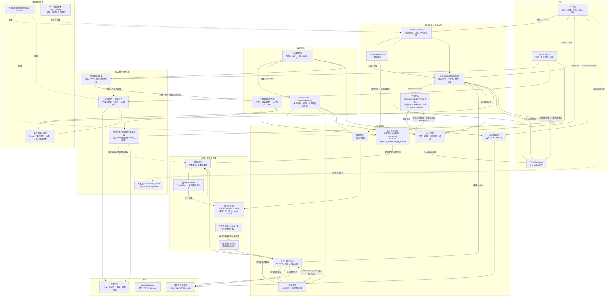
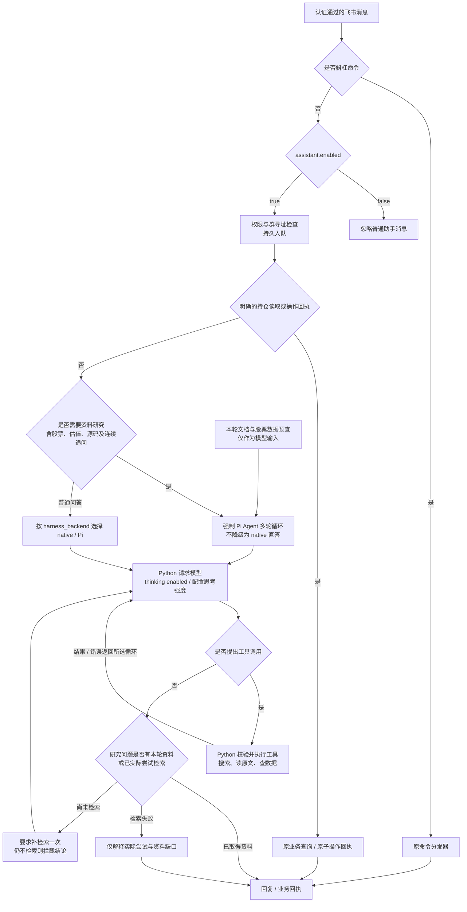
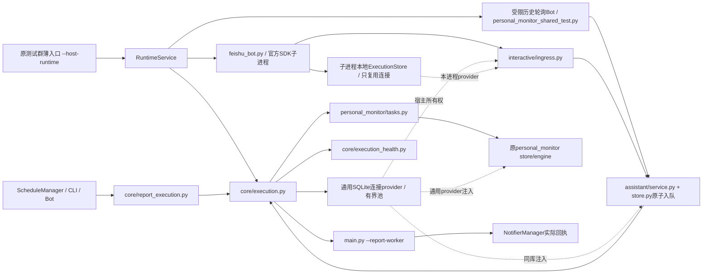
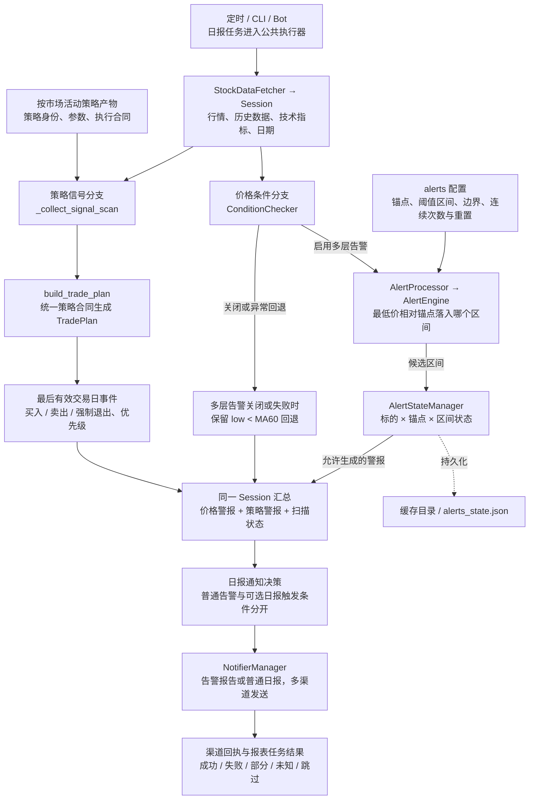
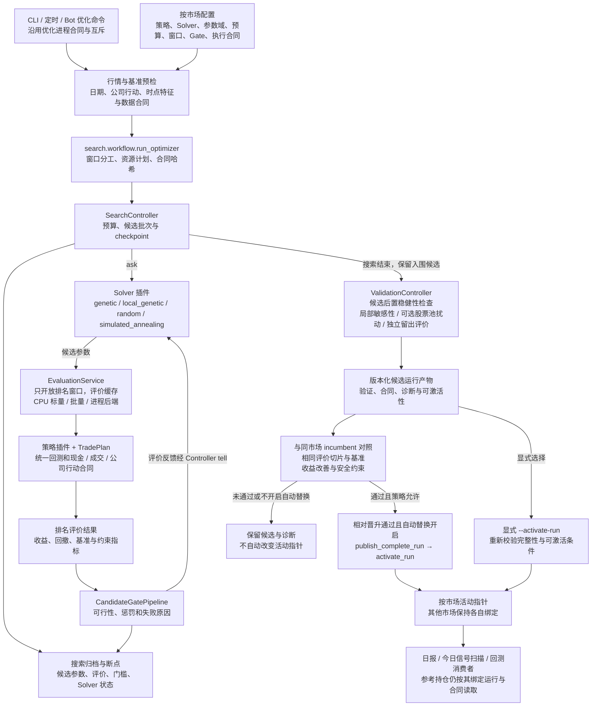
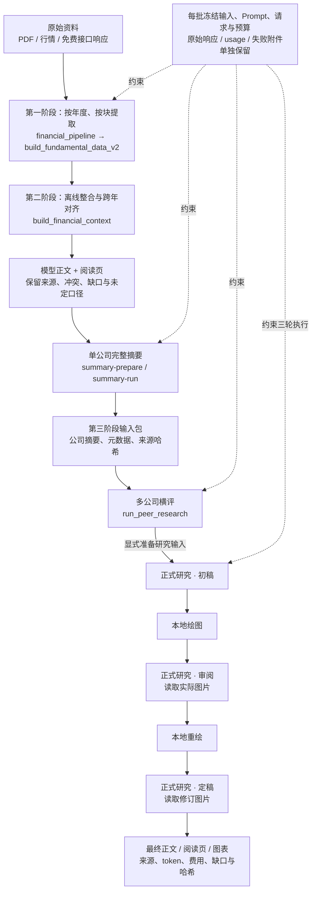
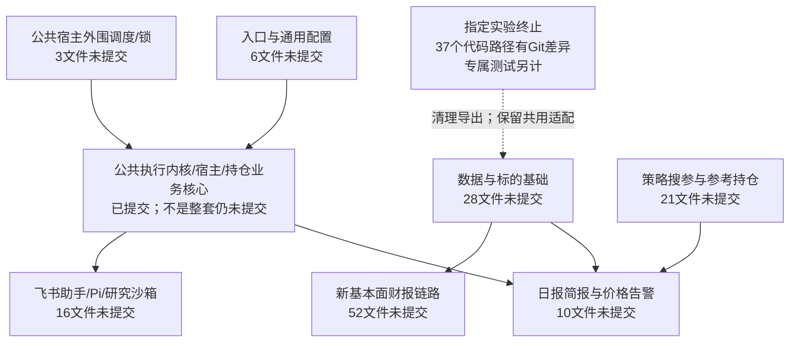

# 全项目架构总览

核对日期：2026-10-30。总图以当前本机源码能力为范围；本机与线上实际启用情况、开关及已核对的版本差异单独列在下文，不能将本机源码直接当成线上完整架构。当前未提交模块另见文末工作区快照；此前线上核查仍保留原日期，不代表本次重新验过生产。

本文集中保存全项目总图、飞书开关与对话路由、公共运行层、告警链路、搜参子系统和财报研究六张 Mermaid 图，以及环境对照、执行边界与源码导航。三条主业务分别是日常告警、策略搜参与财报研究；它们共享部分数据和基础设施，但执行、状态与发布边界不同。更细的公共运行层说明见[项目架构说明](architecture.md)，财报命令见[财报启动指南](guide/financial_pipeline.md)。

- [全项目总图](#全项目总图)
- [飞书开关与对话路由](#飞书开关与对话路由)
- [本机与线上环境对照](#本机与线上环境对照)
- [公共运行层放大图](#公共运行层放大图)
- [告警链路放大图](#告警链路放大图)
- [搜参子系统放大图](#搜参子系统放大图)
- [财报研究链路放大图](#财报研究链路放大图)
- [当前未提交模块](#当前未提交模块2026-10-30快照)

> 历史发布核查：2026-10-29 核验生产公共层为 v1.18.0（6a55894，构建 b7e30404）；不能将它当成当前所有环境的最新版本。当天已退役本机旧业务循环和专用 watchdog，并注销测试任务，历史数据保留；见[退役记录](development/shared_runtime_retirement_20261029.md)。本次只盘点本机未提交模块，没有重新核对或部署生产。下方 09:03 环境表同样为当时快照。

## 图例

- 实线：实际调用、控制或数据流；不是每个入口都会执行所有分支。
- 虚线：可选能力、显式文件交接、配置约束或只读查询；不表示自动触发。
- 图中一个框可能包含多个文件，不代表一个进程；独立子进程与批次已单独标注。
- “对齐”“完成”“成功”分别受各阶段合同约束，不代表财务口径已经人工复核。

## 全项目总图

## 飞书开关与对话路由

> 以下为 2026-10-29 研究问答修复候选；尚未部署。下方环境表的 09:03 线上快照保留修复前行为，不能视为候选已经上线。

`assistant.enabled` 控制是否启用普通消息助手。修复后的资料研究问答强制使用 Pi；`harness_backend` 仍控制其他问答的 native/Pi 选择。研究所需 Pi 环境缺失时明确失败，不默默改成直接回答；部署需安装 Node >=22.19 及 `tools/feishu-pi` 的锁定依赖。斜杠命令、持仓查询、提醒及原子操作回执保留各自路径；持仓公司的研究分析仍进入资料研究链。

单股票预查结果只送入模型，不再拼模板发出；自然语言估值问题不再被旧历史研究查询截走。模型先分析本轮已有资料，不足时继续搜索、读原文或查数据。导航目录和旧会话不算本轮已核实资料；没有资料也没实际检索时，暂扣结论，要求补检索一次，仍未执行则明确失败。真实搜索失败会交给模型选择其他来源或说明具体缺口，不用模板冒充研究结果。

thinking 在实际模型请求中启用。检索和只读分析不要求确认研究提案；配置修改、脚本/回测执行和策略激活仍遵循原确认合同。工具次数不是质量分数，已有有效本轮预查数据时不强迫重复查询。证据与引用检查可以阻止无检索直答及无效源码引用，不能保证所有模型推理和投资判断都正确。

Pi 的共享实现仍在 [shared-runtime.mjs](../tools/feishu-pi/shared-runtime.mjs)，飞书通过 [harness.py](../src/interactive/assistant/harness.py) 调用。`--profile research` 协议能力保留，但 `research_report.py` 独立固定三轮研究没有接入它；本轮修复的是飞书研究问答，不复活旧基本面研究执行器。

## 本机与线上环境对照

此表为修复前环境快照，修复候选未部署。快照日期：2026-10-29。线上于 **09:03（Asia/Shanghai）** 经 SSH 只读核对配置、关键源码和既有对话审计；本机读取当前主配置及源码。下表不是全量源码同步证明，也不代表新发送了一条消息完成端到端验收。

| 项目 | 当前本机主配置 / 源码 | 线上已核对配置 / 源码 |
|---|---|---|
| 飞书助手开关 | 未显式配置，默认 `enabled: false` | `enabled: true` |
| 对话循环后端 | 未显式配置，默认 `native`；助手关闭时不运行 | `harness_backend: pi` |
| 普通对话模型 | 默认 `deepseek-flash`；未因源码存在就运行 | `deepseek-flash` |
| thinking | 模型客户端发送 `enabled`，强度默认 `high`；仅在实际模型路径生效 | 模型客户端发送 `enabled`，配置强度 `high` |
| 最大模型调用轮数 | 默认 6 | 配置 16 |
| 最大工具调用次数 | 默认 48 | 配置 48 |
| 通用 Pi 桥 | 代码保留；助手启用后的研究候选强制选 Pi，当前主配置仍关闭助手 | 已选作飞书助手后端，尚未替换本轮问答修复 |
| 关键文件版本 | 09:03时 `harness.py`、`settings.py` 与线上哈希相同；之后本轮修改了本机 harness/service，候选未部署 | 保留09:03所读版本，不能用本机候选解释现行线上行为 |
| 本机财报研究 | 显式批次脚本，不接 Pi；旧研究专用接入已退役 | 本轮未完整核对线上财报研究模块，不能将本机退役结论外推 |
| 本机测试任务 | `TradeEyesPersonalMonitorTest` 已主动停用 | 不代表生产助手停用；本次生产服务为 active/running |

差异来源：10 月 28 日公共层发布是限定 38 文件的生产覆盖，保留线上其他业务补丁与配置；没有整体同步本机的研究/优化实验，也没有拿本机关闭的助手配置覆盖线上。因此架构需要同时记录代码能力、配置条件和环境版本，不能只画一条无条件的“飞书 → Pi → 研究”。

上述配置摘录、关键源码 SHA-256 及版本差异的脱敏快照保存于 `.tmp/feishu_quality_audit_20261029/architecture_snapshot.json`。原对话证据单独保留，不复制到文档。历史审计能证明此前出现过多轮调用和直接回复两种路径；不能由某个历史结果保证当前每次回答都会检索或思考。

## 公共运行层放大图

SQLite 保存执行与业务事实，内存/IPC 用于唤醒；各进程拥有自己的连接。图中的测试群薄入口源码保留并接公共宿主，本机任务注册已注销，不再自动常驻。个人监控业务库与公共执行库职责保持独立，完整合同见[架构说明](architecture.md#公共运行层)。

## 告警链路放大图

- **价格条件与策略事件是两个来源。** 前者按锚点/阈值配置检查，后者读取已激活策略，以统一 `TradePlan` 的最后有效日期事件生成警报。价格告警不需要先运行一次搜参；信号扫描也不会现场寻找新参数。
- **多层规则状态有明确范围。** 连续次数阈值与区间变化重置由配置决定；`AlertStateManager` 不提供渠道送达确认，也不能概括为同日严格去重。其状态在候选警报生成时更新，未与后续发送成功做事务绑定。
- **通知决策与规则判断分开。** `main.run_once` 将两种警报汇入 Session；即使可选日报触发条件未命中，已有普通警报仍可走 `send_from_session`。没有警报时，普通日报是否发送再受频次/手动触发等设置控制。
- **个人提醒与运行健康告警另外维护状态。** 个人持仓/到期提醒走 `personal_monitor` 及其 outbox，执行健康事件走 `execution_health`；二者不共享 `alerts_state.json` 的价格区间规则。

核对入口：[ConditionChecker](../src/core/condition_checker.py)、[AlertProcessor](../src/alerting/alert_processor.py)、[AlertEngine](../src/alerting/alert_engine.py)、[AlertStateManager](../src/alerting/alert_state_manager.py)、[通知管理器](../src/notification/manager.py)、[main.py](../main.py)。

## 搜参子系统放大图

- **搜参不是 LLM 调用池。** 并行度、批大小和后端由搜索资源规划与 Solver 能力决定，不能套用财报 API 的 20 路并发或美元预算。
- **参数搜索、策略、评价解耦。** Solver 用 `ask/tell` 提议参数与接收评价，不直接访问留出窗口、执行成交或决定通知；统一策略和 Backtester 负责候选的交易计划及评价合同。
- **门槛有不同层次。** 排名阶段的 `CandidateGatePipeline` 会影响可行性及分数；搜索完成后 `ValidationController` 才执行配置要求的后置稳健性和独立窗口评价，不能将这些结果反馈成 Solver 的训练窗口。
- **候选发布与活动切换分开。** 候选文件可保留而不替换活动参数。自动切换要求同市场相对晋升通过且配置允许；人工切换也调用 `activate_run` 重新检查产物合同和资格。当前实现允许已记录的相对晋升作为激活路径，否则检查绝对留出通过条件，不能画成两条路径都必须再叠加同一绝对收益门槛。
- **消费者只读取确定版本。** 告警信号读取活动产物；已初始化参考持仓绑定运行、参数和执行合同，不因活动指针变化悄悄换成另一套策略。股票池扰动/benchmark 的诊断任务本身不激活结果。

核对入口：[run_optimizer](../src/search/workflow.py)、[SearchController](../src/search/controller.py)、[EvaluationService](../src/search/evaluator.py)、[Gate](../src/search/gates.py)、[ValidationController](../src/search/validation.py)、[相对晋升](../src/search/promotion.py)、[产物与激活](../src/search/artifacts.py)。

## 财报研究链路放大图

这条完整路径组合了多个显式命令，不是 `financial_pipeline.py` 一条命令自动执行到最终报告。正式研究入口也接受已声明的其他材料；上图表示本聊天四大行采用的交接路线，而不是所有研究都必须先横评。

第一阶段使用提取模型；第二阶段是本地机械整合，不新增模型调用。摘要、横评和正式研究分别有自己的准备与执行边界。`research_report.py` 的固定三轮依次为初稿、审阅、定稿；图片在轮次之间本地生成，后续轮次读取实际图片。

## 关键边界

1. **公共执行器的覆盖范围。** 日报、简报、飞书会话和个人监控任务接入公共执行器。策略优化仍由原进程合同与独立子进程执行；财报研究是独立批次，不能从公共队列并发数推断研究 API 并发数。
2. **服务宿主与传输。** `RuntimeService` 组合调度器、Bot 与执行器；飞书会话由 Python 持有凭据、模型 HTTP、工具校验和审计。Pi 是可选编排桥，不独立取得文件系统、Shell 或模型凭据。HTTP/HTTPS 管理监听入口已经退役。
3. **个人监控与策略账户分开。** 个人持仓、提醒、版本及 outbox 由个人监控业务库维护；共享执行器及连接 provider 不等于合并业务账户。计划任务和 watchdog 属于本机运维，不能据此认定生产已部署同一候选版本。
4. **研究与策略没有隐式接线。** 研究报告不会自动变成交易信号或活动策略。基本面特征只有经显式历史面板、时点与可用性合同接入策略；候选仍需回测、留出与晋升门槛。
5. **成交含义。** 图中 `TradePlan`、Backtester 和参考持仓描述模拟成交、评价与账户记录，不能据此宣称已连接券商实盘下单。
6. **源资料状态逐层区分。** 原件存在、文本可读、接口字段有值、模型提取成功、财务口径对齐和研究可用是不同状态。采集局部缺口标记为 partial，并保留实际数据；源站封禁、磁盘不足等全局问题另行处理。
7. **费用与预留分开。** 返回 usage 的计价、账户范围的实际扣减和在途最大预留分列；缺 usage 保持未知。历史最大预留不是实际消费，模型 completion 已包含 reasoning，不重复相加。
8. **输出与发送分开。** 生成研究 HTML、PDF 或图表不自动调用通知管理器。日常业务需要显式通知调用，个人提醒使用自己的投递适配器；发送回执区分成功、失败和未知。
9. **旧路径只读。** `src/fundamental_quant` 保留历史查询与已有文件指针；旧执行、自动研究、补修与发布调度已退役。`data/fundamental_quant` 下仍可保存 tokenizer、源资料及历史文件，目录名称不能用于判断旧执行引擎仍在运行。
10. **保留能力与已终止实验分开。** `fundamental_embedding` 只保留仍被其他业务使用的数据/估值适配，`experiments` 保留既有 benchmark 等工具；指定MOE训练、旧评分/消融与Ke实验已删除，后续不再尝试，见[终止记录](development/failed_quant_experiments_retirement_20261030.md)。助手的原研究worker队列与Docker沙箱仍保留，没有迁入公共对话队列，也不等于恢复这些实验。

## 模块与源码导航

| 范围 | 主要入口与实现 | 职责 |
|---|---|---|
| 主入口 | [main.py](../main.py) | CLI 分流、日报业务、优化、审计与活动策略消费 |
| 服务宿主 | [runtime_service.py](../src/core/runtime_service.py)、[schedule_manager.py](../src/core/schedule_manager.py) | 生命周期、调度、接收器、心跳及计划停止 |
| 公共执行器 | [execution.py](../src/core/execution.py)、[execution_health.py](../src/core/execution_health.py) | 持久入队、任务分道、并发池、租约、恢复与健康事件 |
| 报表执行适配 | [report_execution.py](../src/core/report_execution.py)、[report_cli.py](../src/core/report_cli.py) | CLI / Bot / 调度共用任务入口，内部 worker 调用报表业务 |
| 交互与助手 | [interactive](../src/interactive)、[assistant/service.py](../src/interactive/assistant/service.py)、[Pi 桥说明](../tools/feishu-pi/README.md) | 认证入站、命令、会话、受控工具、提案及编排 |
| 个人监控 | [personal_monitor](../src/personal_monitor)、[personal_monitor_runtime.py](../src/personal_monitor_runtime.py) | 业务存储、持仓、提醒、来源行情及投递 |
| 数据接入 | [data_source.py](../src/data/data_source.py)、[data_fetcher.py](../src/core/data_fetcher.py)、[data](../src/data) | 多源行情、缓存、技术指标、公告、公司行动与时点数据 |
| 标的画像 | [instruments](../src/instruments) | 标的分类、财务推导、基金穿透及审计 |
| 策略 | [strategy](../src/strategy) | 策略注册、行情与基本面面板、信号和 TradePlan 合同 |
| 搜索与晋升 | [search](../src/search)、[promotion.py](../src/search/promotion.py) | Solver、评价、门槛、验证、版本产物及按市场相对晋升 |
| 仿真与参考持仓 | [backtest](../src/backtest)、[ref_portfolio.py](../src/core/ref_portfolio.py) | 模拟成交、现金流、基准、评价与版本化执行合同 |
| 告警链路 | [condition_checker.py](../src/core/condition_checker.py)、[alert_processor.py](../src/alerting/alert_processor.py)、[alert_state_manager.py](../src/alerting/alert_state_manager.py) | 价格阈值与区间状态；与活动策略信号汇入 Session 后由通知层分发 |
| 报告与通知 | [notification](../src/notification)、[alerting](../src/alerting)、[templates](../src/templates) | 报告渲染、条件报警、渠道投递及回执 |
| 源资料批次 | [backfill_ashare_sources.py](../scripts/backfill_ashare_sources.py)、[采集指南](guide/ashare_source_backfill.md) | 筛选、原件/行情/免费财务归档、限速、断点复用与缺口 |
| 财报统一 CLI | [financial_pipeline.py](../scripts/financial_pipeline.py)、[fundamental_data](../src/fundamental_data) | 提取、离线对齐、摘要准备/执行与第三阶段交接 |
| 提取与对齐实现 | [build_fundamental_data_v2.py](../scripts/build_fundamental_data_v2.py)、[build_financial_context.py](../scripts/build_financial_context.py) | 年度分块提取、结构校验、跨年正文与阅读页 |
| 摘要与横评 | [run_company_summary.py](../scripts/run_company_summary.py)、[run_peer_research.py](../scripts/run_peer_research.py)、[handoff.py](../src/fundamental_data/handoff.py) | 模型传输与回执、单公司摘要、横评及输入交接 |
| 正式研究 | [research_report.py](../scripts/research_report.py)、[research_inputs.py](../scripts/research_inputs.py)、[research_rounds.py](../scripts/research_rounds.py)、[research_render.py](../scripts/research_render.py) | 冻结材料、三轮研究、本地绘图与最终交付；复用摘要执行器及交接依赖 |
| 共用数据与保留诊断 | [fundamental_embedding](../src/fundamental_embedding)、[experiments](../src/experiments) | 保留业务的时点数据、估值适配与 benchmark；指定MOE/旧评分/Ke实验已终止 |
| 旧历史接口 | [fundamental_quant](../src/fundamental_quant)、[退役说明](development/research_retirement_20261024.md) | 只读历史元数据与已有报告路径 |
| 配置与运维 | [config_store.py](../src/core/config_store.py)、[config](../config)、[tests](../tests)、[ci_cd_deploy.py](../ci_cd_deploy.py) | 配置合同、Prompt/Schema、测试、部署与运行核验 |

## 状态和文档维护

本图不固化 PID、实时进度、API 余额或运行批次费用。运行状态应读取具体批次的 launch/status、回执、冻结清单和验收报告；历史产物继续保持原样。

2026-10-25 的默认正式研究配置使用输入驱动的公司与行业范围，旧工程/白酒案例模板仅作为历史版本保留，不属于默认通用研究合同。旧五脚本目标未实现，相关旧执行说明已合并至[退役记录](development/research_retirement_20261024.md)。

修改架构时同步检查实际入口、执行机制、依赖和输出消费者，避免只更新模块名称而保留过时箭头。

## 清理前未提交改动与架构模块对照（历史快照）

本节固定记录2026-10-30 19:48的清理前状态，不代表当前仍未提交的文件。后续清理与提交结果见[清理记录](development/workspace_cleanup_20261030.md)。

盘点时间：北京时间2026-10-30 19:48；基准为本机 `master` 的 `9b3f6ee2afa464aa1d5410d5ba3275c0abce183b`。最近合并已包含公共执行层、版本标识与多市场公告等提交，本节只列该HEAD之后的工作区差异，不把已经提交的功能再次算作“未提交”。无暂存文件，本次不提交、不推送、不部署。以下数量固定为快照时点；原件下载会继续增加数据文件，结束复核时新增项仅为原件PDF，功能/配置/测试/文档清单未变。

Git共列出23,712个变化路径：140个已跟踪修改、44个已跟踪删除、23,528个未跟踪文件。其中文件层面的代码/配置/测试/文档共538个，另外23,174个在`data/`、`.runtime/`和`tmp/`。后者以资料、运行/验收结果、测试临时目录和本地依赖为主，不能按源码一并提交。

以下按路径主职责归类，每个文件只计一次；`main.py`、优化配置、测试和文档实际可能包含跨模块改动，表格不是可直接整文件提交的分组。M为已跟踪修改，D为已跟踪删除，新为未跟踪文件；文件数不等于测试用例数、代码行数或生产进程数。

| 架构模块/主归属 | 文件数 | M | D | 新 | 当前改动范围 |
|---|---:|---:|---:|---:|---|
| 入口与通用配置 | 6 | 6 | 0 | 0 | main.py等跨模块入口、依赖和通用配置；同文件可能含多个主题，不能按整文件混提交。 |
| 文档与项目说明 | 99 | 19 | 0 | 80 | 架构、指南、合同、历史审计和项目记录；含文档目录下的验收产物。 |
| 运维与审计工具 | 8 | 2 | 0 | 6 | 数据快照上传/下载、迁移、费用与部署/核对工具；不自动等同于生产未部署业务。 |
| 策略搜参与参考持仓 | 21 | 20 | 1 | 0 | 策略配置与晋升、评价/验证、参考持仓、回测修复、保留的PB/期权研究与benchmark。 |
| 新基本面链路 | 52 | 1 | 0 | 51 | 财报提取、跨年整合、摘要/横评/三轮研究、披露结构、Prompt与版本配置；保留历史Prompt不等于默认使用。 |
| 数据与标的基础 | 28 | 18 | 0 | 10 | 采集/目录/下载与披露、交易日/行情时间、逐时点数据及行业/估值共用适配。 |
| 实验终止 | 37 | 2 | 35 | 0 | 指定旧估值/行业评分/消融、MOE及Ke的已跟踪删除；共享包导出清理。原未跟踪文件删除不会显示D。 |
| 日报简报与告警 | 10 | 9 | 0 | 1 | 通知正文/图表/模板、盘中行情与价格条件；不是未提交整个公共报表执行器。 |
| 公共宿主外围 | 3 | 3 | 0 | 0 | 进程锁、调度和历史调度迁移的剩余改动；ExecutionRuntime/RuntimeService核心已提交。 |
| 飞书助手与研究沙箱 | 16 | 8 | 0 | 8 | Pi/检索路由、命令及Telegram适配、沙箱Docker/部署辅助；通用SDK/持久队列核心已提交。 |
| 测试与夹具 | 232 | 52 | 8 | 172 | 跨模块测试、夹具、被退役测试删除；不把夹具文件数当用例数。 |
| 本机持仓验收配套 | 6 | 0 | 0 | 6 | 验收脚本、隔离配置模板和性能包；个人监控业务核心及薄入口已提交。 |
| 历史研究材料包 | 20 | 0 | 0 | 20 | skills/fundamental-research静态材料20文件；当前源码未发现引用，不属于已确认新财报执行闭包。 |

已提交且当前无工作区差异的核心包括：`src/core/execution.py`、`execution_health.py`、`runtime_service.py`、`report_execution.py`、`report_cli.py`、`src/interactive/ingress.py`、`src/personal_monitor/`及`personal_monitor_runtime.py`。这表示相对本机HEAD已提交，不等同于它们刚刚重新完成线上验收。

几个需要明确的边界：

- **新基本面不是全部未提交。** 固定三轮研究入口和共用摘要执行器已有提交；未跟踪的大头是提取/整合/横评入口、披露处理实现、配置和版本化Prompt。历史Prompt版本保留，不代表默认配置仍用旧版。
- **实验删除数与Git的D数不同。** 上次清理共删除27入口/17实现/16专属测试，其中部分文件原本未跟踪，删除后不会出现在`git status`。本次仅统计Git实际报告的差异。
- **历史研究材料单列。** `skills/fundamental-research/`有20个未跟踪静态文件；初步产品源码检查未发现调用；后续清理查到一个测试仍读取其中方法原文，现已将原文迁至`docs/design/company_summary_question_origins.md`并改测试依赖，旧20文件已删除。
- **公共层与个人监控的验收配套另计。** 脚本和配置模板仍有未跟踪文件，不能由此声称公共执行内核或持仓业务尚未提交。
- **不以未提交推断未部署。** 先前采用过限定文件发布/生产补丁；本节没有逐文件重新核对生产，不能仅看本机Git状态断言线上是否存在某个改动。

完整逐文件清单保存在本机`.tmp/uncommitted_architecture_20261030/modules.json`，原始Git状态及差异统计分别为`status.json`、`numstat.txt`。大批产物文件不复制进正文；可据清单逐模块审阅，但不得直接`git add .`混入数据或未审改动。
