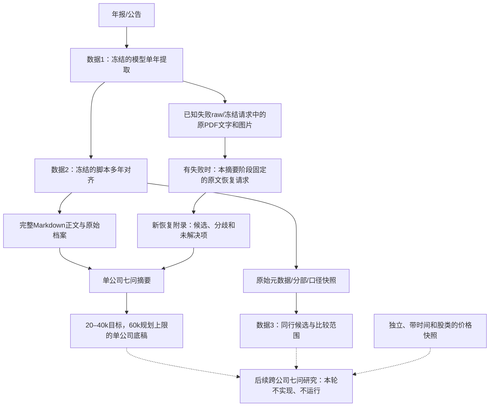

# 单公司长期摘要轮契约（待真实模型验收）

2026-10-24。本轮只定契约、prompt、排版示例，准备已有三公司三年的离线调用包和预算；实际付费调用为0。第一阶段、第二阶段及旧产物不变。不接统计模型，不恢复已退役研究引擎。

## 它在流程中的位置

摘要轮是研究准备层：把**完整长期财报资料**变成**围绕原七问的单公司研究底稿**，再供跨公司研究使用。它允许有依据的解释与待验证假设，但不能把它们变成原披露事实。它不是新数据真值库，也不替代完整第二阶段档案。

数据3现有prompt只判断候选/不宜比较/资料不足、分部比较范围和后续问题，明确不估值、不执行研究；不能把新摘要说成现有数据3已经能完成七问研究。同行判定仍能读取完整的原始元数据快照，不只依赖摘要挑选的信息，避免压缩抹掉不可比条件。

一家公司没有坏块时：完整二阶段正文 → 一次摘要。有已知坏块时：预先列定的恢复包 → 完整可见恢复附录 + 完整二阶段正文 → 一次摘要。恢复只整理失败资料的必要事实；第二步才做长期整合，因此不反复“摘要的摘要”。恢复不是自动反复补盲、Agent循环、模型工具调用或失败重试。

## 输入格式

最终模型读Markdown文本和已存在的必要图片，不读审计JSON。API的JSON只是传输外壳，token统计只计算消息中的文字及图片token，不把base64字符串当文字计费。

| 部分 | 内容 | 进入哪次请求 | 不得做什么 |
|---|---|---|---|
| 任务说明 | 七问原文、范围、信息分类/缺失规则、排版示例 | 摘要；恢复有单独的短格式要求 | 示例不得借数字，三年不得冒充七年 |
| 公司与窗口 | 名称/代码标签、实际输入年报列表、业务范围 | 两类请求 | 标签不是自动修复原字段的证据 |
| 完整二阶段正文 | 全表、共同口径、政策、管理层解释、原缺失/独立保留标记 | 摘要，原字节文字完整嵌入 | 不筛三表行、不重写第一阶段、不新造跨年对应 |
| 失败清单 | 原报告/任务、失败性质、有无raw、本轮恢复包编号 | 恢复及摘要 | 无响应不能记成未披露 |
| 原raw全文 | 原返回原样，不通过JSON解析后才交付 | 对应恢复请求 | 不last-wins、不补括号、不猜尾值 |
| 失败涉及的原材料 | 从冻结请求复用的整份年报提取文字及原附图片，按报告去重 | 对应恢复请求 | 不重新调用API、不裁掉未读材料、不新做OCR |
| 恢复回答 | 完整可见content，含局部结果和局限；无content则执行缺口 | 摘要 | 不传thinking，不按schema过滤，不把恢复当已验证 |
| 现价/同行 | 本批未提供；后续研究独立提供 | 本次明确缺失 | 不用历史股价充现价，不凭单公司证明行业共因 |

离线准备包：`模型输入.md`供人检查，`request.template.json`供未来调用绑定，`plan.json`和哈希只用于审计，不默认进入模型。摘要模板中的`{{RECOVERY_CONTENT:调用编号}}`和`{{RECOVERY_STATUS:调用编号}}`不是事实：前者绑定完整可见回答或明确无content缺口，后者绑定finish_reason/执行异常及是否中断；付费前必须按固定规则绑定并重新计数/冻结，本轮不能直接发送它。不传推理内容、不按JSON过滤，原可见回答逐字保留。

完整二阶段正文680,492 tokens及7份旧raw都保留。恢复包重新使用了失败涉及的7份年度原文、27张冻结图片；没有新读取/裁剪PDF或猜测章节位置。为便于模型辨认，原文本分页间仅添加页标记；所有分页文字本身逐字保留，图片与冻结的短文字页一一对应。页标记是阅读辅助，**不是恢复逐格Evidence对象或页码核验门槛**。

## 七问和内容边界

七问从[保留的方法原文](company_summary_question_origins.md)回查；只复用方法目标，不调用已删除的退役技能或执行器。

| 原问题 | 摘要必须留下 | 本次不能假装已完成 |
|---|---|---|
| Q1 怎样赚钱、产品客户及成本锚 | 产品/分部/客户/渠道/地区、单位经济可用的原数、业务和会计边界 | 缺失销量不能编成吨成本；集团不等于可比分部 |
| Q2 历史利润、资本和每股价值 | 利润、权益、投入、股数、EPS/BVPS/ROE、重述、并购/拆并股、归属 | 期末股数不能代加权平均股数；相同年度不保证同口径 |
| Q3 最近方向及行业/公司因素 | 实际量价结构与现金变化、当时管理层解释及后续兑现、替代解释 | 未投递同行，行业共因只作待对照假设 |
| Q4 利润—现金及正常化条件 | CFO、完整Capex、营运资本/项目回收、维护与增长投入约束、税息和普通股权利 | CFO−Capex不是正常化普通股自由现金；正常化不是历史均值 |
| Q5 再投资与分派 | 项目/并购/股权投入回收、还债、宣告与实付分红、回购、权利约束 | PPP本金不是永久收益；受限资金/客户资金不是自由现金 |
| Q6 现价对应什么现金与增长 | 后续估值可用的盈利/现金假设、恢复时间和资本需求、敏感条件 | 无现价快照，不给现价隐含回报/价值区间/安全边际结论 |
| Q7 反证和重看条件 | 公司具体暴露、方向/金额、传导路径、反证与可观察事件、缺口影响 | 不编造明确阈值、日期或投资人要求回报 |

每问应保留实质事实、支持与反对解释及后续比较问题，不能只列待办。原披露、管理层说法、模型分析、待验证假设分清；不要求每句机器打标签。数值推算需列原输入和公式并注明未独立计算复核，不当作脚本已验算事实。

## 输出格式

主产物是一个自足的`单公司底稿.md`，依次包括范围与限制、核心历史面板、Q1—Q7、失败恢复/关键分歧、保留/压缩/仅归档说明。不另建大JSON schema、关系型数据库、逐单元格证据对象或需要模型精确满足的字段门槛。

核心面板至少覆盖：收入/分部与经营和归母及扣非利润；CFO及完整现金Capex和重大项目/股权现金；现金及受限部分、债务、权益归属；股数及EPS加权分母、基本/稀释EPS、BVPS、ROE/扣非ROE；分红回购。未取得项仍有缺口说明，不造数或推断“未披露”。

### 单位、期间、统计口径及跨年

共同的主体、准则、单位/币种、统计口径和版本放在**该表**上方一次；例外分组。表内行是稳定项目，列是实际期间；不能逐行造列。原来的C/G引用在摘要中转换成可理解的财务语句，不让最终研究再读大字典。

| 情形 | 展示/合并规则 |
|---|---|
| 同集团、同项目、同单位、同统计方法、同调整版本的年度总额 | 年度横排，实际起止日明确；披露年度另注明 |
| 期末金额 vs 年度总额 vs 季度平均 | 分表；不能写成同一FY口径 |
| 金额元 vs 百万元；百分比 vs 金额 | 明确单位分别展示；不凭量级换算；确需换算另列原数/依据/公式 |
| 原表单位在表头/正文而不在行 | 结合已提供的明确表头解读；无法确认就“单位未定”，不从科目名硬拆 |
| 股数期末 vs 基本/稀释加权平均；EPS vs BVPS | 独立项目保留分母、权利和期间，不互相填补 |
| 同年原报/重述；不同报告的比较值有差异 | 同期多版本并列、标披露报告；不取最后一个或算平均 |
| 名称近似或同identity_code，但主体/方法/期间不清 | 不强并；明确待核对差异 |
| 缺失/文本/百分比/区间 | 原文字保留；缺失原因用自然语言，不统一成n/a |

最终摘要是模型的语义整合，可能提出新的对应关系；与第二阶段脚本已经确定的对齐要区分。若模型确认不了，就分开保留，不创建“看起来整齐”的错误合并。新摘要不会反向更新原表。

### 行业保留与压缩

| 范围 | 必留的判断材料 | 通常不整段带入 |
|---|---|---|
| 所有公司 | 核心长期面板、每股与权利、口径变化、核心业务解释、重大风险/反证、缺口 | 全量三表附注逐行复制、共用字典、调试日志/审计JSON |
| 工程 | 结算回款、应收/合同资产和负债、账龄减值、PPP/BOT等投入/本金回收、债务担保、受限现金、项目集中与重大异常 | 不能改变判断的每项目重复表；重大单项/异常/反例必须留下 |
| 白酒 | 产品量价档次、渠道结构、厂内/渠道库存区别、经销商预收返利促销、产能与陈酿占款、财务公司资金 | 重复通用确认政策、普通客户/子公司的全量名单 |
| 银行 | 息差及资产负债收益成本、信用成本/风险迁徙、资本流动性、股类和监管约束 | 大量不影响判断的逐债券/逐机构流水 |
| 保险 | 寿险/财险/投资分部、新旧准则、CSM/新业务、准备金与偿付能力 | 不改变权益/利润/现金判断的常规条款全文 |
| 证券及其他金融 | 经纪/投行/资管/自营、自有与客户资金、净资本杠杆/流动性、敞口 | 与主要风险/现金资本无关的明细清单 |
| 其他行业 | 根据披露盈利来源、资本占用和主要风险补充；矿业价格/储量、地产交付/预售、制造产能/订单等 | 不把本批工程/白酒样例冒充全行业验收 |

通用政策短述一次；影响可比性的特殊条款、口径变化、合并变化和重述保留适用年份及影响。语义相似不等于完全相同；模型应讲清共同点和差异，不让脚本算相似度后删掉。仅归档资料**仍完整保存在原目录**，不是物理删除；摘要需交代未带入资料的类别和可能限制。

## 最后兜底的明确责任

旧批81个块中11个失败。7个有raw：3个JSON语法错误，4个因重复键被严格解析拒绝；后4个共113处重复`accounting_basis_code`全为CAS/CAS。4个无raw是3次ConnectionError和1次ChunkedEncodingError。这里没有“所有数据都没有披露”的证据。不能普通json.loads覆盖重复键后称修复成功。

1. 先保留冻结旧状态，再在新目录为每个失败块列出投递材料。对同一报告的失败块合并投递一次完整年报，不重复付费读同一原文。
2. 恢复模型读取原raw与对应原年报文字和图片，尽可能给出七问必要事实；重复键和语法错误都不依赖成功JSON解析。没有上下文的尾值、冲突数字或表头不能猜。
3. 用新的Markdown附录区分：原文明确支持的恢复事实、只存在于旧模型raw的未确认候选、部分恢复、已提供但未定位、材料不足/中断。关键项给本次材料/表名或页标记即可，不恢复重型Evidence或数值复核门槛。
4. 摘要读取完整可见附录，不按结构要求过滤。某条没恢复，不牵连其他条；已有摘要/表格不被schema意见整块丢掉。
5. 到此结束本批恢复机会。未解的缺口随底稿进入同行阶段并限制结论；不静默续写、自动补调或回改冻结阶段。

“最后一次机会”不等于保证正确/完整：没有被识别的静默漏提、原PDF扫描不可读、同一公司的历史披露冲突都可能留下问题；模型重读也不能保证无误。本批正文和原材料仍完整归档，可由人回查。它是有界恢复路径，不是新的真值认证层。

若恢复请求本身中断：保存收到的所有原响应/可见片段并注明中断，后续摘要仍使用它们；若完全无content，把执行缺口写入摘要输入。不因格式丢结果，也不在本批添加第九次请求。原记录不被覆写或“通过”化。

## 本批调用与预算

最新完整预算与8个调用包见：`data/fundamental_data/summary_contract_20261024_174500_release_v2/预算与验收.md`。

| 公司 | 历史窗口 | 原完整二阶段tokens | 失败块 | 预定恢复调用 | 摘要调用 |
|---|---|---:|---:|---:|---:|
| 四川路桥600039 | 2023–2025 | 206,260 | 6 | 3（每报告一次） | 1 |
| 隧道股份600820 | 2023–2025 | 268,483 | 2 | 1（两报告合包） | 1 |
| 泸州老窖000568 | 2023–2025 | 205,728 | 3 | 1（两报告合包） | 1 |

共5次恢复 + 3次摘要，**这是本批已知失败的处理计划，不是所有公司都要8次**。没有旧坏块时，这三家公司只需3次摘要。恢复请求按报告为不可拆单元、机械按实际token装包；这与正常长年摘要按主题切分的情况不同，恢复不做跨年研究结论。

摘要目标20–40k、规划上限60k/公司，4家公司目标80–160k、规划上限240k，另加最多50k分析prompt约290k，余量可给同行范围和必要定向附件。旧资料3公司3年680k不能线性外推成4公司7年1.57M：按这批平均，4×7约2.117M；单公司7年约529k，尚未计prompt/兜底材料，因此**不能承诺七年永远一包**。

60k是压缩交付目标，不是已实现保证。真实回答超过目标仍完整保存并标“未达到篇幅目标”，不能剪掉尾部、直接声称四家公司必定装下，或自动追加摘要请求。后续研究只按实际正文总长加所有prompt/附件重新计数；超水位先不发送，已有资料不作废。

对未来长窗口：按真正输入重新测量，完整单公司消息在500k水位内则一包；超过时人工先定跨全历史的主题包（经营/资本现金/权利风险，保留完整表头和共同核心），预算与范围先冻结再调用。多个主题的输出共享单公司总目标20–40k/上限60k，不是每个主题各60k；共同核心只在最终正文出现一次，主题间无法确认的差异明确并列，不能让脚本猜合并。不要临时按字符裁尾或分年份后失去长期变化。本轮只实现现有三年包的机械准备，不实现通用语义切分器。

草拟参数：Flash、thinking enabled/high、无工具/搜索，恢复输出额度65,536（必要事实目标10–20k），摘要131,072（正文目标20–40k）。额度包含生成消耗，不保证全部可见正文；thinking可能挤占可见结果，length/中断必须作为未完成留下，不偷偷续写。64k/128k是本次预算规划，不是误认模型的384k服务商输出上限。

按官方2026-10-24价、全未缓存和用尽输出额度，本批规划上界约**非峰时US$0.85、峰时US$1.71**；不是本轮支出或新授权。所有消息、排版范例、图片上界、每请求4096余量、恢复回答的最大可见长度预留均已计入。真实调用前重查价格与绑定后计数；实际usage和reasoning统计单独存，不用本地估计冒充账单。

官方依据：[价格](https://api-docs.deepseek.com/quick_start/pricing/)、[上下文与输出额度](https://api-docs.deepseek.com/api/create-chat-completion/)、[图片计费上界](https://api-docs.deepseek.com/guides/vision/)。本地tokenizer可能与新服务端有差异；水位和预算仍是规划上界估计，不是绝对计费保证。

## 脚本做什么、模型做什么

脚本仅复制/打包冻结材料，标记原文分页/图片，按token装包，记录哈希和预算，生成带真实原值的离线排版片段。它不做主题分类、同义猜测、数据修复、财务验算、政策改写、JSON恢复或模型质量评分。未来调用器只需按固定依赖绑定可见content并逐步持久化传输日志；本轮没有实现或执行付费调用器。

未来调用器必须关闭SDK及HTTP层自动重试，发送前写入请求与预算/依赖哈希，接收过程中逐步保存原HTTP/SSE片段及可见内容，结束再记finish_reason和usage；中断也保留已收到片段。推理内容如有仅留执行日志，不带入摘要下一次请求。不允许“先解析成功再保存”，也不能为格式或缺失字段自动补调。这些是后续执行契约，本轮只离线打包，未声称日志执行器已经落地。

模型负责七问导向的取舍、共同点与差异、问题解释和必要恢复；其内容需要实际结果验收，不能因为离线包通过就声称摘要正确。局部格式、少标题或超规划篇幅只列意见，正文原样保存；可读性问题不升级成丢弃数据的门槛。预算/输入容量/不覆盖文件是**发送前保护**，与拦截已有业务数据不同。

本次只增加一份约400行的离线准备脚本及契约/prompt/示例/测试；未新增生产包、队列、状态数据库、向量库、统计模型、语义解析器或联网执行入口。现有`src/fundamental_data`递归18个Python文件6,882物理行，其中`model_context.py`1,158行；三个已有数据CLI共945行。旧研究包只剩4个只读文件198行，未复活。不能把这一现状说成已经达成历史“五脚本、每个不超过100行”的研究架构目标；新摘要只是内容接口契约，不是那套执行框架交付。

## 离线验收边界

- 核对七问与原目标一致，prompt和排版范例都实际写入请求消息；恢复输出格式与七问要求一同投递。
- 三家公司9个年报的现有二阶段正文完整进入摘要模板；11个失败块逐项有恢复包、7个raw全文字节及7份原文/27图片均可回查。
- 新目录写入、旧来源/源码/配置受哈希保护，离线禁止网络，不调用生产模型客户端。
- 测输入容量、输出额度预留、未缓存峰谷预算及请求体大小；不把多次token上界说成一次模型load。
- 离线样例只复制已存在原值并展示七问模板，**没有生成模型摘要**；模型恢复率、实际压缩率、遗漏/扭曲、长期解释质量和跨公司有效性仍未验收。
- 实际模型验收重点是：核心数字/口径/每股权利是否保留、重大风险反证和缺口是否被压缩掉、四公司总上下文是否达标；不是新增一组会整块挡住结果的检查规则。

它不是能证明的全局最优，但在冻结提取、保留完整档案、限制单次上下文和不自动追加付费的约束下，把重点放在七问需要的信息与不确定性传递，符合长期同行研究的设计目标；真实效果仍需付费样本验证。
