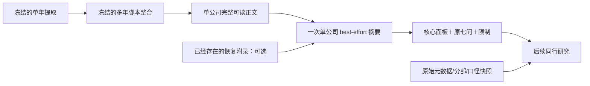

# 单公司七问摘要 v1：best-effort 冻结设计

定稿日期：2026-10-24。此文是当前执行边界，补充并优先于原`company_summary_contract.md`中“最后兜底”的流程描述；原契约、第一/二阶段、代码、prompt、已发请求及旧结果保留原版本，不回写。

## 目标

按实际可用资料，为**单家公司**生成一份可直接供后续同行研究使用的七问底稿。有多少可靠信息用多少，缺口说明清楚；不以恢复完整、字段齐全或填充率达标作为生成摘要的前置条件。当前三家公司分别独立摘要，不在本步骤作同行优劣或完整投资判断。

本版先固定链路，未来再研究提取率、数据源质量对分析精度和有效性的影响；不一边调模型一边修改提取、schema或追加修补流程。

## 冻结流程

已有恢复材料能用就用；没有、失败、部分恢复或未定位，都直接以这些现实条件继续摘要。捡不回的内容留作缺口，不再补提取、读新PDF、加数据源、修复JSON或调用模型追问。

旧raw/完整表格/原文保留归档；本轮不会把旧失败状态改成通过，不构建“恢复完成后才准研究”的门槛。未解决部分不反向阻塞其他已知信息，也不阻止整个公司产出底稿。

## 输入和模型职责

输入是该公司完整第二阶段Markdown正文、全部共有定义，以及已经取得的恢复附录和执行状态。保留实际覆盖年份、主体/分部、单位/币种、实际期间、时点/期间/平均方法、股类与普通股权利、原报/重述版本。

沿用原七问、现有摘要prompt和排版规范，不新增一套业务JSON schema、语义解析器或检查引擎。脚本负责原样投递、保存、token/费用记录与阅读页；模型负责有依据的压缩、归纳和解释。

事实、公司解释、分析判断、待验证假设分开。能确定的原金额和表头优先于摘要中的金额缩写；明显冲突应说明并保留原数，不替选不明版本，不凭量级猜单位，不把空白当零。无法判断就留下限制，不补造事实。无需逐单元格Evidence、页码复核或财务勾稽验收。

## 输出：一份自足的单公司Markdown

1. **范围**：公司、实际资料窗口、主体/准则、资料限制；三年资料不能冒充七年。
2. **核心历史面板**：收入与分部、经营/归母/扣非利润，CFO与完整现金Capex、重大项目及股权投入回收、现金及限制、债务与权益归属；股数、基本/稀释EPS及分母、BVPS、ROE/扣非ROE、分红回购。缺失项用已有缺失原因说明。
3. **Q1** 公司怎样赚钱，产品、客户与单位经济的成本锚是什么？
4. **Q2** 实际历史中利润、资本与每股价值怎样增长或损耗？
5. **Q3** 最近经营方向发生什么变化，是行业共因还是公司差异？
6. **Q4** 利润如何变成现金，正常化现金需要什么恢复和投入假设？
7. **Q5** 现金投向哪里，再投资、分红和回购能否延续价值创造？
8. **Q6** 哪些现金与增长对应当前价格，价值范围和安全边际怎样？
9. **Q7** 哪些具体反证会推翻判断，何时重看？
10. **限制和归档**：关键缺口、冲突、哪些结论暂不能下、压缩/仅归档的资料类别。

每问用已有事实回答到能回答的程度，不要一遇缺失就整问“待研究”；同一整表不在七问重复。没有现价，不给现价估值和安全边际的确定结论；没有同行材料，不把公司变化判成行业共因。

正文目标20–40k tokens，60k为单公司上下文规划水位；不是必须凑足的字数，也不是丢弃超长或短答的门槛。通用政策解释一次，普通逐项目流水不全量复制；重大项目、风险、反例和对普通股现金的约束必须留下。未展开材料仍归档。

以完整可见原回答作为正式版本，另生成HTML阅读页。格式意见、局部未定、未达篇幅目标仅作说明，不清空、不裁尾、不自动再摘要或续写。

## 本轮执行

- 复用`summary_paid_20261024_160800`中已经绑定好全部资料的三份摘要请求；其模型、prompt、thinking、输出额度及消息内容不变。
- 仅新建运行目录并串行尝试这三份请求，不重复5份恢复，不再次提取第一阶段，不重跑第二阶段。
- 这三次是用户本条指令授权的新尝试，不重发旧运行目录的attempt；旧目录始终只读。
- 继续受原合计US$2约束：原已知费用US$0.337602738，原未知usage保留US$0.858958200，剩余额度US$0.803439062。
- 按实际已绑定请求计算，三次全峰时输出额度及25%输入计费余量共预留US$0.752444700，连同原费用/预留合计US$1.949005638。
- 不把连接失败的usage当零。新结果按返回usage计费，未知项保留本次分配的全额预算；thinking已包含在completion中，不重复收费。
- 新调用前冻结代码、prompt、设计、请求、预算及顺序；调用后仅由冻结程序在新目录追加原响应/正文/日志和生成约定报告，不改模型正文，不追加付费调用。

若连接仍失败，保留执行状态和全部可见片段；这是执行问题，不退回重做提取架构。单次发送总输入仍按真实资料计量，超过500k先不发送，不静默删材料。本轮三个已绑定请求约223k–283k，均在水位内。

## 以后如何验证数据改善是否有效

以后单独安排试验，不在本轮实现评估系统或自动研究循环。当前输入、prompt、模型设置、底稿和失败记录作为不可变基线。

比较时固定公司、历史窗口、信息截止日、七问、模型设置和分析目标，分别改变“提取率提高”“增加数据源”，必要时再测两者结合；新增资料记录时间与口径，不能引入当时未知的信息冒充历史可得。

评价重点：关键财务事实/单位/期间/股类是否准确；业务与现金解释是否更充分；关键判断、正常化条件与风险是否改变；反证是否更具体；后续已观察事实是否支持原判断；人与模型回答关键问题的有效性是否提高。并记录token、费用、延迟和分歧。填充率是解释变量，不能代替分析质量或作为摘要的放行门槛。

不能预先断言“多提取或多数据源必然更好”：新增内容可能无关、重复、有口径冲突，或稀释模型上下文。是否改善精度和有效性，由固定基线的对照结果决定。

本版冻结的是单向、单公司、best-effort 的研究准备接口；不承诺缺失清零、不保证模型无误、不恢复旧研究执行器，也不以设计文档代替真实摘要结果。
