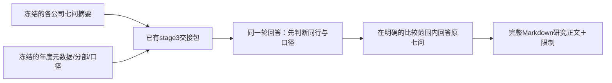

# 第三阶段 v1：同行、口径与七问跨公司分析

2026-10-24，离线方案与请求准备。前面的单年提取、多年整合、单公司摘要、交接入口、prompt及旧产物保持冻结。本轮不调用API，不恢复旧研究执行器，不开发新的提取或检查引擎。

## 目标与流程

第三阶段把若干公司的七问摘要与原始年度元数据放在一起：先说明谁与谁在什么业务上可比、哪些指标能比，再用原七问解释公司间差异及其对普通股现金和价值的影响。不是把所有公司强行放进一张排名表。

A、B是同一次模型调用的两个顺序部分，不是两个付费阶段。先给同行矩阵与比较口径，再展开七问；脚本不解析矩阵来决定是否发送第二次请求。当前三家公司整包在500k输入水位内，默认规划一次调用；只有未来明确批准其他拆分方案时才改变。

架构增加的是一个终端研究步骤：接收已有文件，输出原始Markdown。不会反向改动第一/二阶段或摘要，不循环补数据，不引入统计模型、向量库、自动排名器或新的业务JSON schema。

## 输入约定

| 输入 | 本轮实际内容 | 用途 |
|---|---|---|
| 明确任务 | 本契约、完整system prompt、原七问、排版示例 | 固定分析目标与表达方式 |
| 各公司完整摘要 | 四川路桥600039、隧道股份600820、泸州老窖000568，各2023—2025 | 业务、历史面板、现金、资本去向、风险与单公司判断 |
| 原年度元数据 | 9份年度快照及其来源清单 | 公司/业务身份、行业、客户、地区、模式、分部和会计口径 |
| 资料状态 | 摘要complete/partial等原状态、已有issues和限制 | 说明执行与信息边界；complete不等于事实正确 |
| 市场与估值条件 | 本轮未提供现价快照、投资人要求回报、额外行业证据 | 明确Q3、Q6能回答的范围 |

正式输入通过`read_stage3_input(<交接目录>)`取得。此次使用`data/acceptance/financial_entrypoints_20261024/stage3_ready`：完整模型正文只进入消息一次；另存元数据JSON供归档/程序读取，不再把它重复塞进模型。

不读取新PDF，不追加第二阶段全文、失败raw、thinking、API日志或完整源JSON。摘要没有保留的信息，本轮就按缺口处理。元数据中已有的原分部表、口径政策和来源清单不擅自删改。排版示例只能教格式，不能充当额外事实。

本轮是基于所提供版本的离线横向阅读，不伪装成历史时点回测。统一分析时点未指定；保留资料年份与披露版本，不能用电脑当前日期补出现价或把后续披露当作更早已知。摘要中的2022比较值不增加一整年样本，2026目标/事件也不自动成为已实现业绩。

## 第一步：同行资格与比较范围

同行身份、经济可比性和单个指标口径是三个不同问题，不能互相代替。公司名称相似、行业代码相同、会计准则相同或都能计算ROE，都不是充分条件；行业代码缺失也不自动排除同行候选。

本批三家公司要说明三组两两关系。一般N家公司覆盖相关公司对；分组不要求每公司有伙伴，不按名称强制聚类，不把A/B与B/C可比传递成A/C可比。

| 同行判断 | 含义 | 后续处理 |
|---|---|---|
| 同行候选 | 核心盈利机制与客户/资产/风险链有实质交集 | 仍逐项判断比较口径，不自动确认集团全面可比 |
| 仅局部业务可比 | 主要集团业务不同，但某分部/业务机制有明确交集 | 只在该局部范围比较；分部数据缺失时保留定性比较 |
| 非同行 | 核心需求、盈利和资本占用机制不同 | 不进入同行排名；可作明确标识的跨行业独立参照 |
| 资料不足 | 现有资料不足以说明关系 | 不编造行业或强制配对，其余已知分析继续 |

每组判断写：业务及盈利模式交集、客户/地区、资产与现金周期、业务组合/阶段差异；明确可以比较的议题、不能推断的结论。不能因为一家公司利润更好才把它挑为同行；候选集合限定为实际输入，不虚构额外上市公司或“已覆盖行业”。

“候选”不表示必须停在待确认：已有材料足以说明交集时，直接按明示范围作同行研究，不等待行业代码齐全、额外审核或另一轮调用。

本批离线示意：四川路桥与隧道股份可形成工程候选组，但施工、PPP/BOT、矿业/清洁能源出表、城市运营、设备制造和融资租赁等范围需区分；泸州老窖无白酒同行伙伴，保留独立参照。本段是人工依据现有材料的方案示意，不是模型裁定，最终回答须自行说明依据与限制。

## 第二步：哪些口径能比

只对支撑七问的关键比较列口径，不建立所有字段×公司×年度的巨大检查矩阵。比较结论分为：**可直接比较、满足明确条件才可比、仅描述并列、暂不可比**。这些是分析结论，不是脚本过滤器。

| 维度 | 必须对应的含义 | 不一致或未知时 |
|---|---|---|
| 业务/主体 | 同业务分部、集团/母公司、权益归属与合并边界 | 集团事实可并列，但不能冒充同业务效率；分部数据不足就明确限制 |
| 期间 | 实际起止日、期末时点/全年累计/单季/平均 | 分表；不能只按FY标签混合，不能把披露年当数据年 |
| 单位/币种 | 元/万元/百万元、股/元每股/%、记账币种 | 明确单位才允许另列换算及公式；不按量级猜，不覆盖原数 |
| 统计方法 | 平均/加权、年化、利润与现金定义 | 方法未定只限制受影响指标，不丢整家公司 |
| 版本 | 原报、后报比较值、重述/重分类、估计变更 | 并列保留；可以另列明确版本序列，不能静默替选或拼接 |
| 普通股权利 | 归母/普通股、少数股东、优先/永续、库存股、股类 | 权益与分母对应不清时不能做普通股排名或估值结论 |
| 信息性质 | 披露值、单公司模型推算、第三阶段新推算、公司解释 | 保留来源性质，不把模型推算升级成公司披露或核验事实 |

关键项目的具体规则：

- 三表核心项目及完整现金Capex：按原含义、期间、单位、主体和版本分别看。金额高低反映规模，不自动表示经营更有效；总额可并列不等于经济机制相同。
- 集团毛利率、净利率、ROE：业务组合、分部占比、资产出表、非经常性项目、杠杆和普通股权利不同，不能直接据高低得出经营优劣。
- EPS：基本/稀释/扣非、加权股数、除权和版本要分清；不同公司的EPS绝对值不能直接排名，缺加权分母不使已披露EPS作废。
- BVPS：四川摘要列披露值，普通股调整仍需说明；隧道摘要列扣永续债的模型推算；泸州未取得。三种性质不能拼成同口径排名表，也不自动补算缺项。
- 现金质量：CFO与利润对应，营运资本、预收、票据、供应链融资及PPP本金回收分开解释。CFO减完整Capex仅是代理；工程收益和持续投入不可拆开比较，已进入CFO的流量不能再扣/加一次。
- 分红回购：所属年度方案、实际支付年度、股权登记时点、金额/每股、普通股权益、融资来源分开；“分配股利、利润或偿息”不能直接当股东分红。
- 行业与集团差异：同一会计标签不改变商业本质。银行客户资金/受监管资本、保险准则和寿财险/投资、证券客户资金/自营及杠杆，未来都须先划业务和权利边界，不能套非金融CFO减Capex模板。

四川2024的`source_record`声明公司与年度，原提取`company/report_period`仍未定，而部分metadata自身有明确期间；三者如实并列，不脚本修复，也不因局部身份未定否定另外两年。隧道2023原报与后报EPS/ROE等版本差异单列。结构表为空表示本交接范围未带入结构表，不是公司没有分部。

摘要是模型底稿，不保证数值缩写、推算或“未披露”字样正确。原金额与中文缩写冲突时同时说明；只有所提供原数及明确单位足以支持时，才可在新分析另列简单换算/公式，并标为模型推算。本轮没有复核原PDF，不宣称源事实已纠正，不回写摘要。不同版本/范围冲突不能按“更精确的小数”替选。

## 第三步：原七问的跨公司回答

七问标题从冻结的`config/company_summary_contract.json`读取并逐字沿用。每问围绕同行组展开：可比较的发现与决定性事实、不同机制与替代解释、对普通股现金/资本的影响、仍不能下的结论、可观察反证。非同行公司只作明确标识的独立参照，不要求凑出同业排名。

| 问题 | 跨公司重点 |
|---|---|
| Q1 怎样赚钱 | 同业务收入/客户/成本锚，规模与效率、施工与投资运营、关联与市场化边界 |
| Q2 历史价值变化 | 利润、资本、股本与每股变化；区分经营增长、重述、出表、增发/转增和权益工具 |
| Q3 最近方向 | 同向/反向事实与公司解释；两家公司不能证明全行业共因，白酒更无同业样本 |
| Q4 利润到现金 | 结算、合同资产/负债、票据/库存、供应链融资和持续投入；正常化保留条件，不用历史平均替代 |
| Q5 现金投向 | 项目/股权投资、回收、融资、分红回购的联动，区分阶段回收与可持续分派 |
| Q6 价格与价值 | 本轮无现价、要求回报，保留可用于估值的变量、假设和条件；不填折现率或给确定便宜/昂贵排序 |
| Q7 反证与重看 | 能推翻相对判断的公司/共同条件、观察变量、方向和何时获得同口径新资料 |

Q3不能把共同趋势当已证明因果；Q6不因缺价整问空白，可回答哪些现金/增长/资本约束决定估值；Q7的触发事件相对于资料时点表达，不凭当前日历假定已发生或未发生。

## 输出约定：一份自足Markdown

按顺序输出：范围与限制 → 同行关系矩阵 → 关键口径矩阵 → 精简跨公司历史面板 → 原七问 → 未解决缺口/冲突及重看事项。

- 关系矩阵：公司对、关系、比较范围、主要差异、禁止外推；不输出全局总分。
- 口径矩阵：项目/范围、可比结论、期间/单位/版本与必要条件、影响哪问。
- 历史面板：行是“公司＋项目”，列是实际年度/时点。共同主体、单位、统计方法和版本在表上方注明一次；例外分组或脚注，不逐行造列，不重复全部单公司摘要。
- 面板范围：支撑七问的收入、经营/归母/扣非利润，CFO、完整现金Capex及重大投资回收，现金/受限、债务与普通股权益，股本、基本/稀释EPS、BVPS、ROE/扣非ROE、分红回购；关键已有数据不因示例省略就不展示，关键缺项说明原因，不为全空项铺表。
- 七问：优先写相对发现，引用前面的表名，不反复复制数字和政策。比较不了的项目明确写原因，其他内容继续。
- 缺口清单：保留执行缺口、未投递/未取得、原文未定位、摘要标注未披露但本轮未核验、不适用、口径未定、版本冲突的区别。只说明它限制哪个结论，不设补齐率门槛。

目标15–30k可见tokens，60k是规划水位，不是必须凑足或裁尾的限制；供应商输出额度按既有配置记录，不能和可见正文混淆。原始回答全部保留，格式不规范、少一节、超目标或局部冲突只记录，不丢整篇/整表，不自动重试、续写或追加调用。不建立逐单元格Evidence、页码或勾稽验收。

未来执行只需冻结的request、预算、raw/SSE、可见正文、thinking、receipt/usage/费用和可选HTML；这些是传输归档，不是下一轮默认模型输入。Markdown是主要研究交付物；HTML仅阅读页。本轮只有请求预览和人工排版示例，没有模型研究结果。

## 离线准备与验收

1. 读取已有交接包并核对包内哈希，不重跑前面阶段。
2. 将完整system prompt、原七问、排版示例和完整交接正文组装成`request.preview.json`；额外从`manifest.companies[].summary_status`投递简短公司状态表，不能假设正文已含receipt。归档必要原字节副本与来源哈希。无API密钥读取、无网络发送。
3. 以同一本地tokenizer计量全部消息：真实输入加4096消息余量；500k以内才标为可规划。超出只标需要重新讨论范围，不静默删材料或自动多轮。
4. 对照检查：七问逐字一致、示例覆盖三组关系和关键口径、全部正文只投递一次、缺失不冒充未披露、无强制排名、无自动补提取/调用路径、前面受保护文件不变。
5. 本地格式/材料保留验证不证明模型会正确判断同行、解释因果或算准金额。本轮不授权付费，调用预算待另行确定；不把预览接入旧peers或summary-run执行。

本轮不新增生产命令或研究执行代码。未来若批准实现，只需在既有文件交接与传输层之上增加明确的第三阶段执行入口；不改第一/二阶段和摘要，不恢复旧执行器。
