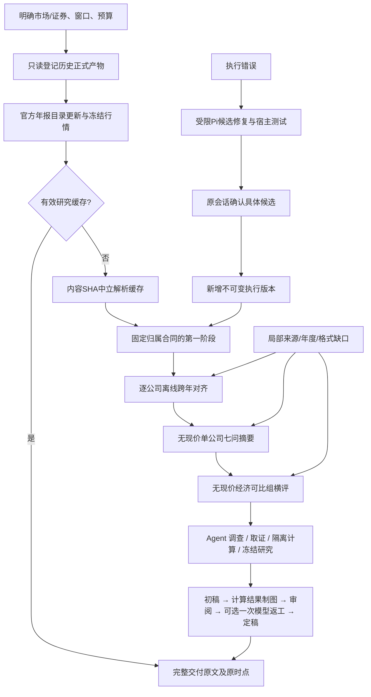

# 统一年报研究编排

版本：2026-11-01。源码入口为 `scripts/financial_pipeline.py run`，领域实现为 `src/research_pipeline/`。这份文档描述实际接口及其验收边界；真实模型、服务器部署和财务准确性不由离线测试替代。

后续Linux、Docker及真实模型补验见[实机记录](../development/research_pipeline_live_acceptance_20261101.md)；隔离验收与生产服务发布仍分开。

数据入口重复与跨项目复用见[新旧架构与本地实现映射](reusable_data_research_runtime.md)、[共享平台指南](../guide/reusable_platform.md)。本地公告/归档/研究入口已接统一资料层与执行/模型准入，生产尚未发布；独立旧档案不代表当前仍运行多套链路。

## 数据流与责任

公共执行底座仍是 `ExecutionRuntime/ExecutionStore`。领域层负责资料版本、DAG、结果索引与授权账本，不新增HTTP监听或第二套通用任务服务。模型任务与Pi维修共用同一个SQLite中的 `research_llm` lane，容量20，不能按run各开20路。预算可能让实际在途小于20；页面分开显示池容量和真实在途。

历史批次runner不作为新入口的动态依赖。旧原件、计划、请求、原响应、摘要和报告原字节保留。新任务冻结公共源码、合同、prompt、示例和tokenizer，不复制 `.env` 或账户凭据。

独立host启动冻结worker并等待真实退出；异常先暂停队列，之后再收齐在途及诊断。输入文件、归一化来源清单和发现快照另有绑定哈希，执行、resume和实际POST前核验。context元数据及年度数据哈希独立于正文校验，未验证的附件不能进入横评。

## 年报身份、版本与源站

- 输入必须明确 `a_share:600348 / hk:00883 / us:XOM`。证券身份与发行人身份分开；共享发行人只有显式映射或来源证据成立才启用，不凭名称、价格或ADR价格反推。
- A股从官方目录取得完整年报及年报更正；旧年度修订的查询上界到本次检查日期，不能仅查询财年次年。
- 港股区分 annual report 与 annual/final results。真实财年不强制12月31日。
- SEC读取submissions中的10-K、20-F、40-F及/A，使用实际reportDate和申报身份。HTML/iXBRL保留表格与DOM锚点，不制造PDF页码，不以companyfacts替代整份年报。
- 原完整年报与适用修订组成年度资料包；全文替换只替换同一报告系列，其他口径或过渡期间保持区分。原字节全部保留，不猜哪些块未受修订影响。
- 默认七个统一FY标签，显式记录period start/end和披露日期。缺年不凑更早七份；上市前“不适用”必须有证据，不能从第一条行情或最早申报猜。
- 每次真实run查官方目录，离线plan不联网。目录失败是freshness未知，不是已确认无更新。只认官方版本，不声称检测同URL静默替换。
- 下载共享源站限速及锁；失败或中断同一版本留attempt，不因新run自动重下。403/429等限制保留状态，不换身份绕过；其他来源继续。

## 缓存与去重

中立解析按文件内容SHA存放完整文本、图像、页/表结构、完整性记录，独立于行业profile和prompt。所有提取入口包括单块都使用它。相同文件换URL、移动目录、并发请求，只构建一次有效解析。HTML无物理页码。存在已验证解析或后续产物时，不强求原件二进制还在本机。

| 资产 | 语义身份 | 自动失效 |
|---|---|---|
| 年度块 | 发行人＋年度资料包内容集合＋块 | 对应年度版本变化 |
| 对齐、摘要 | 发行人＋实际年度资料集合 | 年报变化；非prompt/模型升级 |
| 横评 | 请求发行人集合（无序）＋各年度版本集合 | 增减对象或年报变化 |
| 最终研究 | 年报/横评依据、证券与权利、行情日期/价格、focus、假设 | 这些研究条件变化 |

行情指纹不包含observed_at、HTTP Date、run ID或路径。同日同价不因抓取时间变化重做研究；完整源quote_time仍留作来源证据。最终研究所有轮次使用同一冻结快照，不使用复权技术指标价格。

旧版摘要/横评可能带旧行情，导入时保留原文并标记历史价格依赖，不能自动再付费“清理”旧prompt。新摘要和横评不附当前价格。

缓存缺失、损坏、原件更新不同：先核验哈希及同SHA副本；可从已有raw离线恢复，不重发旧模型请求。无法恢复记录 `artifact_unavailable`，其他公司继续。来源身份不明登记unassigned，不靠目录名猜，也不能直接新付费补一遍。

任务attempt是独立于成果缓存的证据：complete/partial/failed/unknown只要已发送就不自动重复；新run只能复用原capture及状态。只有确认从未发送的任务可以在同一授权下接续。

## 状态、故障与预算

研究状态包括planned、running、partial、complete、budget_stop、cancelled、paused/awaiting_approval、failed；任务状态额外区分not_sent和unknown。某公司没有摘要仍留在请求清单，不能静默删掉；全部公司无有效材料则只交付缺口，不发送空研究请求。

| 局部降级，不作为全局单点 | 停止新的付费派发 |
|---|---|
| 补数失败、缺年、坏JSON、空摘要、行业不明、行情失败、图片/HTML/通知失败 | 授权/余额/预算、attempt与账本持久化、请求完整性、核心代码冻结、磁盘安全 |

非空partial可进入下一既定步骤，明确截断和分段状态，不额外续写、不补盲、不增加轮次。空附件或capital null检查位不是失败；某段不含某年不等于年报没提供。任务完成、JSON通过、原文字段提取、财务核验是不同指标。

同一run授权覆盖全部阶段与维修；历史缓存费用不重复归属。按真实attempt/producer计算prompt、completion、cache hit/miss、reasoning与usage费用。completion已包含reasoning。账户余额是全局资金观测，不把整个账户扣减重复分给每个run。unknown、在途和未来任务预留均不是消费。

默认10%为维修份额，未花预留可以释放；后续研究优先预留，其余按调用方公司顺序提取，不删合同凑数量。每次实际请求写冻结输入与计价依据；尚未产生的材料和未来成本标未知，不伪造精确输入数。

500k只是告警。硬上下文保守采用1,000,000，输出最多131072含reasoning，输入估算×1.10，加8192余量，并检查50MiB请求体。允许的无损摘要分段保留共同定义与完整覆盖目录，验证原文拼接完全相等。不能为过水位剪尾。

宿主死亡后先暂停领域队列，再恢复公共runtime。queued不等于获准自动恢复；显式resume只开放未发送项。PID创建身份确认死亡，不能凭status不动判死。取消后活着的网络handler仍占并发位。

## Feishu Pi维修与确认

现有Pi桥本来没有任意文件写入和shell。研究工具扩展只暴露该run的诊断、源码只读范围、候选补丁、实际测试与候选确认；不开放任意系统命令、凭据或其他用户日志。

每事故最多2轮，每轮10分钟、12次模型交互，总上限20分钟/24次，同时受总预算中维修份额约束。研究与维修共享并发与账本。模型回复“测试通过”不算证据。

候选在隔离目录生成。宿主使用明确配置的本地Docker镜像、禁网络、只读候选和有限结果目录做测试；不自动pull/install，不在缺沙箱时退化为任意本机执行。没有镜像/运行时记test_unavailable，不能应用。

原会话确认绑定candidate hash、基线、实际测试回执及恢复范围。确认前只生成候选，不改线上、不部署、不恢复付费队列。确认后发布新增不可变执行版本，旧freeze永远不改，未发送项才接续。治理代码、授权/预算、财务prompt/schema和原数据不在维修修改白名单。

401/402/403/429、源站封禁、磁盘与资金问题只诊断，不能清状态或换身份绕过。模型内容矛盾列核验注记，不靠脚本篡改原响应。

## 可观测性与用户交付

接受任务先给ID。5秒心跳、即时状态事件、节流流式字节进度、按run/task/attempt关联的脱敏日志。展示当前阶段/公司/年度、真实在途、最后网络活动、等待原因、复用/失败/unknown/未发、费用与预留、维修/待确认及下一步。慢请求不伪造进度或ETA。

SQLite事件为事实；HTML是派生视图。错误先落事件，再更新状态、异步通知。图片、页面、通知失败不能吞掉原文或费用。原会话主动提醒关键状态，局部失败合并去重；无明确origin的CLI不猜聊天目标。

本地页面自动刷新并保留阅读位置；远程通过现有Bot任务工具和受限文件/ZIP交付，不只给服务器路径，不新增公开HTTP管理端口。主机离线的即时报警需要外部监督，不能由同一个死亡进程自报。

## 验收矩阵

| 故障注入 | 观察断言 |
|---|---|
| 所有补数接口失效但缓存可用 | 仍交付，freshness未知，不全局卡死 |
| A缺年、B坏JSON、C正常 | C真实完成；A/B可用年份继续；公司清单保留 |
| 空摘要/partial/空附件/null | 分别记执行、分段和字段边界，不改成缺原件 |
| HTML锁住、图错误、通知失败 | raw/receipt/usage留存；其他任务继续 |
| POST后终止worker | unknown不再POST；重启先暂停；resume只发未发 |
| 两run与维修竞争 | 全库并发≤20；实际费用只归属producer一次 |
| 同PDF多URL/多进程 | 解析一次；读取同一中立缓存 |
| 修订、非自然FY、HTML | 更新准确依赖；不用业绩公告替代年报 |
| 行情变化 | 摘要/横评零增量，最终研究三轮更新 |
| 账本/授权/核心完整性坏 | 停新POST，已有结果可读且原因可见 |
| Pi红→绿候选 | 实际测试回执、未确认不应用、确认后仅续未发 |

测试跑正式CLI/Python、SQLite、缓存、文件和流式解析，仅在外部HTTP/SSE边界注入响应。新增故障组合及重复/并发测试，既验“继续”也验其他公司的产物确实生成。旧BUG先红后绿；旧档案不修改。离线回归不代表真实模型、Linux/服务器部署或财务正确性已验收。
