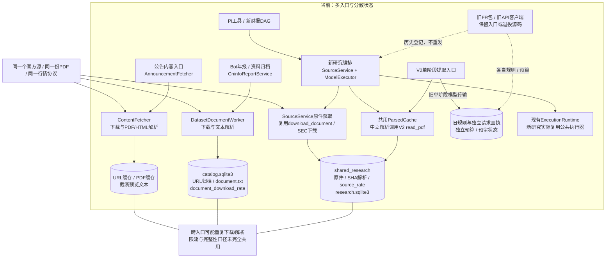
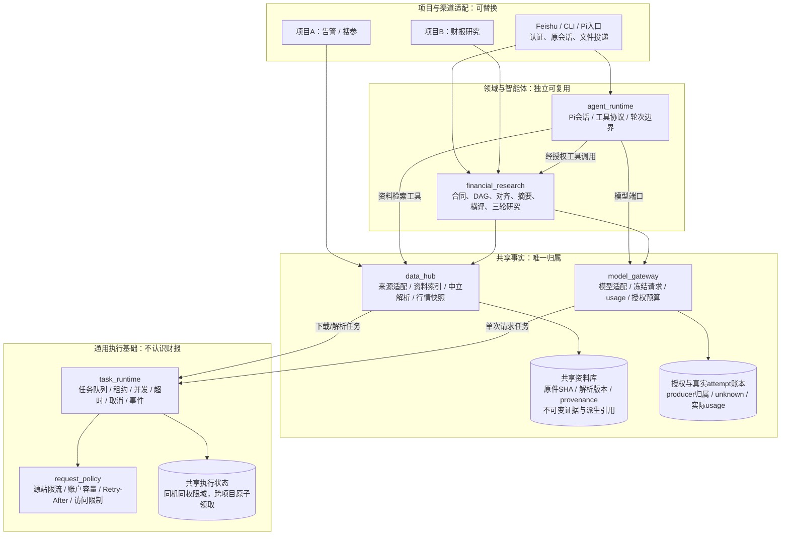
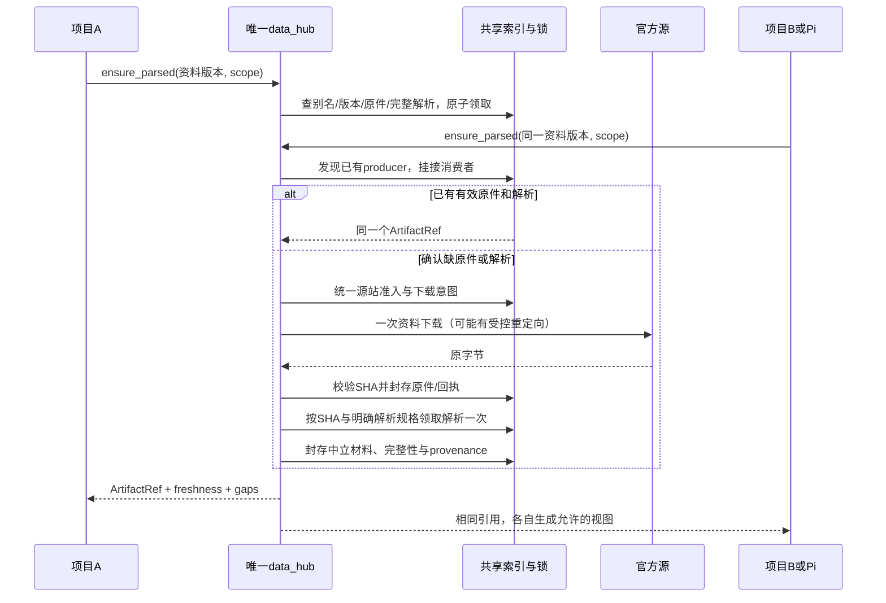

# 数据、Pi研究与执行底座：现状和目标边界

日期：2026-11-01。**用户认可边界后，本地代码已按下列映射落地；生产尚未发布。** 使用与实际限制见[共享平台指南](../guide/reusable_platform.md)，当前实施验收另行存档。先前实机记录只覆盖当时的旧版本，不能代替本次新库的生产验收。这里的“计时请求库”按用户确认，指包含队列、并发、超时、取消、持久化的通用执行库。

部署范围已收窄为开发和生产各自单机；同机跨项目显式共用authority，两机各自保有凭据、队列、预算和账本，不在本轮建设分布式服务。跨机器资料迁移仅通过另行授权的哈希清单导入导出。

| 设计职责 | 本地实际路径 |
|---|---|
| 共享合同与主项目组合 | `src/shared_contracts`、`src/platform_composition.py` |
| 通用执行与请求准入 | `src/task_runtime`；旧`src.core.execution`为同模块兼容别名 |
| 唯一资料事实与解析 | `src/data_hub`；catalog与旧入口保留受校验引用桥 |
| 唯一模型发送与attempt | `src/model_gateway`；金融原账本作为业务/历史投影 |
| 通用Pi/native循环 | `src/agent_runtime`；Feishu只负责宿主适配 |
| 金融领域 | 复用单份`src/research_pipeline`，不再复制同等金融实现 |

下方第一张图保留迁移前现状，第二张表示目标逻辑职责；`financial_research`是职责名，实际仍位于`research_pipeline`。旧FR合同与退休档案没有为追求删行数而改套新schema。

核心约束：业务可以有多种视图和不同研究合同，但同一信任域内，一份资料只能有一个权威原件索引、一个可复用的中立解析入口、一套源站访问状态。业务项目不得各自实现下载、解析和持久缓存。仅复制同一套库代码并不能满足这一点，还必须共享明确的状态所有者。

## 1. 当前：底层部分复用，资料和治理仍有多套归属

实线表示当前调用，虚线表示历史残留或显式登记；不是所有旧入口都在运行。图中数据库/目录分开，是逻辑事实归属，不代表必须各起一个服务进程。本图核对的是本机E盘源码，不声称生产已经切换到新编排。



已核对的重复及边界：

| 事实 | 当前证据 | 收敛方向 |
|---|---|---|
| 多条PDF解析路径 | `data/content_fetcher.py:348`、`data/dataset_documents.py:254`、`research_pipeline/parsing.py:150`、旧`fundamental_quant/sources.py:1923` | 统一中立材料仓库；预览/领域校验作为派生视图 |
| 原件归档与限流分散 | `dataset_documents.py:561`用SQL限流表；`research_pipeline/sources.py:250`用source_rate文件 | 源站策略和访问状态归一个请求权限域 |
| 腾讯行情多处解析 | `data/web_crawler.py:1284`、`instruments/providers.py:410`、`research_pipeline/sources.py:858`，另有筛选与ETF路径 | 一次协议解析，转换成不同业务视图；保留市场、股类、币种、源时间、价格口径 |
| 财报规则有直接复制 | 旧`fr_pack.py`与`fundamental_data/disclosure/__init__.py`有6个AST实现相同的函数，函数范围249行 | 现行规则一处维护，旧版本只作档案 |
| 旧付费入口绕开新治理 | `fundamental_data/api_client.py`、`v2_transport.py`仍有独立POST入口 | 迁入同一模型网关后保留兼容命令，不能并存独立预算/并发账本 |
| 旧缓存API遗留 | CacheManager六个方法252行，在src/scripts未找到现行调用；历史读写含5%/2%随机故障注入 | 先查外部/动态调用，后退出；随机故障移到测试边界 |

新编排与V2正式/单块入口已经共用SHA解析缓存；这不能推广为全项目的公告、预览和旧归档都已共用。`StockDataFetcher → DataSource`是编排/访问分层，不因文件不同就判作重复。不同parser并非全部冗余：识别稀疏页、检查文本完整性和产生预览是不同能力，但不能因此各自保存一份无关联的权威原文。

## 2. 目标：共享资料事实，业务只做解释与编排

以下是逻辑职责图，实际模块路径见上表。先在同仓形成单向边界，通过可迁移源包验收，再决定是否独立发布；不先建多个仓库再复制实现。



图中数据流不表示所有业务事实都塞进一个数据库。资料、授权账本、任务队列分别有唯一逻辑所有者；同机允许不同表/文件，但跨库不能伪称一个原子事务。实际POST采用保守预留、持久发送意图和可核查结算，无法原子确认时保留unknown，不能盲目重发。

共享合同是一个很小的独立叶包：`ArtifactRef / SourceRef / TaskSpec / TaskResult / RequestIntent / Event / Scope`。其他库引用这些类型，它不反向导入任何运行库。市场证券、FY、年报修订等类型属于金融领域合同；不要把金融字段塞进通用TaskSpec。

## 3. 三条迁移边界怎样划

| 可复用单元 | 独占的职责与状态 | 提供的端口 | 不应拥有 |
|---|---|---|---|
| `task_runtime`＋`request_policy` | 持久任务、owner身份、原子领取、容量、心跳、截止时间、取消、外部请求准入和源站退避 | submit/status/events/cancel；RequestIntent领取/发送许可/结果封存 | 证券、FY、财报prompt、研究结论、人民币兑美元假设、Bot会话、模型自主修改预算 |
| `data_hub` | 原件索引/CAS、中立解析版本、来源证据、源站适配、数据快照；唯一下载与解析入口 | discover/ensure_original/ensure_parsed/read_view/quote | 公司摘要、投资结论、项目临时目录、默认付费OCR、复制一个CacheManager给每个应用 |
| `financial_research` | 年度资料包、完整归属合同、既定阶段DAG、产物有效性、原缺口、证券权利与估值输入 | prepare/run/status/artifacts/resume | 独立下载器、独立PDF解析、直接requests.post、另一套余额/usage账本 |
| `agent_runtime` | Pi会话、工具调用协议、上下文与轮次边界、模型/工具事件 | run_turn(ModelPort, ToolRegistry, Policy, EventSink) | Feishu SDK、项目root推断、任意shell/文件写、财报业务规则、自动应用维修 |
| `model_gateway` | 所有模型网络调用、冻结实际请求、API回执、usage、额度预留、生产者归属、费率来源、账户观测 | invoke(AuthorizedModelIntent)；get_receipt | 资料自行补全、研究阶段自行加轮、按账户扣减分别给每个项目记费用 |
| 项目/渠道适配器 | 用户身份、允许资料范围、原会话通知、沙箱宿主、配置组合、部署 | 注入上述端口，映射工具与事件 | 复制底层执行器/资料缓存/模型传输；另起绕过共享状态的runner |

### 数据源不是“每个项目一个fetch函数”

源码组织可分`data_hub/core`（原件、解析、目录）、`data_hub/providers`（HTTP协议和字段映射）、`finance_sources`（年报/公告/FY/修订/证券口径）。项目用薄适配选择能力；同一个provider不会被复制到各个项目目录。

实时行情、历史OHLC、逐时点财务和原始披露有不同时间/修订合同，可以各有表和投影。应共享来源连接、原响应和解析规则，而不是强行把所有数据塞成一个通用JSON后丢失币种、复权、known_at、源交易日和更正身份。

中立解析保留全文、页/DOM/表结构、必要图片和完整性状态。`preview(max_chars=...)`只是读视图；文本截断结果不能登记为完整研究材料。已存在的不同解析器可以做同一服务内的受控后端；只有明确请求不同解析规格才有不同产物，不能业务各自私建解析缓存。

### Pi与固定研究流水线分开

Pi是可替换的决策/工具循环；三轮研究是领域预先批准的固定DAG，两者不是同一个模块。其他项目可只迁移Pi工具循环而不带金融合同，也可只调用财报流水线而不启用Pi。

Pi调用`data_hub.read/search`和`financial_research.prepare/status`等受限工具。Python宿主拥有权限、凭据和实际工具执行；Pi不能自行决定下载新范围、开启付费OCR、放宽预算或重发unknown。维修工具注入受限RepairPort：候选→宿主实际测试→人确认→新增执行版本。沙箱/确认属于宿主策略，不应成为任意shell工具。

### 执行库不是调度器、网络请求和财务策略的大杂烩

定时器只负责到点submit；`task_runtime`负责可靠执行。source级限流/阻断由`request_policy`统一准入；source插件只做请求构造和响应解释，不自己sleep重试。模型费用策略在`model_gateway`，通用执行器只接受准入结果与预留句柄，不硬编码DeepSeek或20路。

同一部署的研究模型与Pi维修共享配置容量；项目可以更严格，不能用自己的配置把共享上限提高。失败分类和是否允许重试由显式策略决定。对现有财报任务，已发送/failed/unknown保持不重发；普通幂等GET的有限重试也必须在统一attempt下留证。

## 4. 同源去重必须成为可验证协议



必须固定的身份和规则：

1. **来源请求身份**：provider＋官方document/version标识＋规范URL别名＋访问权限域；不包含项目名、run目录或抓取时间。同一个URL也不能掩盖官方明确修订。
2. **原字节身份**：SHA256＋访问范围。下载前未知的两个URL是否内容相同，无法凭空判断；只承诺已知别名/版本不重复下载，下载后同SHA不重复存储。同URL静默替换仍需另立探测政策，不能声称天然识别。
3. **解析身份**：原件SHA＋中立输出合同/明确解析规格；首次固定解析版本，后续完整材料默认复用。parser升级不自动扫全库重解析；显式重建生成新版本，旧解析保留。不能用文字相同但图/表结构不齐的旧预览假冒完整缓存。
4. **业务视图身份**：输入ArtifactRef集合＋视图合同；财务行业块属于此层。完整归属合同稳定，“本次执行哪个块”位于尾部和调度记录，不污染中立解析缓存。
5. **金融结果有效性**：无年报更新则第一阶段/对齐/摘要继续有效；横评对象变化或年报变化才重算横评；行情、权利、估值条件变化只影响相应最终研究。prompt/model/排版升级不自动收费重算。
6. **副作用意图身份**：领域生成逻辑intent_id，执行库保证唯一producer。不能仅凭相同HTTP字节合并两个本来不同的授权任务；也不能因换项目/批次就重发同一失败金融任务。共享缓存消费者不重复分摊历史API费用。
7. **安全范围**：凭据不入产物或缓存键，访问范围使用非秘密scope标识；跨项目复用前校验权限，不能通过猜SHA读到私有材料。公共资料原件可共享，含私有研究重点/持仓的prompt与输出默认隔离。
8. **共享源站状态**：source_policy_id明确域名别名集合、账户指纹和额度；访问同一限制域的不同hostname不能各算一份额度。Retry-After/阻断不会被新项目清空；较宽松调用方配置不得覆盖更严格已生效规则。

这里的“一次”指同一逻辑资料获取/解析producer，不等于网络永远只有一个数据包，也不保证网络失败时恰好一次。崩溃或响应不确定必须保留事实；没有服务器幂等保证的POST无法承诺exactly-once，应按unknown不重发。

## 5. 跨项目共享与跨机器共享是两件事

| 部署形态 | 实际保证 | 约束 |
|---|---|---|
| 同机、同信任域的项目A/B | SDK指向相同AuthorityRef、资料根与执行/账本库；跨进程锁和SQL原子领取使资料/并发/源站额度真正共享 | 一个库的不同实例可以并存，但不能各指自己的默认缓存/SQLite后仍宣称共享 |
| 同机、彼此不信任的项目 | 通过受权限控制的本地IPC宿主共享；项目不能直接写共享库和凭据 | project_id逻辑字段不能替代OS/服务权限；不开放新的公网管理端口 |
| 不同机器的项目 | 复用包和接口，但默认各机独立；若要求全局去重/统一账户容量，需后续专门部署单一资料/请求权限服务 | 不能靠复制缓存或把SQLite放网络盘实现分布式一致性；该服务部署不在本提案实施范围 |
| 独立离线/测试 | 显式isolated命名空间，可导入验哈希证据和模拟边界 | UI标为isolated，不计入共享容量承诺，不读取线上密钥 |

启动必须显示并核验`authority_id / scope / material_store / execution_store / provider_policy_id`。AuthorityRef由部署配置显式注入，不由当前仓库目录猜；运行记录绑定该身份。需要共享却指向不同状态根时应拒绝或显著降级，不能悄悄退化成每项目一份。

原件和模型原响应不会因为某个项目清缓存而删除；保留策略归权威资料库，采用引用和明确GC流程。项目目录只存run计划、manifest、状态投影和引用；PDF/解析全文只有为离线交付显式导出时才复制，副本可验哈希但不是新事实源。

组合关系可以表达为下面的接口草图，名称仅示意，不是当前可执行API：

```python
authority = open_authority(explicit_deployment_config)  # 不从project_root推断
runtime = TaskRuntime(authority.execution, request_policy=authority.source_policy)
materials = DataHub(authority.materials, runtime=runtime, providers=source_plugins)
models = ModelGateway(authority.attempts, runtime=runtime, credentials=secret_port)
research = FinancialResearch(materials=materials, models=models, runtime=runtime)
agent = PiAgent(models=models, tools=authorized_tools(materials, research))
```

项目A/B各有自己的run与业务状态，但对共享能力注入相同authority。复制这段组合代码、却给每个项目传入不同authority，并不满足跨项目共享承诺。

## 6. 从现有代码迁移，不重跑历史资料

| 顺序 | 改动 | 不能破坏的验收 |
|---|---|---|
| 0 | 冻结当前入口/调用方、旧attempt和原件/解析哈希，给重复项建立故障测试 | 退役代码、当前源码、线上启用分开盘点；不把旧27k行全当现行功能 |
| 1 | 建data_hub门面并只读登记catalog、公告缓存与shared_research；原件可引用旧路径 | 同版本三入口并发：已有资料0下载、完整解析0重做；缺失时只有一个producer |
| 2 | 接入公告/归档/研究所有入口，共用源站状态；预览改读视图 | 不同项目同时运行仍守同一额度；截断预览不能污染完整缓存；局部来源失败不全局卡死 |
| 3 | 统一腾讯等provider协议，保留业务视图和时间口径 | A/H/US、ETF、源时间/币种/复权、历史as-of、停牌/陈旧行情合同不回退 |
| 4 | 将旧API入口改为model_gateway兼容适配，通用执行依赖移为独立包 | 跨项目研究+维修共用容量；预算和usage唯一归属；POST后杀进程仍unknown不重发 |
| 5 | Pi宿主/工具协议与financial_research解耦，显式注入配置和端口 | 全缓存命中0模型/0维修/不要求密钥；无财务模块的项目也能独立使用Pi |
| 6 | 现行规则只留一个实现；旧命令改兼容/退役提示，历史源码档案保留 | 不改历史freeze、request、raw、正文；动态调用与测试确认后才退出重复实现 |

验收应从两个独立项目根目录同时跑正式门面，不只在一个研究run内测多线程。至少检查：实际下载producer、PDF解析次数、共享限流时间线、POST次数、无权限访问拒绝、不同authority提示、取消后仍占位、producer死亡后unknown、补数全失败但缓存可交付、预览/完整材料分离，以及账户观察不重复计入多个run费用。

本地实施不包含付费调用或生产发布。新加坡/日本数据接入及中国大陆服务器跑通已单列[后续待办](../development/todo_backlog.md)，不能把接口可迁移当成这些市场已经就绪。
