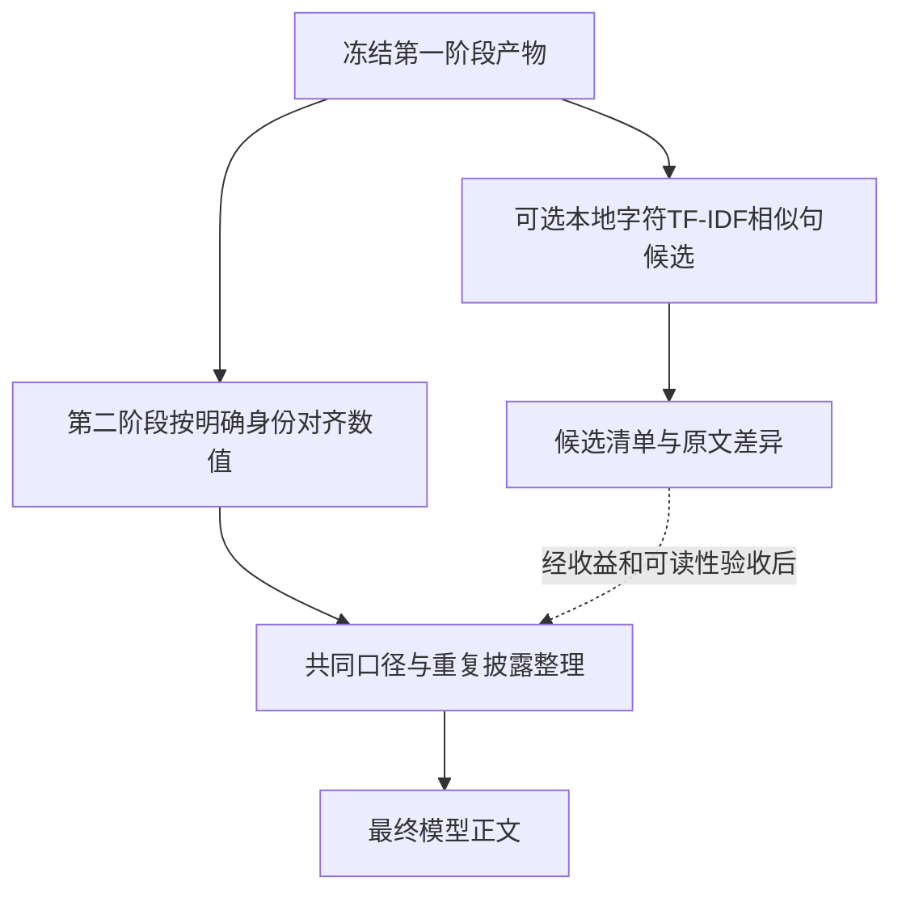

# 财报第二阶段统计去重：已有三家公司九份产物的离线研究

日期：2026-10-24。旧研究退役提交：`328cc03`。

建议先集中整理第二阶段的共同口径、重复说明与重复披露列。若接入统计方法，采用字符 TF-IDF＋余弦相似度生成相似原文候选；保留各版本的不同原文。当前样本尚未证明引入主题模型或句子差分能显著缩小整体模型输入。

本轮只新增本目录研究脚本、实验记录和样例，没有接入生产链路，没有修改第一阶段、第二阶段实现、prompt/schema或既有产物，没有调用付费API，也没有下载模型或安装依赖。

## 1. 提交边界

`328cc03` 只提交旧研究执行引擎退役与四文件历史读取能力：78个已跟踪路径变化，318行新增、35,086行删除。

仓库还有大量既有未提交修改。此次没有将技术面、运行服务、第一/二阶段未跟踪实现或CLI/Bot接线整文件混进提交。
HEAD原先没有这些CLI/Bot接线，因此提交文案只承诺Python历史读取接口。
旧工程财报测试的HEAD版本从提交中移除；工作区迁移后的数据测试原文件仍保留。

暂存内容单独导出到 `.tmp/research_retirement_staged/`，在该目录运行历史只读测试和 `tests/validation/`，46项通过。此前387项验收属于完整工作区，不能与此提交的46项混同。

## 2. 样本、计数和保护范围

输入为 `three_companies_fixed4_20261024_115306` 的第一阶段既有产物，以及 `stage2_model_context_20261024_125223_final` 的既有模型正文。

| 公司 | 年度 | 政策输入条目 | 现有第二阶段政策版本 | 现有政策段落区token |
|---|---|---:|---:|---:|
| 四川路桥600039 | 2023—2025 | 77 | 77 | 14,651 |
| 隧道股份600820 | 2023—2025 | 106 | 105 | 19,181 |
| 泸州老窖000568 | 2023—2025 | 118 | 118 | 19,473 |
| 合计 | 九份既有输入 | 301 | 300 | 53,305 |

这不是九份完整无缺的财报：原提取失败块、缺表、缺失值全部沿用，本轮没有补提取。

计数使用仓库原有DeepSeek tokenizer，SHA-256：`8f9f37ca37fdc4f5fd36d5cf4d3b0e8392edb4e894fd10cc0d70b4957c8633cf`。
合并文件 `模型输入.md` 为795,889 token；三家公司正文分别计数后相加为795,868，21 token差异来自合并边界和额外分隔文字。下文整体比例采用795,889作为分母。

政策区约占6.70%。即使把全部政策区删去，也只能减少这部分篇幅；这是规模上限说明，绝非删除建议。
表格与开头说明部分合计704,781 token，约占88.55%；其余为政策、管理层披露、事件、元数据等。分段token计数和整文件计数存在边界差异，不能将所有分段结果当作严格可加账本。

研究前后核对1,631个登记输入/实现文件SHA-256，无变化；又按此前清理前的1,669项保护清单复查（含旧版数据CLI等），无变化。两份清单有重叠，不能相加。范围见 `run/input_hashes.json`，最终独立复查见 `run/verification_complete.json`。哈希证明限于清单内文件内容，不证明财务正确或模型阅读效果。

## 3. 实测方法与结果

### 3.1 整段字符TF-IDF候选

使用本机已有scikit-learn 1.5.1、NumPy 1.26.4，字符2—5 gram，不分词、不删数字、不删否定词、不做同义词替换。
向量化与余弦计算约0.20秒；301段的稀疏特征矩阵约2.63MB，90,620个特征。这不是整个Python进程的内存峰值，未计词典、模型和其他数组。

同公司内部共15,394个段落对。以下只表示候选数量，**不表示错误率、重复率或可删除数量**：

| 余弦阈值 | 候选段落对 | 原文逐字相同 | 原文有差异 | 原始口径元数据不同 |
|---:|---:|---:|---:|---:|
| 0.75 | 38 | 2 | 36 | 22 |
| 0.85 | 12 | 2 | 10 | 8 |
| 0.90 | 6 | 2 | 4 | 4 |
| 0.95 | 3 | 2 | 1 | 2 |
| 0.98 | 2 | 2 | 0 | 1 |

“口径不同”按原始scope/accounting_basis字段严格比较，其中可能包含准则名称写法差异；没有据此判断财务口径实质不同，也没有猜测它们相同。
topic/module不用于阻止候选检索，否则同一政策被分到不同主题时仍会漏找；实际复用必须保留每项主题、范围、准则和年度。

本样本中，整段相似度受模型对原文的不同压缩写法影响较大。政府补助、存货等政策看起来重复，逐字重合程度却不一定高。
提高阈值会漏掉这些重述，降低阈值则引入更多同主题但不同内容的候选。0.85只是本实验参数，未定为生产门槛。

### 3.2 句子级检索

沿句号、分号、换行切分，保留所有原字符、标点及原顺序；共有1,435个长度不少于15字符的句子用于检索。

同公司、不同政策记录之间：阈值0.85时得到359对候选，其中140对逐字相同、219对存在原文差异。这里包含同一年不同主题的重复披露，也包含跨年披露。
候选对数量不等于可复用句子的数量；一句重复出现多次会产生多个句对。

实际原文例子：

- 仅末尾句号/分号不同的政策句，相似度可达0.99。
- 持续经营评价基准日期2023年与2025年不同，相似度约0.927。
- 固定资产折旧句中一版带“残值率5%”、另一版省略该内容，相似度约0.863。相似并不能证明省略部分适用于另一个版本。

因此句子级检索比整段检索更能定位共用文字，但仍只负责找候选。

### 3.3 LDA对照

LDA使用字符2—4 gram计数、min_df=2、最多20,000特征、batch学习20轮；分别测试6主题和12主题、两个随机种子。

| 主题数/种子 | 主题向量余弦≥0.98的段落对 | 其中字符TF-IDF余弦<0.50 |
|---|---:|---:|
| 6 / 0 | 1,761 | 1,583 |
| 12 / 0 | 812 | 633 |
| 12 / 1 | 778 | 608 |

这些列不是LDA准确率；低词面相似度本身不能证明语义不同。另检查了实际反例：泸州老窖收入确认与存货计价，两者主题向量余弦接近1，原文显然回答不同财务问题；所得税与固定资产折旧也出现此现象。

这说明当前LDA设置不适合承担近重复判定。现有schema已经带主题，继续训练主题模型也没有解决年度差异保留的问题。没有必要为了去重引入LDA训练、主题版本和主题迁移管理。

### 3.4 高相似度危险反例

额外构造四个**合成对照样例**，仅用于离线方法测试，未作为财务数据写回：在真实长段落上分别改变一个否定词、数字、单位、主体名称。

| 人为变化 | 字符TF-IDF相似度 |
|---|---:|
| 确认→不确认 | 0.9947 |
| 改变一个数字 | 0.9960 |
| 万元→百万元 | 0.9973 |
| 本公司→本集团 | 0.9916 |

所以阈值再高，也不等于财务含义相同。增加数字/否定词字典只能辅助标注，不能替代完整差异保留，更不能再演变成整段拦截。

## 4. 实际能省多少token

第一组实验：从已有政策区抽出重复口径；保留各政策版本和主题；再尝试相似段落的“完整基准原文＋完整差异句”。只在原始口径字段完全一致、能逐字还原、实际token更少时采用差异表示；不建立多层引用链。

| 公司 | 原政策区 | 抽出共同口径后的完整原文 | 再加TF-IDF候选＋完整差异句 |
|---|---:|---:|---:|
| 600039 | 14,651 | 12,684 | 12,679 |
| 600820 | 19,181 | 16,640 | 16,640 |
| 000568 | 19,473 | 16,618 | 16,618 |
| 合计 | 53,305 | 45,942 | 45,937 |

共用上下文、标题、来源标识和版式共同重排后净节省7,363 token，不能将它全归因于口径抽取；统计检索加句子差分仅额外节省5 token，且唯一选中差分发生在四川路桥2025同一年两个主题之间，并非跨年去重收益。总计约占整个三家公司正文0.93%。这里不是全正文重跑结果，只是政策区研究样例。

第二组实验独立测试了“逐字相同长句的共用句库＋每个原版本按顺序引用”，连不同口径版本的文字也可复用，但不合并其适用范围。仅比较政策文本与一致的版本标识：40,336→39,763，节省573 token，约1.42%。
这组和前一组实验的基线不同，不能相加；句库预览只含ID和文本，未含scope/accounting_basis/issues，须依赖外部corpus才能还原完整口径，所以不能当作可直接给模型的独立正文。它还要求模型在句库间来回引用，阅读成本可能超过这点节省。

保留性证据：38组已保存候选差分、1组实际选用差分，通过独立脚本反向应用已保存编辑，全部还原原始政策字符串。之后又从保存的Markdown预览独立读取完整原文、基准引用和中文差异指令，重建全部301条输入政策的原文字串；另从保存的句库文件展开引用，也重建全部301条。最终证据为 `verification_complete.json`，而非生产脚本内部的布尔标志。它证明这些样例的文本可还原，**不证明财务正确、元数据全字段可逆、语义等价，也不证明模型读起来同样准确**。合并样例未作为正式产物发布。

## 5. 推荐接入位置与最小边界



1. **数值保持明确身份规则。** 同公司、科目、维度、期间、单位、统计方法、范围、会计基础与调整状态确认一致后，完全相同的值才共用展示，并列出原披露版本；值不同则同时展示。未知身份不通过相似度补身份，不自动换算单位。
2. **先整理确定重复。** 公司级共同口径一次说明、表级覆盖差异；同组行共享路径前缀；同一缺失原因用短标识和图例；重复提示集中说明。每个标识在同一份模型正文里有完整定义，模型无需读JSON或跳外部文件。
3. **统计只产生候选。** 输入原文及定位，输出两个定位、分数、原文差异。没有缺失填补、财务同义词猜测、整块检查门槛或自动丢弃行为。
4. **文字复用与事实合并分开。** 同一文字可引用一次，但适用主体、年度、准则、主题仍逐项保留。相似改写保留两版完整差异；无法清楚表达差异时直接保留完整版本。
5. **不建新服务。** 若以后接入，在第二阶段正文输出前增加一个本地纯函数即可；按公司批次计算，不训练长期主题模型、不引入向量数据库、不接付费embedding API。
6. **候选模块失败不阻断整理。** 按原有数据继续输出，附上候选模块未运行的说明；已有表格和原文仍保留。原有第一阶段契约、原始响应与已有产物保持冻结。

字符TF-IDF更适合现在的候选定位。MinHash/LSH适合规模扩大后的近重复候选加速，本次15,394个段落对没有检索规模压力；它也不会自动判断政策等价。
句子embedding可以作为未来改写召回实验，但需要模型权重、版本和新的财务反例验收。当前没有下载或运行，因此没有实测收益承诺。
项目现有 `src/fundamental_embedding` 主要处理估值、财务特征及同行专家模型，并非句子语义编码器，不能按名字直接当作文本去重模型复用。

## 6. 接入前应验收什么

- 展示整理前后，每个原数值、缺失原因、期间和口径仍可对应；不同披露版本的差异全部可见。
- 相似句候选以人工标注的小型对照集评估召回与误配，覆盖新增/删除条件、数字、单位、否定、范围和日期变化；本轮没有这样的独立标注集，不能给准确率。
- 字符串重建通过与模型可读性分别验收；不能以“可以程序还原”替代“模型能正确读取”。
- 同一tokenizer比较整份最终模型正文，包含字典、引用、差异和图例成本，不能只比较去重前后的段落数量。
- 只保留能带来明确正文收益的表示；引用和差分若更长或更难读，则保留完整原文。检查报告与正文分开，不逐行重复诊断。

本轮结果支持先改确定重复的正文排版。TF-IDF候选能力可作为独立、可选的小功能，待更大收益样本与可读性验收后再进入第二阶段。现在直接接入LDA或把所有政策改成差分，收益证据不足。

## 7. 证据、样例与复现

- `run/results.json`：版本、参数、候选数量与政策区token比较。
- `run/verification_complete.json`：两份输入保护清单、正文篇幅分解、完整预览及句库的独立原文重建。`verification.json`仅为早期差分编辑记录检查。
- `run/sentence_results.json`：句子级候选与逐字句库实验。
- `run/candidates.json` / `run/sentence_candidates.json`：真实原文候选，分数不是删除许可。
- `run/synthetic_contrasts.json`：明确标记的合成危险反例。
- `run/lda_counterexamples.json`：主题相似但财务问题不同的实际例子。
- `run/600820_policies_preview.md`：共同口径抽出、完整版本保留的政策正文样例。
- `run/600039_policies_preview.md`：含一组保留完整差异句的研究样例。

复现主实验可指定全新的输出目录，避免覆盖记录：

```powershell
python -B -X utf8 docs/development/audits/statistical_dedup_20261024/experiment.py .tmp/statistical_dedup_new_run
```

`sentence_probe.py`、`verify.py`为已保存 `run` 的独立补充实验；其输出采用排他新建，重复运行不会覆盖现有回执。
生产依赖文件未增加scikit-learn直接声明；若以后正式接入，应明确声明和锁定兼容版本，再在目标环境验收，不能依赖某个开发机偶然存在的传递依赖。

方法依据：

- [scikit-learn：字符n-gram、TF-IDF和词袋表示的局限](https://scikit-learn.org/stable/modules/feature_extraction.html#text-feature-extraction)。字符特征支持候选检索；相似度不包含完整语义结构。
- [scikit-learn：余弦相似度定义](https://scikit-learn.org/stable/modules/generated/sklearn.metrics.pairwise.cosine_similarity.html)。分数是归一化向量点积。
- [scikit-learn：LDA](https://scikit-learn.org/stable/modules/decomposition.html#latentdirichletallocation)。目标是发现抽象主题。
- [Broder：Identifying and Filtering Near-Duplicate Documents](https://research.google/pubs/identifying-and-filtering-near-duplicate-documents/)。近重复检索与大规模采样方法的参考。
- [Sentence Transformers：Semantic Textual Similarity](https://sbert.net/docs/sentence_transformer/usage/semantic_textual_similarity.html)。语义相似候选的备选路线，本轮未实测。

以上官方文档用于方法定义；实际软件版本和运行结果以本地回执为准，不把当前在线文档版本冒认为本机版本。
