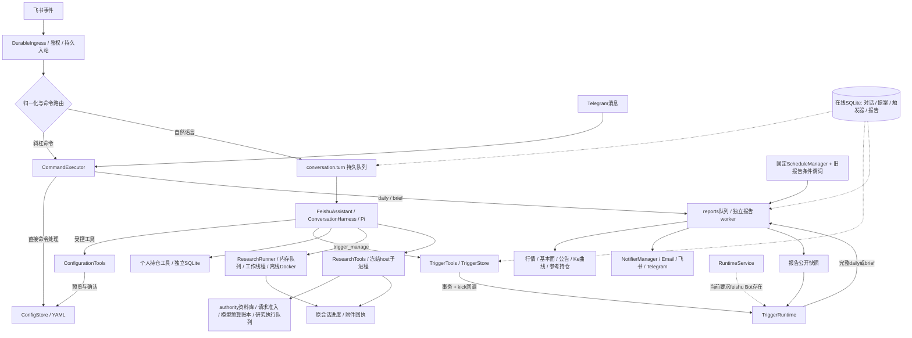

# 关键路径分支与机器人耦合审计（2026-11-09）

后续状态：G01/G02 已收敛为本地修复（G02 复用既有提案确认），见 [修复说明](g01_g02_confirmation_fix_20261109.md)；尚未部署。下文保留原审计基线、缺陷复现与当时行号，随后离线回归继续修复 G03/G04，见 [离线回归](offline_regression_20261109.md)；G05 未在本轮删除。

基线：`9d8e4cabb571d63a415e0d74dc54ec2166387ec9`。本轮做源码审计、隔离回归和合成故障复现，没有修改业务实现、提交、推送、部署或外发消息。此前的发布不等于本次发现已修复。

## 如何读 mark

- **C01–C21**：机器人入站、鉴权、命令、自然语言、确认、恢复。
- **T01–T20**：受管触发器、任务提交、报告 worker、渠道及回执。
- **R01–R20**：研究、共享执行/资料/模型、持仓及退役边界。
- **S01–S13**：主入口、服务生命周期、固定调度、配置、报价和质量状态。
- **B00001–B17954**：当前工作树的 Python 语法分支索引，包含文件、行号、函数、条件和源文件 SHA256。B 标记仅在本次快照内稳定。

语法索引覆盖 270 个 Git 跟踪的根目录和 `src/` Python 文件，共 17,954 项，解析错误 0。包含 if/条件表达式、布尔短路、循环、except、match、assert、推导式过滤；嵌套判断会重叠计数。它不是分支覆盖率、路径可达性或所有组合均已验收的证明。测试、scripts/tools、JavaScript 不在该 Python 索引范围；对话 Pi 边界另按 C 表人工追踪。未给业务源码插入注释，以免将审计标记变成运行代码改动。

附件：[逐项 Markdown 索引](../../.tmp/critical_paths_audit_20261109/branch_index.md)、[完整 JSON 与源码哈希](../../.tmp/critical_paths_audit_20261109/branch_index.json)、[可重生成脚本](../../.tmp/critical_paths_audit_20261109/index_branches.py)。`.tmp` 附件为本地审计证据，不受 Git 跟踪；关键结论、分支表和复现步骤保存在本文。

`src/core/data_fetcher.py`、`src/data/announcement_fetcher.py` 存在本轮开始前的未提交变化。索引保存其当前字节哈希，但不能将这些本地行为称为已部署。其他既存脏文件未更改。本轮没有重新登录生产或确认生产数据状态，涉及生产开关的陈述只引用前一轮发布核对。

## 需要优先处理的结论

| 问题 | 对应 mark / 证据 | 影响及结论强度 | 修正验收应覆盖 |
|---|---|---|---|
| G01：mention 后的斜杠命令可能被重放 | C 表；`src/interactive/ingress.py:143` 与 `feishu_handler.py:47` 使用不同的命令分类文本 | **本地已复现**。普通 `/daily` 执行前置 unknown；`@机器人 /daily` 执行副作用后若崩溃仍 pending，恢复再次调用。会影响非幂等直接命令 | 同一归一化消息对象贯穿入站与执行；普通/mention/空格命令，副作用前后崩溃，重启不重复执行 |
| G02：参考持仓重置确认可被绕过 | `commands/handlers.py:587,679,712`；C 表复现 | **本地已复现**。存在待确认日期 A，再发日期 B 不需 confirm 就进入三市场 reset。pending 是全局 YAML 字段，未绑定会话/发送者/有效期。涉及参考持仓数据，不是券商实盘下单 | A→B必须重新预览；原会话、原发送者确认唯一版本；过期/跨会话/并发确认拒绝；三市场写入中途失败可辨认 |
| G03：单渠道初始化异常阻断全部渠道 | T13；`notification/manager.py:30`、`email_notifier.py:88` | **本地已复现**。邮件归档路径异常时飞书/TG构造次数均0，逐渠道发送隔离根本没有开始 | 对构造阶段也做逐渠道隔离；保留失败渠道回执；其他可用渠道继续；总状态不得成功 |
| G04：无效绑定被写成撤销 | T11；`core/report_execution.py:530` | **本地已复现**。worker将invalid记成skipped/trigger_revoked并exit0；掩盖失败原因，无越权发送证据 | parent/worker使用同一分类；invalid、revoked、allowed与检查间状态变化分别断言 |
| G05：“只有一种触发器”尚未彻底实现 | S04–S05；`main.py:647,864`、`config_tools.py:396` | **源码确认的需求缺口**。固定调度及另一套报告发送谓词仍可配置；不是已移除的个人提醒复活，也不是又一套邮件发送器，但确实有第二套条件评估入口。前轮生产开关关闭不能替代删除 | 收敛到managed trigger后，Bot配置schema、固定调度、旧字段加载/迁移、CLI与自然语言都不能重新创建旧规则；保留历史证据，不重放 |

另外记录的耦合/契约风险，不当作已发生生产故障：TriggerRuntime依赖飞书启动（S03）；任一Bot接收线程异常会停止整个宿主（S13）；两套研究生命周期并存（R05/R10）；基本面query可能补数（R07）；报告配置采用入队快照而发送凭证/撤销检查用当前配置（T20）；共享authority的容量、预算、限速封禁跨调用生效（R13–R18）。

## 机器人与其他系统如何耦合



图是调用和状态依赖，不表示所有入口都会执行全部路径，也不把不同数据库误画成同一个。`src/core/execution.py` 是 `task_runtime.execution` 的兼容别名，不是第二个执行器实现。

| 边界 | 当前连接方式 | 具体影响 |
|---|---|---|
| Bot → 业务 | 自然语言经工具schema/确认/持久对话；斜杠命令经CommandExecutor直接调用handlers | 同一业务可能有不同的授权、确认和崩溃语义；G01/G02就在这条接缝 |
| 助手 → 触发器 | 构造器注入实例、认证上下文、同库事务与kick回调 | 创建与入队原子性较强；触发启动和邮件/TG发送授权仍依赖Feishu来源身份 |
| 对话/触发器/报告 → 在线状态 | 同一个在线SQLite中的不同表和任务lane | 能事务绑定；也共享锁竞争、服务进程生命周期。并非所有研究都使用此库 |
| 助手 → 配置/调度 | ConfigurationTools、ConfigStore字段更新、全局ScheduleManager reload | 自然语言配置预览与显式命令不是同一调用层；旧规则字段仍可达 |
| 报告 → 通知 | 统一NotifierManager，受管任务使用带持久绑定guard的渠道适配器 | 发送异常有回执；初始化异常尚未隔离。全渠道指本次任务配置中启用的渠道，不是强行启用关闭的渠道 |
| 报告 → 数据/参考持仓 | 业务模块直接调用，session汇总，读取行情/公告/曲线/参考持仓状态 | 会发生数据缓存/快照/估值等写入；unknown不能简单重跑报告 |
| 对话 → 个人持仓 | PersonalTools + 独立personal_monitor.sqlite3 | 仍保留账户、图片导入与持仓管理；旧提醒执行器已删除，纯日历/行情函数仍复用旧包名 |
| 对话 → 研究 | ResearchRunner内存队列 与 ResearchTools独立host两套生命周期 | 确认、取消、恢复、产物和交付必须分别核对；不能笼统声称研究已经统一队列 |
| 研究/数据 → 共享底座 | platform_composition注入authority，复用Python库与SQLite | 没有新增网络微服务；资料、请求限速、预算与并发可跨模块共享，具体路径配置决定边界 |
| 普通答复/研究交付 → 渠道 | 原认证会话的send_message/send_file回调 | 这是对话/任务结果交付，当前未走触发器全渠道报告链。是否进一步统一属于产品范围判断，本文不擅自删除 |
| Bot → 宿主健康 | RuntimeService监视接收线程、执行owner、助手健康 | 共享故障域；Bot接收故障能够令调度一起停止，需要联合恢复验收 |

## S01–S13：宿主、配置与数据关键分支

| Mark | 位置 | 分支及两侧行为 | 判断/本轮证据 |
|---|---|---|---|
| S01 | `main.py:16,1025,1046`；`core/report_cli.py:14` | 脚本once/brief先走轻量parser；import后调用main另走parser；worker需要payload/result；其余service/status/audit/backfill分派 | 两套CLI parser接入同一report提交；T19记录group被解析但未使用，不能从exit0推导已送达 |
| S02 | `core/runtime_service.py:527` | 服务锁/执行owner存在拒绝启动；登记、启动任一步失败进入清理；存活owner不可被竞争者停止 | 正常；runtime_service相关受控测试已运行 |
| S03 | `core/runtime_service.py:549` | register_reports且有feishu才构造TriggerRuntime；无feishu即没有这套evaluate/到期执行 | 强耦合、可达性限制；不能称email-only/TG-only部署仍可正常跑managed trigger；本轮为源码确认 |
| S04 | `core/schedule_manager.py:88,99,112,175,433` | daily_enabled/brief enabled默认True；startup受daily开关约束；旧optimize拒绝；disabled不能reschedule | 固定日报/简报仍存在且配置可开启。生产此前关闭。测试覆盖常规/禁用/退役分支，但产品单一入口要求尚未收敛 |
| S05 | `main.py:647,864`；`notification/report_triggers.py:80`；`assistant/config_tools.py:396` | managed daily直接发；普通日报按独立predicate any/all或frequency；普通brief另过predicate和指纹；force跳过后两类限制 | **G05已确认**。另一套声明式条件引擎仍在，Bot可改daily/brief规则；不是所有条件都归TriggerStore |
| S06 | `core/schedule_manager.py:200,256` | 旧generation callback不执行；当前任务按应发生时刻生成request_id；reload失败回退旧配置/作业 | 防止陈旧回调与重复提交；相关现有测试通过，不等于真实时钟跨日验收 |
| S07 | `core/config_store.py:32,55,85` | env仅覆盖runtime副本；配置非法失败；更新加锁、验证临时文件、原子替换；异常保留旧文件 | 正常；配置原子更新测试通过。下面S08为调用者另一约定问题 |
| S08 | `commands/handlers.py:108`；`assistant/config_tools.py:299` | _load_config读CONFIG_PATH；watchlist修改却由CONFIG_PATH.parent.parent重建root/config/config.yaml | 本轮test_config_store旧夹具给tmp/config.yaml导致路径不一致，单测独跑同样失败；尚不能据此断言标准生产目录配置失败 |
| S09 | `core/report_quotes.py:61,155` | 错标的、非法价格、未来时间、过期/闭市报价失败；合格报价按实时/延迟/最近收盘分类；各股票独立处理 | 报价质量50项受控测试通过；不是实际外部数据源测试，不填造缺数据 |
| S10 | `notification/report_builders.py:454`；`main.py:375` | 缺股票/报价质量/错误记录→not_ready；即便渠道sent，总结果降为partial或全无价failed；保留真实送达回执 | 数据就绪与渠道送达是两个维度；force不伪造合格报价；受控测试通过 |
| S11 | `main.py:448,493,521,642,684` | 非force周末跳过；可选公告/定增/快照失败与主流程异常分开；主异常failed | 正常业务分支但error可影响readiness。日报日期取宿主本地时区，简报显式取scheduler时区；异时区部署应补边界验收 |
| S12 | `main.py:721,864,879,893` | 简报休市跳过；非force按规则和指纹抑制；unknown/partial仍记录尝试指纹，避免自动重复外发；force直接送 | 正常幂等取舍；unknown不是可靠成功，也不是自动重发许可 |
| S13 | `core/runtime_service.py:238,249,527` | Bot异常/意外退出设置全局stop_event；心跳还检查线程、执行owner、助手transport；失败不是单凭PID判断 | 强共享故障域；接收故障连带停止宿主，runtime_service测试覆盖此行为 |

## 测试事实与覆盖缺口

1. 本轮服务/调度/ConfigStore/validation：**62 passed，1 failed，14.01s**。命令：`python -X utf8 -m pytest -o addopts= tests/validation/ tests/test_runtime_service.py tests/test_schedule_manager.py tests/test_config_store.py -q --basetemp=.tmp/critical_paths_audit_20261109/pytest_root`。失败为`test_bot_field_updates_preserve_concurrent_changes_and_secrets`，独跑仍`1 failed`。原始日志在`.tmp/critical_paths_audit_20261109/root_tests.log`与`config_single.log`。没有删改测试使其通过。
2. 报价与完整入口受控回归：**50 passed，12.08s**。命令：`python -X utf8 -m pytest -o addopts= tests/test_report_quote_quality.py tests/test_report_quote_entrypoints.py -q --basetemp=.tmp/critical_paths_audit_20261109/pytest_quotes`。日志`quotes_tests.log`。
3. 研究/共享底座受控回归：**48 passed，29.21s**，精确命令和输出见R表附录。其余C/T表测试位置仅表示源码中找到的测试，不冒充本轮全量通过。
4. 最初不覆盖pytest.ini的命令在收集前失败：本地缺pytest-cov，不能识别默认`--cov`参数。之后用`-o addopts=`运行选定功能回归；**没有生成覆盖率**，不作覆盖率达标声明。
5. 本轮没有真实模型、SMTP/平台外发、生产时钟触发或线上Docker实机验收。合成故障均使用隔离文件/数据库或mock，不操作真实参考持仓。

已有测试的主要盲区是**跨层状态与分支组合**：原文/归一化命令分类、入站记录/业务副作用、待确认A/新参数B、构造阶段/发送阶段、parent guard/worker guard、managed trigger/可编辑旧规则。单模块成功路径数量再多，也不能替代这些契约验收。现有架构总览还保留个人到期任务等历史节点（`docs/architecture_overview.md:38,80`），应以本次源码图为准并在后续修正文档时同步。

建议修复顺序：先G02与G01阻止未确认重置/重复副作用；再G03与G04保证独立渠道与真实回执；随后G05收敛触发创建和配置入口。每项先补上述反例，再修改实现；最终用隔离完整链证明路径。本文只列证据和建议，不将修复、生产验收或部署记为完成。

---


---

# 机器人对话关键路径审计

基线：`9d8e4cabb571d63a415e0d74dc54ec2166387ec9`。审计日期：2026-11-09。只读审计业务代码；该分项审计没有写入其他业务文件。没有外发消息、真实 LLM 调用、实际配置/持仓修改或生产操作。下列测试名称表示已检查的现有覆盖，不表示本次重新执行全套测试；本次实际运行的是两个隔离缺陷复现。`.opencode/agents/checkpoint-acceptor.md` 在本 checkout 不存在，按 AGENTS 所列子功能验收职责审计。

## 已确认缺陷

### G01：@机器人 后的直接命令绕过 durable ingress 的不可重放边界

- 位置：`src/interactive/ingress.py:143`；`src/interactive/feishu_handler.py:43`、`:68`、`:92`。
- ingress 用原始文本 `startswith('/')` 判断是否为直接命令；handler 先剥离经过机器人身份验证的 mention，再判断 `/`。因此 `@_user_1 /daily` 在前层被视为可重试自然语言，后层实际直接执行命令。
- 命令副作用之后、handler 返回之前崩溃时，普通 `/daily` 已经持久标记 `unknown`，重启不会重放；带 mention 的相同命令仍是 `pending`。新进程的 BotAccess 去重缓存为空，命令再次执行。
- 这是确定的跨层分类不一致，影响至少入队类副作用；不是“所有自然语言都可能重复”的泛化结论。实际生产是否发生过此窗口尚未查询。
- 复现方法：临时 SQLite + 真实 `DurableIngress`、`BotAccess`、`handle_feishu_message`；app 的 `get_bot_open_id` 固定返回已认证的 `this-bot`，事件 mention 的 open_id 匹配；替换 `command_executor.execute` 为计数器，第一次调用计数后抛 `RuntimeError` 模拟副作用后崩溃。重新创建 app/BotAccess 并对同一 inbox dispatch。没有调用任何真实命令业务。
- 实际输出：

```text
/daily -> state_after_crash unknown, command_calls_after_restart 1
@_user_1 /daily -> state_after_crash pending, command_calls_after_restart 2
```

- 已有测试：`tests/interactive/test_shared_conversation.py:195::test_legacy_unknown_dispatch_is_never_replayed_and_other_chat_is_filtered` 只覆盖原始 slash；`tests/interactive/test_assistant_routing.py:75::test_group_mentions_must_target_authenticated_bot` 只覆盖 mention 转自然语言。缺少“真实 handler + durable ingress + mention slash + 副作用后崩溃”的组合测试。
- 最小修复方向：在执行前共享同一经过认证的消息分类/规范化结果，不能只把 ingress 原始文本检查替换成任意 mention 文本剥离。

### G02：已有待确认基期时，输入另一个日期就会跳过清仓确认

- 位置：`src/interactive/commands/handlers.py:587`、`:679`、`:712`。
- `pending_date` 从共享配置 `optimizer._ref_date_pending` 读取；只有它为空时才要求清空持仓预览。已有待确认日期 A 时，直接发 `/ref_date B`（不是 `confirm`），会跳过确认进入三市场 `reset()`，并把基期改为 B。
- pending 也没有 chat、sender、transport 或过期时间；因此任意获准操作同一全局配置的会话共享这个确认状态。这是直接命令确认机制的缺陷，与 NL proposal 的 owner/hash/expiry 保护不同。
- 实际隔离复现：mock `_load_config/_update_config`、已激活策略、三市场执行配置、`RefPortfolioManager`、hash/contract；所有写入仅内存，真实持仓没有被调用。

```text
command=/ref_date 2026-11-09; preexisting_pending=2026-11-01; explicit_confirm=False
reset_calls= 3
reset_dates= ['2026-11-09', '2026-11-09', '2026-11-09']
response_success= True
config_after= {'optimizer': {'reference_base_date': '2026-11-09'}}
```

- 已有覆盖：`tests/test_ref_date.py` 测 parser、未设置/无可绑定策略/坏日期；`tests/test_reference_trade_plan.py:185` 验证成功重置绑定三市场策略；`tests/interactive/test_shared_dispatch.py:94` 仅验证分派。没有 pending 后不同日期、不同 owner、过期确认分支。
- 最小修复方向：只有明确确认且与已预览动作匹配才能清仓；换日期必须重新预览。确认状态应绑定调用者/会话及有效期。不要把这误记为 NL proposal 出现了 owner 绕过。

## 关键分支 mark 列表

所有位置均相对 `E:/CodeBases/trade_eyes_keeper/`；函数后的行号为此基线实际源码位置。

| Mark | 路径、函数与条件 | 各分支后果 | 判定与已有测试 |
|---|---|---|---|
| C01 | `src/interactive/feishu_app.py:54 enabled`、`:63 validate_config`、`:78 assistant_enabled`；机器人开关、凭证、allowlist、assistant 开关 | 机器人配置不足不启动；assistant 初始化失败记录错误，保留旧命令；assistant 只有显式 true 开启 | 正常降级。`test_assistant_startup_failure_keeps_legacy_bot_enabled`；`test_legacy_command_remains_available_after_natural_language_failure`。NL 与命令可用性不同属于设计。 |
| C02 | `src/interactive/feishu_bot.py:24 _run_sdk`、`:173 run`；SDK 子进程/IPC wake/退出 | SDK 只接收并落库，不注册业务 worker；父进程扫描 SQLite；wake 丢失仍可扫描；SDK 异常退出视为故障并回收进程 | 正常所有权分离。`test_sdk_child_uses_public_dispatcher_and_its_own_event_loop`、`test_parent_dispatches_events_and_reaps_receiver_on_stop`；`test_inbox_survives_lost_wake_and_dispatch_admission_failure`。health `connected=unknown` 不证明真实连通。 |
| C03 | `src/interactive/ingress.py:69 accept`、`:118 check_access`；event/app/chat/message-id/体积/重复 | 非目标事件或会话忽略；app/identity/大小异常拒绝；同 app+message-id INSERT OR IGNORE；重试缓存 access_result，只消费一次限流 | 正常入口保护。`test_legacy_unknown_dispatch_is_never_replayed_and_other_chat_is_filtered`；`tests/interactive/test_shared_conversation_regressions.py:92` 重试限流测试。仅缓存权限结论，handler 每次仍先检查 gate。 |
| C04 | `src/interactive/ingress.py:136 dispatch` 对比 `src/interactive/feishu_handler.py:43` mention 规范化 | 原始 slash 在副作用前 unknown；NL pending 可重试；mention slash 两层分类不一致会重放 | **确定 BUG G01，已隔离复现**。普通 slash 与 mention 各自有测试，组合缺失。 |
| C05 | `src/interactive/feishu_handler.py:22` 至 `:99 handle_feishu_message`；用户类型、聊天 gate、群聊 mention、slash、sender | 非 user/未授权/空内容忽略；群聊 NL 要求 @认证机器人，slash 无此要求；slash 直接分派；NL 要 sender open_id；assistant 异常返回 retry | 正常但语义分叉：群聊 slash 在允许 chat 内即可执行。`test_plain_text_goes_to_assistant_without_legacy_execution`、`test_legacy_slash_is_preserved`、`test_unaddressed_group_conversation_is_ignored`。 |
| C06 | `src/interactive/security.py:45 BotAccess`、`:83 accept`；enable/allowlist/重复/速率 | 飞书可显式 wildcard；Telegram 不继承通知收件人，也不接受 wildcard；重复或超 chat 限流拒绝 | 设计权限边界为 chat，不是每用户 RBAC；允许群内成员可发直接命令。`test_only_explicit_feishu_wildcard_accepts_other_chats`、`test_feishu_access_state_survives_multiple_events`、`test_empty_allowlist_does_not_inherit_notification_recipient`。 |
| C07 | `src/interactive/telegram_bot.py:114 _process_update`、`:132 run`；文本/暂停/异常 | 文本统一 parse_command→CommandExecutor，无自然语言 assistant；暂停未接纳 update 不前移 offset；处理异常的 finally 仍前移 offset；offset 与 dedup 仅内存 | 设计不对称/可靠性风险，不是已证生产丢消息。`test_unauthorized_disabled_and_duplicate_updates_do_not_dispatch`、`test_pause_never_acknowledges_a_returned_unadmitted_update`、`test_long_poll_transport_has_bounded_timeouts`。尚无持久 inbox 与进程崩溃副作用测试。 |
| C08 | `src/interactive/command_dispatcher.py:63 execute`、`:90 _run_command`；backtest vs 普通命令、停止/异常 | 普通命令同步调用 handlers；backtest 每个 executor 独立 semaphore=1 + daemon 线程；异常转错误回复；stop 抑制回复但不停止既有 backtest | 正常旧架构耦合，存在跨 Feishu/TG 两个 backtest 同跑与停止后继续运算的限制；非共享会话 worker。`test_both_transports_dispatch_same_commands`、`test_backtest_does_not_block_receiver_or_create_unbounded_workers`、`test_command_executor_keeps_callback_receipt_and_stopped_state`。 |
| C09 | `src/interactive/commands/handlers.py:347 _run_main`、`:373/:380`；daily/brief 命令 | 调用已有完整报告队列；命令回复表示入队，不能当成 PDF/邮件/所有渠道交付成功 | 正常队列耦合。`test_reports_use_the_injected_shared_executor_after_confirmation` 证明 NL 确认也进入共享 executor；对外最终交付须另查 report run 与 channel receipts。 |
| C10 | `src/interactive/commands/handlers.py:570 handle_ref_date`；query/new date/confirm/pending | 查询不写；无 active run 拒绝；有持仓首次日期预览；已有 pending 的任意新日期直接 reset 三市场 | **确定 BUG G02，已隔离复现**；确认只存全局配置，无 owner/expiry。覆盖缺口见 G02。 |
| C11 | `src/interactive/assistant/service.py:189 __init__`、`:236/:241`、`:317/:333`；注入 runtime、db 路径、start_workers | assistant/execution/triggers 必须同库；会话 handler 注册共享 execution；只有自建 runtime 才启动/停止它；有 research capability 才开内部 research thread | 正常所有权。`test_same_session_is_fifo_and_queued_turn_survives_new_runtime`、`test_feishu_stop_owns_assistant_created_during_initialization`。不能把 SDK 子进程描述成第二个 conversation worker。 |
| C12 | `src/interactive/assistant/service.py:469 _runtime_config`、`:745 _triggers_enabled`、`:1665 tool_schema`、`:1918 call_tool` | capabilities=None 使用 live config、全工具；非 None 使用构造快照；personal 隐含触发器；无 research 则提前返回，repository 独立能力不会获得 repository tools；有 research 则可获得该大组工具 | **确定配置/能力分叉，设计风险，非已证越权事故**。生产 FeishuApp:89 未传 capabilities，走 None；受限测试 profile 不完全等价生产。`test_restricted_profile_cannot_call_unadvertised_tool` 只保 advertised 边界。需产品确定 research 是否应包含 repository/bot_command，当前代码不是正交 capability。 |
| C13 | `src/interactive/assistant/service.py:480 submit`、`:513`、`:532`；无身份/重复/队列满/control | 无 sender/id 不接纳；普通回合+execution job 原子入库；队列满不消费消息 identity，并告知重发；cancel/progress 绕过 LLM 队列 | 正常。`test_admission_failure_rolls_back_receipt_turn_and_job`、`test_queue_capacity_is_atomic_and_does_not_consume_rejected_identity`、`test_cancel_bypasses_pending_llm_queue_and_preserves_terminal_states`。handler 返回 accepted 不等于用户请求执行成功。 |
| C14 | `src/interactive/assistant/service.py:620 handle`、`:659`、`:694`；并发/模型失败/已提交业务 | 每回合 client、harness、context 隔离；失败持久化 trace；已提交业务 receipt 在后续模型/回复失败时保留；final status 优先 delivery_failed/failed/interrupted | 正常。`test_two_real_clients_harnesses_contexts_and_ocr_diagnostics_are_isolated`、`test_model_failure_is_persisted_with_trace`、`tests/interactive/test_shared_conversation_regressions.py:169` 副作用提交后崩溃测试。须区分业务完成与回答送达。 |
| C15 | `src/interactive/assistant/service.py:1225 _handle`、`:1275`、`:1641 _restore_history`；control/过期/clear/owner/status | 清历史设置 DB barrier；只恢复同 chat+sender、TTL 内、completed 非 control 且有 answer 的回合；有长度条数限额；失败回合不伪装历史成功 | 正常。`test_persisted_history_restores_only_owner_and_clear_is_a_barrier`、`test_context_does_not_leak_between_senders`。回答送达失败但已提交业务必须从 receipt/status 查询，不能只读成功历史判断。 |
| C16 | `src/interactive/assistant/service.py:1264`、`:1341`、`:1378`、`:1436`；持仓状态/历史纠正/仓库能力/股票问题 | 状态查询走确定性数据；历史纠正缩窄工具；repository cap 控制预取；股票研究可自动获取真实基础数据；个人研究不强行改成状态模板 | 正常有意路由耦合。`test_research_about_holdings_is_not_replaced_by_status_template`、`test_stock_query_is_analyzed_by_pi_instead_of_returning_template`、`test_missing_stock_data_attempts_web_and_reports_network_failure`。预取 cap 与最终 schema 分组不一致见 C12。 |
| C17 | `src/interactive/assistant/service.py:2266 bot_command`、`:2431 _preview`、`:2490 _control`；只读/写入/预览失败/owner/expiry/claim | 查询立即执行；写入先生成预览；全部预览与附件送达后 pending；确认需 chat+sender+digest+expiry+CAS；模型无 confirm tool；config hash 变化阻止旧命令执行 | 正常 NL 保护。`test_natural_language_change_requires_separate_owner_confirmation`、`test_model_has_no_confirm_tool_and_queries_are_owner_scoped`、`test_failed_preview_cannot_be_confirmed`、`test_changed_config_or_cancelled_preview_prevents_dispatch`。这些保护不覆盖直接 slash handlers。 |
| C18 | `src/interactive/assistant/service.py:2551 _execute_confirmed`、`:2642`、`:2649`、`:2728 stop`；config/command/pipeline/research、cancel/stop | config/command/pipeline 在 operation_lock 下分派；legacy research 入内部 queue.Queue(max8)→research thread；停止取消子进程/排队任务；独立 pipeline action 再进入其系统；命令 callback 的成功只是命令结果 | 设计存在两个工作域：持久 conversation execution 与旧 research 内存队列。`test_cancel_between_config_claim_and_dispatch_prevents_write`、`test_stop_between_research_claim_and_queue_does_not_leave_queued_job`、`test_startup_reconciles_sealed_result_without_rerunning`。`store.py:559 recover` 构造时全库中断活跃 proposal，多 assistant 实例共享库并行启动的所有权未验证；正常 FeishuApp 是单例。 |
| C19 | `src/interactive/assistant/service.py:422 _reply`、`:1614`；reply intent/发送异常/重复 | 发送前落 intent；已提交 intent 不自动二次发送；失败留 answer/错误；只有成功 reply 加内存 history；网络未知状态不冒充成功 | 正常至多一次的取舍：可能留下 unknown/未送达，需要状态可见；不是保证远端 exactly-once。`test_reply_intent_unknown_is_not_sent_twice`、`test_failed_delivery_keeps_generated_answer`。 |
| C20 | `src/agent_runtime/harness.py:144 _pi`、`:218/:244`、`:317 model`、`:424 tool`；Node/帧/超时/预算/检索/工具错误 | Node 子进程无 key/home 等继承；Python 代理模型与工具；预算最后轮禁止工具；缺检索/引用错误有限修复后失败；未知工具/重复副作用阻断；EOF/520/timeout 终止，不重放工具 | 正常边界。`test_real_pi_bridge_round_trip_and_no_credential_environment`、`test_model_520_is_not_retried_and_does_not_repeat_tools`、`test_final_model_round_cannot_execute_tools`、`test_repeated_bad_citations_fail_closed`。检索 evidence_ready 是结构启发式而非数据完整性证明。 |
| C21 | `tools/feishu-pi/shared-runtime.mjs:152 importMessages`、`:214/:228/:273/:309`；schema/工具序列/错误/结束 | Pi 无内建工具或直连模型；schema 严格校验；sequential、replay=never；真正 tool exception 是 isError，普通业务 error 字段仍属结果数据；终态必须 stop+非空回答 | 正常协议边界。`tools/feishu-pi/bridge.test.mjs:124` native thrown vs business error、`:184` cap、`:195` transport failure、`:220` EOF；Python 测试 `test_tool_exception_is_returned_to_pi_for_a_limited_answer`、`test_normal_tool_data_with_error_field_remains_successful`。业务 failure 必须由上层 receipt 判定。 |

## 依赖关系与耦合类型

```text
飞书服务器
  └─[WebSocket SDK / spawn 子进程] feishu_bot._run_sdk
       ├─[SQLite 写入] execution_ingress（共享 runtime 路径）
       └─[multiprocessing Queue] wake 提示（可丢；不是消息正文唯一副本）
主进程 FeishuBot.run
  └─[扫描 SQLite / 直接调用] DurableIngress.dispatch
       └─[ContextVar access 回调] handle_feishu_message
            ├─[BotAccess chat gate / 配置快照 / 内存限流]
            ├─slash → [直接调用] CommandExecutor → commands.handlers
            └─自然语言 → FeishuApp.get_assistant（单例）→ FeishuAssistant.submit
                 └─[同 SQLite 原子事务] conversation turn + execution job
                     └─[共享 execution lane=conversation] _execute_turn → handle
                          └─ConversationHarness → [stdin/stdout JSON RPC 子进程]
                               Node tools/feishu-pi/bridge.mjs → shared-runtime.mjs / Pi
                                 ├─[RPC model 回调] Python client.complete → 模型 HTTP API
                                 └─[RPC tool 回调] Python call_tool（能力/参数/次数守护）

TelegramBot.run
  └─[HTTP getUpdates / 内存 offset] _process_update
       └─BotAccess → parse_command → CommandExecutor → 同一 commands.handlers
       （当前没有自然语言 assistant、durable ingress、conversation lane）

commands.handlers
  ├─[ConfigStore 文件事务] 全局 config/config.yaml（watchlist/频次/计划/ref_date pending）
  ├─[直接调用] ScheduleManager / 参考持仓文件 / 代码解析 / 回测
  ├─[报告任务入队] 完整 daily/brief worker → 报告数据/模板/PDF → NotifierManager
  └─[独立 daemon 线程] bot-backtest（每 executor 限一个，不是 shared execution worker）

assistant 工具
  ├─[持久 ProposalStore / 同 SQLite] 配置/命令/research proposal，owner/digest/expiry/CAS
  │   ├─预览 → [HTTP 发送 + 回执] FeishuApp.send_message/send_file
  │   └─用户确认 → [operation_lock + callback] CommandExecutor/ConfigTools/pipeline
  ├─[共享 execution/triggers SQLite] trigger_manage → 已有完整报告队列
  ├─[独立 personal_monitor.sqlite3] PersonalTools 持仓事实/账本（已无旧提醒投递业务）
  ├─[受控目录/数据索引] repository/data/research tools
  └─旧 research proposal → [内存 Queue(max8)] feishu-research 线程
       └─ResearchRunner → 研究子进程/产物/封存 receipt → 回调上传
         （启动 recovery 读封存结果，不盲目重跑；不是 conversation FIFO 的第二所有者）

返回路径
  _reply → [SQLite delivery intent] → FeishuApp HTTP → [持久 outcome]
  通知系统报告投递与对话 reply 是不同结果层；入队/模型答复成功不能代替邮件 receipt。
```

## 覆盖结论与可执行检查命令

现有测试覆盖许多局部故障：原子 admission、owner 隔离、确认竞争、失败预览、reply unknown、模型 520、不重放工具、共享 worker 恢复。此次两个缺陷均位于跨层组合：入口分类与真实命令 handler 不一致，以及直接命令自己的全局 pending 状态不受 NL proposal 保护。因此不能用“NL 确认测试全过”证明所有机器人命令确认正确。

以下是回归建议命令，**本次未重新运行，不能计入已通过数量**：

```powershell
python -X utf8 -m pytest tests/interactive/test_shared_conversation.py tests/interactive/test_shared_conversation_regressions.py tests/interactive/test_assistant_routing.py tests/interactive/test_shared_dispatch.py tests/interactive/test_telegram_bot.py --basetemp=.tmp/critical_paths_audit_tests
python -X utf8 -m pytest tests/test_ref_date.py tests/test_reference_trade_plan.py tests/interactive/test_assistant_command_tools.py tests/interactive/test_assistant_acceptance.py --basetemp=.tmp/critical_paths_audit_confirm_tests
python -X utf8 -m pytest tests/interactive/test_assistant_harness.py tests/interactive/test_assistant_service.py --basetemp=.tmp/critical_paths_audit_pi_tests
node --test tools/feishu-pi/bridge.test.mjs
```

必须新增：G01 的真实 ingress+handler+mention slash 崩溃重放组合；G02 的 pending 后新日期必须重预览、非 owner/过期确认无效。能力矩阵、Telegram 崩溃窗口、多 assistant proposal recovery 是额外待验证边界；在产品约束/运行拓扑确认前不夸大成已发生故障。


---

# 触发器、报告执行与全渠道通知分支审计

基线：`HEAD=9d8e4cab`，2026-11-09。审计范围为 `src/triggers/`、`src/notification/`、`src/core/report_execution.py`、`src/core/report_cli.py`，并追踪直接相关的 `main.py`、`RuntimeService`、`ScheduleManager` 和对话注入点。没有修改业务源码、联网、发送通知或部署。只做源码阅读及两个本地受控复现。下表“对应测试”表示现有测试定位，本轮未全量重跑，不把已有测试名称当成本轮通过证据。

## 已复现的缺陷

### T13：渠道初始化异常会阻断其他渠道

`src/notification/manager.py:30` 先构造邮件适配器；`src/notification/email_notifier.py:88` 创建归档目录。若目录不可创建，例如路径被普通文件占用、权限拒绝或文件系统故障，构造异常直接离开 `NotifierManager.__init__`。飞书和 Telegram 都尚未构造，管理器的逐渠道异常隔离仅覆盖 `_dispatch`，未覆盖初始化。

结果是一个邮件本地归档问题阻断全部通知，且不会产生各渠道明细回执。这是实际隔离缺陷，不是将普通条件分支误报为 BUG。现有 `tests/triggers/test_trigger_email_delivery.py::test_committed_report_dispatches_smtp_feishu_and_telegram` 与 `tests/notification/test_channel_receipts.py::test_manager_preserves_partial_recipient_and_piece_details` 覆盖正常构造后的投递，不覆盖该失败点。

### T11：子进程把无效绑定误记为已撤销并返回成功退出码

`src/core/report_execution.py:530` 在 `run_report_worker` 中把所有 `binding_status != allowed` 写成 `skipped/trigger_revoked`，退出码为 0。外层 `_report_handler` 的 `:287` 原本区分 `invalid -> failed` 和 `revoked -> skipped`。如果绑定在两次检查之间变成无效，或 worker 入口直接面对无效请求，数据库/配置/绑定损坏会被误表述为撤销。

这不会越权发送，但会损失真实失败原因。现有 `tests/test_report_execution.py::test_internal_worker_calls_business_directly` 覆盖正常 worker 分派，没有区分 invalid 与 revoked。

### 两项受控复现命令

以下在仓库根目录 PowerShell 运行。仅创建并自动清理仓库 `.tmp/` 下的合成临时文件；HTTP、SMTP、报告业务均未调用。

```powershell
@'
import json
import tempfile
from pathlib import Path
from unittest.mock import Mock, patch

from src.notification.manager import NotifierManager
from src.core.report_execution import run_report_worker

Path('.tmp').mkdir(exist_ok=True)
with tempfile.TemporaryDirectory(dir='.tmp', prefix='branch-audit-') as td:
    root = Path(td)
    blocked = root / 'archive-file'
    blocked.write_text('synthetic', encoding='utf8')
    config = {
        '_trigger_context': {},
        'email': {'archive_dir': str(blocked.resolve())},
        'notification': {
            'email': {'enabled': True},
            'feishu': {'enabled': True},
            'telegram': {'enabled': True},
        },
    }
    fs, tg = Mock(), Mock()
    with patch('src.triggers.delivery.TriggerChatNotifier', fs), patch(
        'src.triggers.telegram_delivery.TriggerTelegramNotifier', tg
    ):
        try:
            NotifierManager(config)
        except Exception as exc:
            print('CHANNEL_INIT', type(exc).__name__,
                  'feishu_init_calls', fs.call_count,
                  'telegram_init_calls', tg.call_count)

    request, result = root / 'request.json', root / 'result.json'
    request.write_text(json.dumps({
        'kind': 'daily',
        'config_path': 'synthetic.yaml',
        'config_snapshot': {'_trigger_context': {}},
    }), encoding='utf8')
    with patch('src.core.report_execution.get_build_info'), patch(
        'src.core.report_execution.ConfigStore'
    ) as store, patch(
        'src.triggers.delivery.binding_status', return_value='invalid'
    ):
        store.return_value.load_runtime.return_value = {}
        application = Mock()
        status = run_report_worker(
            'daily', request, result, application=application
        )
        print('INVALID_WORKER', status, json.loads(result.read_text()),
              'business_calls', application.run_daily_task.call_count)
'@ | python -X utf8 -
```

本次原始输出：

```text
CHANNEL_INIT FileExistsError feishu_init_calls 0 telegram_init_calls 0
INVALID_WORKER 0 {'status': 'skipped', 'reason': 'trigger_revoked', 'artifacts': None, 'deliveries': None} business_calls 0
```

## T01–T20 关键分支 mark 列表

| Mark | 路径、函数 | 关键条件与分支后果 | 判断 | 对应测试 |
|---|---|---|---|---|
| T01 | `src/triggers/models.py:134` `normalize_spec` | `daily/brief` 可执行；`optimize` 明确拒绝；派息事件强制一次完整 `daily` | 正常 | `tests/triggers/test_core.py`；`test_dividend_payment.py` |
| T02 | `src/triggers/evaluator.py:122` `evaluate_condition` | 来源缺失、过期、未来时点、类型非法→`unknown`；有效比较→真/假；未知不作为零 | 正常 | `test_core.py:155`、`:166` |
| T03 | `src/triggers/evaluator.py:412` `evaluate` | `once` 已消费不再创建；`edge` 仅边沿；`level` 按冷却；乱序评估不覆盖状态 | 正常 | `test_core.py:222`、`:636` |
| T04 | `src/triggers/schedule.py:79` `due_times`；`evaluator.py:272` `dividend_target` | 日期任务按时间窗补跑；循环补跑最多回溯127天；已错过的派息目标标记 missed，不补发历史报告 | 正常，语义不同须明确 | `test_core.py:513`；`test_dividend_payment.py:126`、`:205` |
| T05 | `src/triggers/runtime.py:145` `_timer` | 到期/待提交任务进入独立时钟任务；three_daily 只在采集槽抓数据；CRUD 唤醒可仅重算缓存 | 正常 | `test_trigger_runtime.py:266`；`test_trigger_collection_cadence.py:57` |
| T06 | `src/triggers/runtime.py:271` `_load_facts` | 快行情与慢源分开；缓存重算不新抓取；慢源依赖键变化后旧结果不直接复用 | 正常 | `test_trigger_runtime.py:234`、`:309` |
| T07 | `src/triggers/runtime.py:530` `_submit_pending` | reports 模块关闭→保留 pending；缺认证 chat→failed；同日同动作公告可合并；共享事务原子绑定报告任务 | 正常 | `test_trigger_runtime.py:80`、`:96`、`:357`；`test_trigger_coalescing.py:15` |
| T08 | `src/triggers/store.py:416` `set_state`；`:444` `update` | 暂停/修改增加 revision；待执行动作取消；已提交动作由 guard 阻断；历史已发送不回滚 | 正常 | `test_core.py:347`、`:366`、`:669`、`:712` |
| T09 | `src/triggers/delivery.py:29` `binding_status` | 校验 owner、chat、revision、action集合、run、完整持久 binding；无效→invalid；暂停/修改/不再运行→revoked | 正常 | `test_trigger_runtime.py:149`；`test_trigger_email_delivery.py:272` |
| T10 | `src/core/report_execution.py:277` `_report_handler` | invalid→failed，revoked→skipped；启动前登记副作用；取消后等待子进程退出；缺回执或退出码不符→unknown | 正常 | `tests/test_report_execution.py:170`、`:223`、`:251`、`:342` |
| T11 | `src/core/report_execution.py:512` `run_report_worker` | kind不符→failed；daily/brief直调现有业务；但所有非allowed绑定都变成skipped/revoked | 风险：已复现诊断缺陷 | `test_report_execution.py:366`覆盖普通worker；缺 invalid/revoked 区分测试 |
| T12 | `main.py:652` `run_daily_task`；`:864` `run_brief_report` | 管理日报直接完整日报；管理任务的 force 避开固定频次/简报快照去重；数据未就绪仍通过结果降级反映 | 正常，force不应被解释成数据已合格 | `test_trigger_daily_context.py:252`、`:316`；`test_report_execution.py:70` |
| T13 | `src/notification/manager.py:17` `__init__`；`email_notifier.py:88` | 根据配置构造三渠道；SKIP总开关全禁用；任一构造异常会直接退出整个管理器 | 风险：已复现全渠道阻断 | 现有全渠道测试 `test_trigger_email_delivery.py:392` 未覆盖构造异常 |
| T14 | `src/notification/manager.py:76` `_dispatch` | 单渠道发送异常隔离为unknown；sent+failed/unknown/skipped→partial；全skipped→skipped；均sent→succeeded | 正常 | `test_report_execution.py:454`、`:463`；`test_channel_receipts.py:453` |
| T15 | `src/triggers/email_delivery.py:93` `_delivery_guard`；`email_notifier.py:632` `_send_email` | 绑定、当前渠道开关、当前Feishu会话授权、邮件profile变化均检查；SMTP登录后、DATA前再次guard；部分拒收→partial，提交后不明→unknown | 正常；邮件依赖Feishu来源授权 | `test_trigger_email_delivery.py:207`、`:225`、`:241`；`test_channel_receipts.py:83`、`:156` |
| T16 | `src/triggers/delivery.py:128` `_guard`；`:163` `_post_card` | 当前开关/身份/会话/凭证不一致则停止；卡片schema非法不发；明确HTTP拒绝→failed，其余无确认→unknown | 正常 | `test_trigger_card_contract.py:196`；`test_trigger_transport_diagnostics.py:37`、`:46` |
| T17 | `src/triggers/telegram_delivery.py:36` `_delivery_guard`；`telegram_notifier.py:63` `_send_classified` | 当前目标/令牌/来源授权校验；每段发送前重查撤销；一段非sent停止后续段，保留partial/unknown | 正常；Telegram同样依赖Feishu来源授权 | `test_trigger_email_delivery.py:481`、`:505`、`:521`；`test_channel_receipts.py:371`、`:388` |
| T18 | `src/triggers/runtime.py:602` `reconcile`；`store.py:768` `mark_completed`；`:820` `recover_submitting` | 无执行记录→uncertain；partial/unknown→uncertain；失败保留failed；重启submitting→uncertain，不能自动重放 | 正常 | `test_trigger_runtime.py:368`；`test_core.py:406`、`:420`、`:745`、`:756` |
| T19 | `src/core/report_execution.py:425` `submit_report`；`src/core/report_cli.py:14` `main` | 有活跃owner则不竞争消费；owner退出等待者可接管；CLI succeeded/skipped均exit0；`--group`被解析但未参与提交 | 正常执行归属；待验CLI契约：exit0不表示已发送，`--group`参数行为需说明/清理 | `test_report_execution.py:121`、`:140`、`:155`、`:398` |
| T20 | `src/core/report_execution.py:40` `_settings_snapshot`、`:52` `_restore_secrets`、`:522` worker加载 | 业务和原渠道选择采用入队快照；凭证及interactive采用当前配置；发送guard可撤销，但排队后新启用渠道不会自动加入旧任务 | 正常快照设计；待验产品契约：全渠道是入队配置还是发送时配置 | `test_report_execution.py:42`、`:59`；`test_trigger_email_delivery.py:462` |

测试简称：`test_core.py` 等触发器文件均在 `tests/triggers/`；`test_channel_receipts.py` 在 `tests/notification/`；`test_report_execution.py` 在 `tests/`。

## 与对话、配置、数据库和宿主的耦合

1. **入口和权限**：`src/interactive/assistant/service.py:793`、`:1104` 将认证 owner/chat/message 注入 `TriggerTools`；模型不能自行选择收件人。CRUD 完成后通过 `:1091` 唤醒触发器。
2. **共享数据库**：`ProposalStore`、`TriggerStore`、`ExecutionStore` 共用 `data/runtime/feishu_assistant.sqlite3`，构造时强制同库。创建动作与报告提交可原子落库；对话、调度、报告状态也共享 SQLite 写入资源。`src/core/report_execution.py:73` 是路径权威入口。
3. **统一宿主**：`src/core/runtime_service.py:546` 注册报告任务，`:553` 创建 `TriggerRuntime`，`:564` 把实例和 wake callback 注入助手。对话不另起通知执行器。
4. **Feishu启动依赖已确认**：`RuntimeService.run` 的 `:549` 条件是 `self.register_reports and "feishu" in self.bots`，两个条件均真才构造 `TriggerRuntime`。生产 `_configure_bots` 在 `:227` 仅当 `interactive.feishu.enabled` 为真才创建 Feishu Bot；随后调用 `validate_config`，失败会中断启动。因而仅启用邮件或 Telegram、关闭 Feishu交互接收器时，管理触发器运行时不会启动。`scheduler` 已启动或报告任务已注册不等于管理触发器正在运行。此耦合需产品/架构确认，不能直接认定为有意的全渠道设计。`tests/test_runtime_service.py::test_bot_validation_precedes_scheduling_and_startup_notification` 覆盖启动验证顺序；未发现独立 email/TG-only 管理触发器生命周期验收。
5. **运行中来源授权依赖**：邮件和 Telegram 的 guard 都使用 `BotAccess(current, "feishu", allow_wildcard=True)` 检查原认证会话。即使各自通知渠道仍启用，Feishu交互授权被撤销也会阻止发送。这与第4项“是否构造触发器运行时”的依赖是两个不同分支。
6. **配置快照与当前配置**：报告请求保存配置路径和脱敏快照；worker加载当前凭证及interactive，三个渠道guard再次读取当前 YAML。不能把已入队任务理解为完全不受后续撤销影响，也不能把它理解为所有业务配置都实时刷新。
7. **报告与事实反馈**：完整日报/简报调用原有业务流程并生成公开快照；触发器随后从快照和免费数据源取事实。报告涉及参考持仓等副作用，因此未知结果不能自动重试。`main.py:639` 的公开快照保存是可选观察，失败不阻断报告。
8. **结果回流**：渠道明细 → `RunResult.deliveries` → `execution_runs` → `trigger_actions.result` → 对话工具逐动作/逐渠道状态展示。任何一层只查看一个总状态都可能误解部分成功。
9. **保留的命名耦合**：`TriggerRuntime` 与 `src/platform_composition.py:13` 仍引用 `personal_monitor.tasks.market_deadlines` 等纯时段函数。这是日历逻辑复用，不代表个人提醒通知运行时仍存在。

## 固定ScheduleManager仍是另一调度入口

- `src/core/schedule_manager.py:79` `start` 仍支持固定日报：`:88` 读取 `scheduler.daily_enabled`，缺省为真；真时注册日报Cron，并在 `run_on_startup` 为真时加一次启动日报。`:110` 遍历 `brief_reports`，逐项 `enabled` 为假才跳过。
- `:196` `_job_runner` 处理固定任务，`:229` 调用统一 `submit_report`；`:244` 对其他任务类型抛出“固定调度仅支持日报和简报”。这里复用现有 `reports.daily/brief`、完整报告及通知管理器，不是已退役的第二种短消息提醒实现。
- 因而必须准确表述为“**通知执行流程统一，但报告的创建/调度入口仍有管理触发器、固定ScheduleManager、手动CLI/Bot**”，不能声称所有定时创建入口都已合并删除。
- `:303` `_scheduled_specs` 与 `:256` `reload_config` 保留固定调度的读取/热重载能力，不能只改启动逻辑便声称固定入口被移除。
- 仓库 `AGENTS.md` 明确既有生产固定日报、早晚简报和启动报告禁用；本次审计没有联网，因此“生产禁用”为已有运行约定/验收背景，不是本轮重新读取生产YAML和APScheduler注册表所得。此次不得重新启用。
- 对应现有测试：`tests/test_report_execution.py::test_scheduled_callbacks_only_submit_and_obsolete_generation_is_ignored`、`::test_schedule_request_dedupes_but_distinct_manual_requests_do_not`。固定入口仍被主动测试，属于保留能力而非偶然死代码。


---

# 研究、公共基础设施与数据/持仓边界审计

日期：2026-11-09。审计基线：`9d8e4cabb571d63a415e0d74dc54ec2166387ec9`。

本次只读审计，未修改业务源码、未访问外部网络、未调用真实模型、未部署。测试仅使用隔离临时目录和注入边界。

`src/core/data_fetcher.py` 当前有 `+1/-3`、`src/data/announcement_fetcher.py` 有 `+80/-0` 的既存脏修改。本审计不把这些本地变化当作生产已部署行为。

## R01–R20 关键行为分支

以下路径均相对仓库 `E:/CodeBases/trade_eyes_keeper`，行号对应上述审计基线及当前工作区。

| 编号 | 源码、函数与分支条件 | 结果 / 正常或风险 | 测试证据 |
|---|---|---|---|
| R01 | `src/research_pipeline/tools.py:143` `prepare_start()` 必须明确公司列表和美元预算；`:352` `apply_confirmation()` 复核 origin | 预览只计划；原会话和原发送者确认后设置 `paid=True` 并启动。正常权限边界。 | `tests/test_research_pipeline_repair_observability.py:690` `test_feishu_confirmation_dispatch_remains_human_owner_bound` |
| R02 | `src/research_pipeline/tools.py:123` `_owned()` 要求 run 的 channel/chat/sender 全部匹配；`:229` `call()` 分派查询、日志、附件、取消和诊断 | 不能跨用户/会话读取和管理。`diagnose` 符合条件时进入维修模型执行，并非纯状态查询；属于需明确说明的语义耦合，未证实故障。 | `tests/test_research_pipeline_repair_observability.py:485` `test_tools_require_original_chat_and_sender_and_hide_apply` |
| R03 | `src/interactive/assistant/research.py:216` `ResearchJobSpec` 检查脚本枚举、证券标识、日期、标量参数和生成代码一致性 | 禁止用户输入操作路径、未来回测结束日；生成 Python 只做语法检查，Docker 才是执行安全边界。正常。 | `tests/interactive/test_assistant_research.py:137` `test_spec_rejects_invalid_or_operational_inputs`；`:142` `test_spec_normalizes_codes_and_exposes_exact_schema` |
| R04 | `src/interactive/assistant/research.py:1200` `prepare()` 冻结配置/源码；`:1441` `check()` 比较 live 源码、配置及输入清单 | 源码、配置、输入字节或文件集合变化均要求重新预览，不能沿用旧确认。正常；现有脏源码影响新预览身份，不能等同生产身份。 | `tests/interactive/test_assistant_research.py:148` `test_prepare_freezes_source_without_executing_python_or_copying_secrets`；`:175` `test_confirmation_rejects_changed_live_config_or_source`；`:189` `test_frozen_input_changes_are_rejected`；`:196` `test_undeclared_input_is_rejected` |
| R05 | `src/interactive/assistant/service.py:2490` `_control()` 确认 research 时校验并检查队列容量；`:2649` `_research_worker()` 先检查取消及状态 CAS | 研究进入容量 8 的助手内存队列，由单 `feishu-research` 线程执行；执行前取消不准备数据。维护风险：与新流水线共享执行队列不是同一生命周期。 | `tests/interactive/test_assistant_research.py:947` `test_cancel_before_execution_never_fetches`；助手确认/队列细节由主审计并行核对 |
| R06 | `src/interactive/assistant/research.py:1474` `preflight()`：缺 Docker、非 Linux daemon、资源不足或镜像不可用；`:1713` `docker_command()` 固定边界 | 前置阻断，无宿主机任意代码回退。固定镜像、只读输入、无网络、非 root、资源上限。正常。 | `tests/interactive/test_assistant_research.py:404` `test_docker_command_has_only_owned_mounts_and_fixed_limits`；`:441` `test_preflight_fails_without_docker`；`:446` `test_preflight_rejects_insufficient_host_memory`；`:460` `test_preflight_pins_image_id` |
| R07 | `src/interactive/assistant/research.py:573` `query_stock_fundamentals()` 区分指定 dataset 和默认全索引；`:724` 数据缺失且允许补数；`:742` `_backfill_stock_data()` 冷却/次数分支 | 指定数据集不会偷偷改用其他批次；默认查询可能 PIT 补数并写索引。维护风险：query 不是严格只读，冷却和每小时次数记录在进程内，重启会重置。 | `tests/interactive/test_assistant_research.py:607` `test_missing_stock_query_uses_shared_single_code_backfill_and_indexes_result`；`:679` `test_failed_stock_backfill_is_cooled_down_per_code`；`:710` `test_selected_dataset_is_frozen_into_job_and_used_for_preparation`；`:778` `test_gordon_ke_sensitivity_does_not_use_late_disclosures` |
| R08 | `src/interactive/assistant/research_worker.py:120` `prepare_inputs()`：指定 dataset 复制批准标的到任务私有缓存；当前 runtime 配置仅补充运行时凭证 | 不修改已选数据集原本；非秘密行为冻结，凭证可以轮换。正常；存在宿主数据准备和离线计算两个阶段。 | `tests/interactive/test_assistant_research.py:798` `test_trusted_prep_fetches_only_approved_inputs_and_freezes_inventory`；`:908` `test_approved_job_uses_frozen_config_after_later_edits`；`:1435` `test_cached_only_smoke_never_invokes_network_preparation` |
| R09 | `src/interactive/assistant/research.py:2074` `recover_result()`：存在签封结果且 proposal/产物哈希相符，或缺失/损坏 | 正常结果直接恢复；缺失/变化为 interrupted，保留证据、不重跑。正常；助手内存研究队列不可描述为自动续跑。 | `tests/interactive/test_assistant_research.py:980` `test_recovery_returns_completed_host_receipt_without_rerun`；`:990` `test_recovery_rejects_modified_output_and_preserves_unfinished_logs` |
| R10 | `src/research_pipeline/engine.py:1956` `run_research()`：paid=False 仅计划；`:2085` `start_research()` 后台付费任务冻结并 `_launch()` | 独立 Python `_host` 子进程执行冻结代码，保存 pid/birth/logs/launch，`automatic_restart=False`。正常，但它是与旧 ResearchRunner 并存的另一条研究路径。 | `tests/test_research_pipeline_flow.py:396` `test_offline_plan_never_contacts_sources_or_reads_model_key`；`:538` `test_background_spawn_error_is_persisted_with_task_identity`；`:675` `test_public_background_cli_runs_frozen_cached_pipeline_without_model_key`；`tests/test_research_pipeline_host.py:148` |
| R11 | `src/research_pipeline/engine.py:1765` `Pipeline.execute()`：完整缓存命中、有文档、无可用摘要，以及最终状态分支 | 命中复用且不初始化模型；无摘要不发金融研究请求；最终区分 cancelled、budget_stop、complete、partial。正常，任务结束不等于财务证据完整。 | `tests/test_research_pipeline_flow.py:273` `test_real_flow_cache_hit_and_quote_only_invalidates_research`；`:298` `test_missing_company_and_invalid_block_are_isolated`；`:353` `test_partial_draft_preserved_and_next_planned_round_runs_no_retry` |
| R12 | `src/research_pipeline/runtime.py:621` `ModelExecutor.call()`：未授权、暂停、deadline、缺 key、来源封禁、价格未验证；`:898` `_execute()` 再查余额/预算/快照/价格阶段 | 在新 POST 前返回 not_sent；已排队也不能绕过实际发送前检查。正常。 | `tests/test_research_pipeline_runtime.py:238` `test_budget_and_repair_ringfence_are_hard_pre_post_guards`；`:268` `test_balance_failure_blocks_only_new_paid_request`；`:686`、`:844`、`:861` 对应 provider/价格时点守护 |
| R13 | `src/model_gateway/ledger.py:210` `claim()`：相同 intent 请求变更、旧发送/活跃、预算不足、容量不足 | 请求变更拒绝；旧发送复用、不重发；未知费用保留 reservation、不当成零；额度在 authority 内共享。正常；错误共享配置扩大影响范围。 | `tests/test_model_gateway.py:35` `test_two_projects_share_capacity_and_live_handler_holds_until_exit`；`:73` `test_unknown_is_not_zero_spend_and_never_reposted`；`:85`、`:189`、`:220` |
| R14 | `src/platform_composition.py:18` `authority_for()`：显式 root → storage 配置 → 环境 → 默认目录；`src/shared_contracts/authority.py:16` 绝对路径/scope 校验；`src/research_pipeline/store.py:134` 绑定 | root 决定共享 execution/requests/models SQLite，scope 隔离材料空间；已有 authority 身份不符拒绝，研究域不能重新绑定隐藏旧队列。正常；部署必须核对共享 root。 | `tests/test_research_authority_queue.py:23` `test_two_domain_stores_share_real_execution_db`；`:36` `test_domain_cannot_rebind_and_hide_prior_execution_state`；`:47` `test_historical_domain_queue_not_copied_or_claimed_on_binding`；`tests/test_data_hub_authority.py:198` |
| R15 | `src/task_runtime/execution.py:432` `ExecutionStore.submit()`：request_id 重复、输入冲突、模块关闭、队列满、配置版本过期、外部事务 | 相同请求返回原 run，不同输入拒绝；旧配置 skipped；不能自行提交调用方事务。正常。 | `tests/test_shared_execution.py:243`、`:261`、`:273`、`:574`、`:975`，覆盖事务、重复、队列、配置代际和禁用入队 |
| R16 | `src/task_runtime/execution.py:704` `claim()`：全局 lane 容量、session 先后顺序、concurrency_key 占用 | SQLite 原子抢占，多进程共享容量；同会话保序，不同会话可并行。正常。 | `tests/test_shared_execution.py:306` `test_duplicate_claim_is_impossible_across_connections`；`:381`、`:393`、`:431`；`tests/test_research_pipeline_runtime.py:379` |
| R17 | `src/task_runtime/execution.py:650` `recover_offline()` 仅证明死亡的 owner；`:1214` `_invoke()` 缺回执/异常；`:1260` 超时 | 在途死亡变 unknown、不重排；缺回执不能成功；副作用后异常为 unknown。超时 live handler 退出前仍持有容量。正常。 | `tests/test_shared_execution.py:324`、`:350`、`:412`、`:723`、`:890`，覆盖 live owner、死亡、迟到完成、占用保持及缺回执 |
| R18 | `src/data_hub/http.py:53` `AuthorityHTTP.request()`：自动跳转、401/403/429、200 验证页面；`src/task_runtime/request_policy.py:67` `wait()` 共享准入 | 禁止自动重定向绕过准入；项目共用来源限速/封禁；deadline 裁剪实际 HTTP timeout。正常。401/403 永久封禁影响同 authority 其他调用，运维状态需可见。 | `tests/test_data_hub_http.py:43` `test_metadata_access_verification_blocks_other_projects_and_alias_hosts`；`:73`、`:89`、`:101` |
| R19 | `src/data_hub/materials.py:146` `ensure_original()`：URL/version/hash 命中、旧失败、官方新版本；`src/research_pipeline/sources.py:327` `discover()` 市场/as_of 分支 | 原文/解析复用，失败不会由另一项目自动重试，新版本保留旧字节。按 A 股基金/公司、HK、SG、SEC 分派，过滤未来披露，当前空目录不删除归档。正常。 | `tests/test_data_hub_authority.py:28`、`:109`、`:119`、`:148`；`tests/test_research_pipeline_parsing_sources.py:260`、`:300`、`:332`、`:492` |
| R20 | `src/interactive/assistant/service.py:1270` 纯持仓查询结构化投影；`src/interactive/assistant/personal_tools.py:1092` 未知旧提醒动作拒绝、route/账户授权；`main.py:984` CLI；`src/core/schedule_manager.py:175` 旧作业过滤 | 读取个人事实无需模型，不改持仓/规则/通知，但会记录会话路由及消息审计。旧提醒不能成为旁路。CLI 已无 --optimize，调度器拒绝并清理旧 optimize 作业，不能凭历史名称断言 optimizer 仍运行。正常。 | `tests/personal_monitor/test_holdings_query.py:76`、`:107`、`:114`；`tests/test_research_schedule_retirement.py:54`、`:85`、`:92`、`:122` |

## 系统耦合清单

- **对话/报告队列**：`data/runtime/feishu_assistant.sqlite3` 承载提案、会话以及现有报告/触发任务。旧 `ResearchRunner` 另用助手内存队列（容量 8）和单工作线程。见 `src/interactive/assistant/service.py:227`、`:273`、`:337`。
- **新研究队列**：业务事实保存在 `data/fundamental_data/shared_research/research.sqlite3`；执行绑定 authority 的 `execution.sqlite3`。模型 lane `research_llm` 总量上限 20，见 `src/research_pipeline/runtime.py:588`。材料下载/解析共享 lane 上限为 3/1，见 `src/data_hub/runtime.py:22`。
- **共享资料与模型状态**：authority 默认 `data/shared_platform`；材料原文/解析、`requests.sqlite3` 来源限速封禁、`models.sqlite3` 预算/尝试/费用均跨使用同 authority 的模块共享，不是每次对话独立缓存。见 `src/shared_contracts/authority.py:44`、`src/platform_composition.py:18`。
- **数据接口**：DatasetCatalog 位于 `data/dataset_catalog/catalog.sqlite3`。基本面查询调用 PIT 行情/财报；默认补数落 `data/point_in_time/assistant_ad_hoc` 并写索引。准备过程可能调用实时配置及 Baostock 共享访问控制。见 `src/data/dataset_catalog.py:769`、`src/interactive/assistant/research.py:742`、`src/interactive/assistant/research_worker.py:120`。
- **持仓接口**：独立 `personal_monitor.sqlite3`，由认证 owner/chat 约束；模型不能自行创建账户，也不能用截图文字充当修改授权。个人持仓不是策略监控池。见 `src/interactive/assistant/service.py:258`、`src/interactive/assistant/personal_tools.py:1092`。
- **配置**：主 `config/config.yaml`、助手执行资源配置、研究 `config/research_report.json`、authority root 和运行时凭证。非秘密行为冻结；部分凭证执行时读取以支持轮换。见 `src/interactive/assistant/research.py:1200`、`src/research_pipeline/runtime.py:51`、`src/interactive/assistant/research_worker.py:146`。
- **子进程**：旧研究先宿主 Python 准备数据，再离线 Docker；新研究先 `_host`/worker 子进程，模型生成的财务代码由 `ModelSandbox` 离线 Docker 执行。见 `src/interactive/assistant/research.py:2124`、`src/research_pipeline/engine.py:2019`、`src/research_pipeline/model_sandbox.py:44`。未发现 optimizer 常驻/自动调度入口恢复。
- **研究对外交付**：`src/research_pipeline/observability.py:689` `FeishuOriginSender` 向原认证飞书会话发送进度和附件；这是研究任务回执链，区别于管理触发器完整报告全渠道分发。旧 ResearchRunner 同样将结果完成和附件送达失败分开处理，不因附件失败重跑研究，见 `src/interactive/assistant/service.py:2687`。
- **维护风险**：两套研究生命周期并存；查询可能补数；共享 authority 的容量、预算、来源封禁具有跨模块影响。这些是代码层维护风险，本轮未证实为生产故障。

## 本轮实际执行的受控验证

工作目录：`E:/CodeBases/trade_eyes_keeper`。

```powershell
python -X utf8 -m pytest -o addopts= tests/test_data_hub_http.py tests/test_model_gateway.py tests/test_research_authority_queue.py tests/test_research_schedule_retirement.py tests/interactive/test_assistant_research.py::test_spec_normalizes_codes_and_exposes_exact_schema tests/interactive/test_assistant_research.py::test_docker_command_has_only_owned_mounts_and_fixed_limits tests/interactive/test_assistant_research.py::test_gordon_ke_sensitivity_does_not_use_late_disclosures tests/interactive/test_assistant_research.py::test_failed_stock_backfill_is_cooled_down_per_code --basetemp=.tmp/research_boundary_audit_20261109 -q
```

实际终端输出（首批及完成输出合并）：

```text
................................................                         [100%]
48 passed in 29.21s
```

进程退出码：`0`。

其余表内测试为源码核对到的覆盖点，本轮未全部重跑。上述结果不证明生产网络、真实模型、Docker 实机执行或邮箱送达已经验收。
