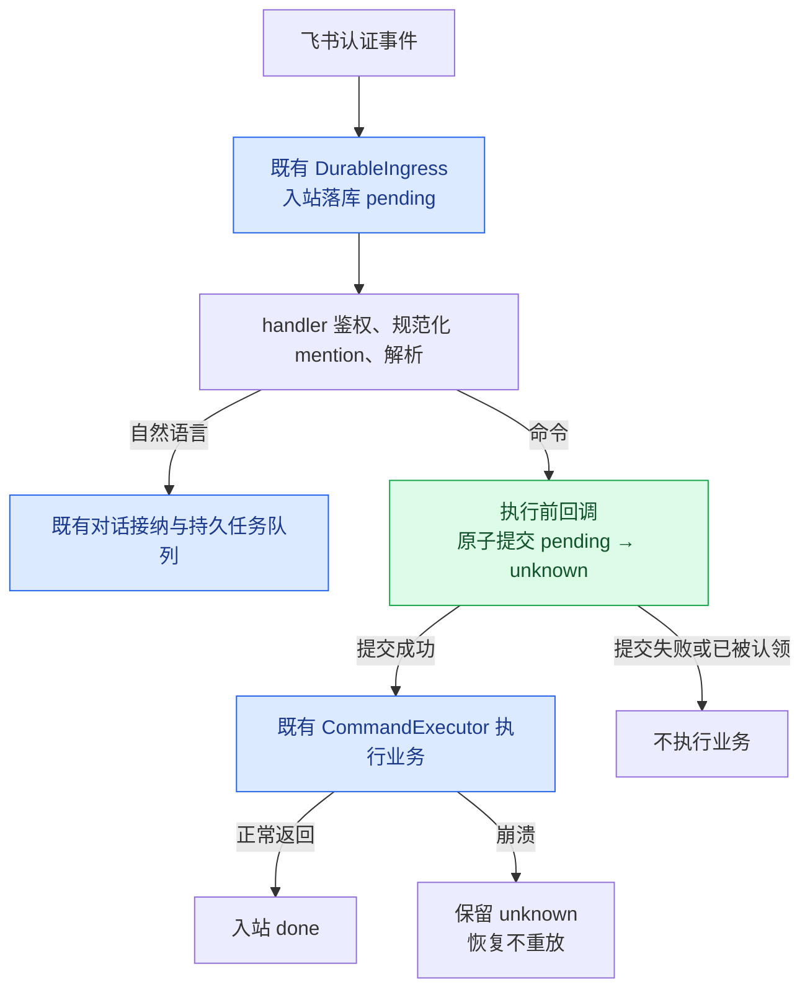
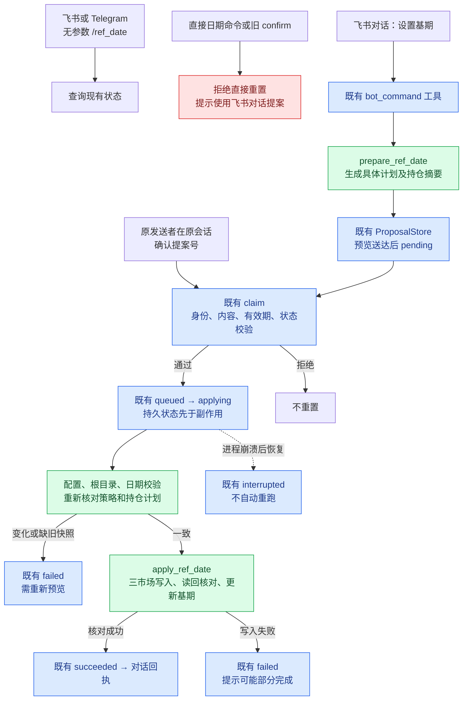

# G01/G02 修复：复用现有确认流程

基于 `9d8e4cab` 的本地修复；对应 [审计 G01/G02](critical_paths_coupling_audit_20261109.md)。G03–G05 未改，尚未提交或部署，原有脏改动保留。

## 最终实现

- **G01**：删除 ingress 的原始文本 slash 分类，由真实 handler 在认证、mention 规范化和命令解析后、执行前提交 pending→unknown。崩溃不重放；未进入执行边界的 NL 接纳失败仍可重试。使用现有入站表，没有新增队列。
- **G02**：删除 `/ref_date` 的直接重置、全局 pending 和专属 confirm 分支。无参数查询保留；飞书/TG 直接日期命令均拒绝并引导到飞书对话提案。重置功能保留在现有 `bot_command` 提案流程中。
- `prepare_ref_date` 只准备日期、三市场固定目标、绑定参数和当前持仓摘要；这些业务数据进入既有 command proposal。用户只需沿用现有“确认 <提案号>”，没有第二次专属确认。
- 已有 ProposalStore 负责 chat/sender、payload完整性、TTL、单次claim和中断恢复，源码未变。执行仅在既有 applying 分支发生；缺快照的旧提案拒绝，不现场补全授权。
- 执行前重新构建固定目标和持仓状态并核对；实际写入使用重建结果，不按 payload 的任意路径写文件。配置变化仍由原有 configuration_hash 拦截。
- 重置后读回核对，避免已有 save() 吞掉写入异常却报告成功。失败走原有 failed/interrupted 状态，不自动重放。

已撤销上一版新增的 CommandContext、RefDateConfirmationStore、专用数据库/锁协议及存储状态机测试；通用 dispatcher 和 Telegram 恢复原实现。不迁移旧 pending 为授权。

## 边界

三市场文件不是共同事务；失败可能部分完成，回执要求核查状态。此修复保证确认授权与同提案不可重放，没有扩展为全系统持仓写者的事务/锁协议。普通业务函数不另行维护授权状态，只有已确认的现有提案分支调用执行函数。

G01 是不重复执行边界而非“恰好一次”：提交 unknown 后、真实副作用前崩溃也不会自动重试。

## 验证

新增回归检查真实入站的普通/mention/富文本命令、崩溃恢复，以及现有 ProposalStore→确认→实际临时持仓写入。覆盖旧全局 pending 无效、换日期只生成提案、指定提案执行一次、跨身份/会话、过期/取消/预览失败、配置/策略/持仓变化、旧提案无快照、任意路径、保存失败及认领后崩溃恢复。

已有 ProposalStore 测试直接复用，不再维护第二套存储测试。测试 mock 外部发送/模型，真实文件操作仅在临时项目中，没有操作生产持仓或外发消息。

最终结果：**200 passed，116.16 秒，0 失败/跳过**；Ruff 和 git diff --check 通过。证据目录 `.tmp/g01_g02_simplified_acceptance/`（pytest.log / results.xml）。此前 222 项结果属于已撤回的方案。

本次业务源码相对原提交新增185行、删除190行，净删5行；不含测试、文档和原有脏改动。没有新增生产源码文件。

## 链路影响图

以下对应当前本地实现，尚未部署。绿色节点表示本次修改，蓝色表示复用既有机制，红色表示旧入口被阻止；图中箭头是调用或状态转换，不代表新增队列。

### G01：命令执行边界

旧链路的问题：ingress 按原文是否以 `/` 开头分类，handler 却在移除已认证 mention 后分类；`@机器人 /daily` 因此可能“实际执行命令、入站仍为 pending”，崩溃后重放。

入站 done 仅表示 handler 返回，不代表报告或邮件已经成功交付。unknown 在副作用前提交，因此提交后、执行前崩溃也不会自动重试。此变更只作用于飞书 DurableIngress，不为 Telegram 新增持久入站。

### G02：参考持仓重置

旧链路是“飞书/TG 直接命令 → 全局 pending 判断 → reset”，对话提案确认后也会回到这套独立判断。现在删除该独立确认分支，只有既有对话提案能进入重置执行。

此重置动作在现有 `_execute_confirmed` 分支内直接调用业务函数，不再绕回通用命令执行器。其他已确认命令仍走原 CommandExecutor；没有新增工作线程、数据库、确认状态或第二次确认。

| 影响面 | 当前行为 |
|---|---|
| 飞书直接命令 | G01统一执行前防重放；`/ref_date`修改入口停用，查询保留 |
| 飞书自然语言重置 | 具体计划进入既有提案，一次确认后执行；助手不可用时不能重置 |
| Telegram重置 | 直接修改不再可用；当前没有对话提案能力，须到飞书完成确认 |
| 旧提案 | 缺少具体 `reference_reset` 快照时拒绝；不能自动补齐后执行 |
| 报告/触发器/邮件 | 报告队列和通知分发未改；飞书命令入队前会经过G01边界 |
| 其他写入者 | 没有增加全系统持仓锁；跨入口并发和三市场部分写入限制仍存在 |
