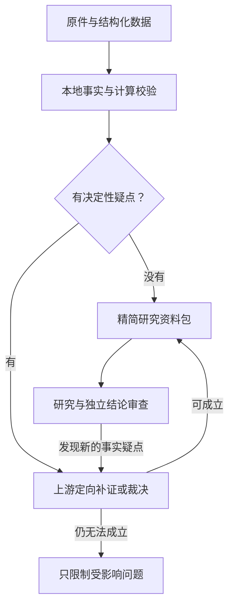

# 按研究问题验收资料

> 历史方法与验收记录：本文涉及的旧研究执行器及工具已退役；当前可运行入口见[退役记录](research_retirement_20261024.md)和[财报流程](../guide/financial_pipeline.md)。

七年是目标观察窗口，不是公司筛选条件。经营历史、上市历史、业务口径连续性分别处理。
资料验收只判断证据能支持哪些研究；不输出投资评级，也不代替研究与独立结论审查。



## 政策与硬边界

### 先判断重要性，再补数（2026-10-19）

默认 `valuation_materiality_threshold=0.05`，按整家公司股权内在价值判断，
不是按ROIC名次、费用规模或单个指标波动判断。上游给出有依据的估值变化范围，
代码用最大绝对变化除以正值估值下界；低于5%直接 `ignore`，停止该细节的补查。
同一公司多项未决影响保守合计，不能拆成若干小项绕线；已达到5%并不自动否决公司，
仍由上游选择保留范围、缩小问题或补证。未知影响不当作零，也不自动无限重试。

只在业务间移动既有金额、集团现金流及净资产不变，且整体估值方法不变的分类问题，
可以直接收口，不必为这个停止决定先估出公司价值。分部倍数、可分派权利、可扣减现金等
改变实际估值时不使用这个捷径。停止细分不证明经营ROIC排序，也不能将集团管理费加回现金流。

`ignore`裁决绑定原证据、政策和方法，保存 `materiality` 的依据及重看条件。
`follow_up=closed_immaterial` 取消同一问题的自动补查和重复裁决；新证据或裁决改变后可重看。
已有可用指标保留 `limited`；无可用指标时为 `omitted_immaterial`，不能当作已披露事实或支持精确排名。
错公司、错误单位、伪引用及计算错误仍隔离；停止补数不恢复隔离字段。
下游只收到停止原因和实际可用范围，不重新承担这项分类验收。主报告采用两三位有效数字。

这条规则不启动任何付费模型，也不恢复旧验收轮。离线测试验证执行规则，不能证明模型给出的
影响区间正确；经济依据仍由上游研究者及独立审查判断。

- `config/material_policy.json`：行业问题、依赖指标和目标窗口；不设置最低年数和填充率。
- 观察窗口优先使用同行组的 `history_years`，未指定时使用政策的 `target_history_years`。
- `config/material_review_prompt.md`：上游疑点裁决提示词，允许补证后支持、缩小范围、区间估算或阻断。
- 公司用 `material_profile` 选择普通企业、银行、保险、REIT或年轻科技企业；不由上市年数自动推断商业模式。
- 事实身份、期间、原文引用、单位币种、计算和披露时点仍由代码核对。负值不属于数据错误。
- 填充率、旧全年覆盖和MD&A覆盖继续保留在 `legacy_diagnostics`，不决定研究准入。
- 不制造上市前EV；当前价格快照与历史估值分开。A/H与转股口径及固定汇率没有因放宽年数而放宽。

## 接口

`MaterialPolicy` 保存版本化政策；`MaterialDecision` 保存逐公司、逐问题的
`supported / limited / pending / blocked / not_applicable` 及实际期间。
公司汇总 `usable / limited / pending` 仅描述可研究范围，不能当作选股结果。

`ResearchInputBundle` 只包含已接受事实、计算、实际财期、共同可比期间、必要限制和原文章节目录。
原文、失败记录和全部诊断保留在上游；资料包不发送填充率、解析失败列表或补数重试日志。
公司自身较长历史与同业共同窗口分开。CAGR按实际起止区间，现金累计只表示列明的已覆盖期间；
缺年度不补零、不冒充连续完整七年。口径断点不得被表述为已确认的有机增长。

`request_material_review` 工具把新发现的基础事实疑点送回上游并隔离关联依赖；
其他事实仍可研究。隔离记录随检查点保存，重启不会把待复核数值重新当有效输入。
新取得的财务资料也必须经过同一上游规则才能更新研究面板。

## 有条件的上游 Agent

`material_review.review_material_question` 没有内建付费接口。调用方没有提供 reviewer 时，
只返回待裁决请求，不调用模型；没有证据时不向 reviewer 发出空请求。
提供 reviewer 的调用方须使用有效授权、统一费用账本和截止时间。
成功与失败都按相关证据、政策和提示词内容缓存；相同错误不会自动重试。

裁决只处理指定问题，引用绑定冻结证据哈希；估算与披露事实分开。
结构校验通过只证明格式、依赖和引用绑定，不证明会计解释正确。
缺乏必要的真实语义审查时保持待裁决，不能用模拟回答声明Agent验收通过。

## 离线验收

```powershell
python -X utf8 scripts/accept_research_materials.py
python -X utf8 -m pytest tests/test_material_policy.py tests/test_material_review.py tests/test_research_material_replay.py tests/validation --basetemp .tmp/material_policy_tests
```

默认读取冻结的 `materials/2026-10-18`，独立写入 `material_policy_acceptance_20261018`。
脚本不调用 prepare/acquire，不下载、不发通知、不修改线上入口、不启动付费研究。
报告给出真实原件哈希核对、旧诊断与新可用范围、共同期间以及仍待建立的EV/NOPAT口径。
离线回放与单元测试通过不等于真实付费研究或Agent语义裁决通过。

新准备任务冻结政策全文并输出 `material_decision.json` 和 `research_input.json`。
旧检查点和旧付费账本不覆盖；方法或证据改变时需要显式的新检查点，不能借此重置预算。

## EV / NOPAT 自动补证与计算

正常 `prepare_comparison` 与研究工具安装新增资料时，都会运行
`enterprise_materials.augment_enterprise_materials`。该步骤复用冻结原文，补取
合并口径税前利润、所得税、利息、债务、现金、总权益和少数股东权益，再接入
同一资料验收决定。它不调用模型，也不替代正常化或投资判断。

- 报告口径 NOPAT 使用 `(合并税前利润 + 费用化利息) × (1 − 所得税费用 / 税前利润)`；
  无可用税率时不默认25%，中期金额不自动年化。投资收益、利息收入及公允价值变动
  保留在报告口径中；另外列示剔除情景，不能未经研究就把项目融资利息视作闲置现金收益。
- EV 使用全股份类别市值、少数股东权益、其他权益融资、有息负债和可扣减现金。
  合并与母公司、现金等价物与货币资金、长期应付款与融资性应付款分开。
  资产增加额不能替代现金Capex，资本化利息不重复加回费用化利息。
- 能由披露建立范围时给出上下界及计算依赖，不生成中点。使用总负债等宽上界时明确
  它不是实际融资负债估计；采用报表项目合计残差时展示该口径的条件及局限，
  不把空白行写成原始披露的零。
- 历史EV单独保存实际年末价格日期及当时已披露的资产负债表日期，不用当年后来
  披露的年报回填历史估值；当前EV不能冒充历史EV。
- 输入事实或计算有冲突时只隔离受影响部分；区间端点被要求复核时整个区间暂停，
  重启不会恢复为有效输入。普通历史不足仍不构成全公司硬阻断。

本地文本层缺失时，可对已有、哈希核验的合并报表图调用 Windows 本机OCR。
保留页面、图片哈希、字词坐标和OCR版本；OCR数字还要经过金额、期间和勾稽校验。
OCR不可用或数字冲突时显示具体原因，不猜数字、不回退到付费视觉服务。

原文提取缓存绑定原件、既有数值依据、披露适用性和解析/OCR方法，不因每日价格变化
重复提取；估值计算仍使用本次价格。历史冻结包保持不变，新快照独立输出。

```powershell
python -X utf8 scripts/backfill_enterprise_materials.py --output data/fundamental_quant/enterprise_materials_20261018_final
```

此入口核验原件及输入哈希，输出补证、计算、可用范围和HTML；不会下载、发邮件或调用付费模型。
完成后重复执行复用同一快照，输入或方法变化则要求新输出目录，避免覆盖原验收记录。

## 长期同行数值比较验收（不调用付费模型）

`enterprise_gaps.build_enterprise_gap_inventory` 将来源状态和研究影响分别记录：
合并金额附注明确无或不适用、原文明示未披露、已核对报表空白、解析失败、
尚未定位、来源冲突、分类待确定和当期原件未缓存。只有绑定公司、期间、
原件哈希与真实页文的收据才可称作原文明示；搜索没有命中不能升级为未披露。
同时标明目标年度、最新中期或历史上下文，避免把非必要旧期当作本轮硬缺口。
有效聚合金额或区间已覆盖的单行空白保持可追溯，不重复提取，也不改为原始零值。

每份补数快照增加 `gap_inventory.json/html`。长期比较消费已验收面板和必要口径限制，
通过入口链接回上游缺口页，不在研究侧重新判定数据验收。

```powershell
python -X utf8 scripts/backfill_enterprise_materials.py --output data/fundamental_quant/enterprise_materials_20261018_longitudinal
python -X utf8 scripts/accept_longitudinal_comparison.py --source data/fundamental_quant/enterprise_materials_20261018_longitudinal --output data/fundamental_quant/longitudinal_comparison_acceptance_20261018
```

比较入口不构造付费客户端，实际禁止socket连接。每组生成多年折线、年度与中期分表、
相同FY窗口的累计现金转化、CAGR、BVPS精度区间、资本与现金流计算、EV及其余额财期，
并保存可复算的引用和检查回执。管理层讨论按公司、财期提供完整原文章节入口。

- CFO转换率使用同窗合并净利润分母，不与归母净利润混用；负现金流保留。
- 七个年度点只产生六个CAGR增长区间；缺年只合计列明的已覆盖年度。
- 不同公司的排名使用共同期间和相容币种口径；一般重述保留reported数值与限制，
  不因此隐藏整组已披露数据，也不把reported增长称为有机增长或护城河。
- 资本收益比要求可用的期初、期末平均投入资本；期末资本不能冒充平均资本。
  资本区间跨零时不生成有限收益率，中点与精确排名不能从宽区间臆造。
- 历史EV显示价格日期、当时可用余额财期及间隔；无未来泄漏不代表旧余额适合横向估值排名。

这里通过的是财务数值、资料入口与可比范围验收。正常化、因果解释、经营持续性与
潜在错价仍需要后续研究及独立审查，不能用本地模板冒充DeepSeek研究结论。

## 同一披露版本的测量范围（2026-10-18）

`enterprise_metrics/6` 在全局面板无法勾稽时，才尝试按公司、期间、币种、合并范围、
文件及披露日选取完整的测量版本。优先完整的重述比较期；没有整套重述报表时，
允许使用完整原刊，但明确标记 `original_nonlatest`，不能称为最新调整后口径。
权益、少数股东权益、债务、现金和NOPAT所需税费及利息均在同一版本内计算。
缺失字段不从其他文件或母公司表补入，也不把已知债务从版本收据中删去。

- 五粮液、贵州茅台2021：后续摘要仅更新部分净资产，未取得整套同刊重述输入；
  使用各自2021年报原刊，不将调整后归母净资产与原刊少数股东权益拼接。
- 中国交建2023：使用2024年报的重述比较期。OCR一侧单元格损坏不再丢弃另一侧
  独立可读的比较期数字；不猜写损坏数字。资产侧不可读时，使用原表实际披露的
  `balance_sheet_total` 检查负债加权益，保留“非独立资产侧交叉验证”限制。

资料合同与研究输入升为版本3：`measurement_cohort` 绑定完整输入、原文位置及哈希。
旧事实仍留在冻结包；在全局最新面板被隔离的旧引用不能作为普通数值重新使用。
只有已验证计算可以局部依赖该同刊数据。`measurement_cohort_inputs` 保存原始输入
作为上下文，`standalone_numeric_use=false`，与全局 `facts` 分开。
来源真实性、算术及复核隔离的失败均不能被该例外覆盖；研究工具重启后仍执行隔离。

这类测量版本不用于当前或历史EV。跨年资本收益比仍要求期初、期末资本和当期NOPAT
口径相容；未有桥接时不因单年资本补齐就恢复跨版本ROIC或精确排名。BVPS仍按全局
已选择净资产和股数计算，报告分别标明BVPS与资本测量版本。

新快照与比较验收使用独立目录，旧冻结资料及费用账本不变：

```powershell
python -X utf8 scripts/backfill_enterprise_materials.py --output data/fundamental_quant/enterprise_materials_20261018_cohort_aligned_final
python -X utf8 scripts/accept_longitudinal_comparison.py --source data/fundamental_quant/enterprise_materials_20261018_cohort_aligned_final --output data/fundamental_quant/longitudinal_comparison_acceptance_20261018_cohort_aligned_final
```

`enterprise-original-recovery/16` 将两侧表格单元格的日期确认分开：比较列日期损坏时
只隔离该列，不拒绝已由原页确认的当期列。这保留了中国交建2026中报的已验证金额，
同时维持错误OCR权益合计的隔离。runner版本6将现价EV区间按其明确的余额财期匹配
验收收据，不因挂载行的财期不同而误报失败。历史EV表同时展示实际余额日期、账龄
及过旧限制，不能把合法但陈旧的余额视为同步可比的EV。

## 同刊期初、期末与NOPAT的回报计算（2026-10-18）

原有 `measurement_cohort_bridge_required` 只说明程序未取得三点同版证明，不能据此
声称原文缺少重述桥接数据。新增 `enterprise_returns` 从目标公司的同一份年报中，
配对期初资本比较列、期末资本及当期NOPAT；普通比较列不再被当作不合法的重述版本。
同刊当期、普通比较期和明确重述比较期分别标注，不要求三者的标签字符串相同。

生成的 `ECR` 同刊测量独立保存，不替换年度NOPAT、投入资本、BVPS或EV：

- 逐项绑定公司、实际财期、币种、合并范围、同一文件、披露日、公式和原文引用。
  计算 `NOPAT / ((期初投入资本 + 期末投入资本) / 2)`；区间用全部端点组合求界，
  不制造中点，负NOPAT如实保留，平均资本含零或非正时不生成有限回报率。
- 披露的1月1日期初余额保留实际来源日期；横轴映射到上一年末不声称等同旧版年末数。
  同一组件的资产、权益、债务及现金不能混用不同余额日，期间流量不作期初余额。
- 中国交建2024的少数股东权益单元格损坏时，仅将同页披露的总权益减归母权益作为
  局部核对残差，并说明缺少独立NCI读取。投入资本直接使用披露总权益，不伪造原始NCI。
- 上游按基本事实、来源隔离和公式重新核验，额外注入的 `base/value`、改写版本或
  跨日期依赖不能通过。旧事实只在各组件对应的上下文内使用，不能恢复成全局事实。
  端点复查会隔离整条ECR，工具重启后仍生效。
- 下游只消费上游接受的 `capital_return_measurements`，只替换原受限的同年回报记录。
  原全局年度面板保留；报告展示三组件金额、实际余额日、出处及原有宽区间限制。
  这仍是报告口径回报代理，不是正常化经济ROIC，也不据区间中点开放精确排名。

```powershell
python -X utf8 scripts/backfill_enterprise_materials.py --output data/fundamental_quant/enterprise_materials_20261018_roic_aligned
python -X utf8 scripts/accept_longitudinal_comparison.py --source data/fundamental_quant/enterprise_materials_20261018_roic_aligned --output data/fundamental_quant/longitudinal_comparison_acceptance_20261018_roic_aligned
```

本轮仅使用原始资料缓存和本地代码；旧报告、事实、费用账本及原件均保留，不启动付费模型。

## ROIC 区间来源与首次执行日期更正（2026-10-18）

后续原图核对发现，上述旧快照的两家公司2021年期初租赁字段有日期误标：
首次执行新租赁准则的2021年1月1日金额，不能作为未重述的2020年12月31日金额。
旧快照保留为更正前历史输出，不代表已证明这些源日期正确。新处理读取首执合并
资产负债表的原页列位置，分别保存旧年末、新期初和调整数；新期初只进入同刊期初
测量，不能替换全局上一年度年末。原错误事实保留审计，仅隔离准确命中的事实ID。

现金等价物附注按所属子表确定日期和单位；同刊明确披露的期初现金独立保存。
不会将上一年现金流量表期末余额自动当成新政策下的期初值。完整流动负债表用于
约束融资债务上界：仅扣除明确的预收、合同、员工、税费及递延项目，未分类的票据、
应付款及财务子公司存款仍保留范围；空白单行不是披露零值。仅在已核验同刊测量内
使用这种拆解，禁止拿不同刊次的负债表去缩窄市场时点EV或混合版本面板。

`capital_bridge` 保存权益、融资负债、所扣现金及各自对区间宽度的贡献，连同原始
来源日接受公式重算。比较页展示更正前后六处同刊回报区间，不生成中点，不将
identified-interest 盈利代理包装为完整融资中性、正常化经济ROIC，也不开放精确排名。
其他年份只有在相同证据条件成立后才适用，不能声称所有普通年度区间都已自动收窄。

资料验收版本5与研究输入版本5区分期初专用事实、当前有效事实和历史纠错记录。
来源修复收据、事实ID与实际来源日期参与缓存键和验收输入哈希，重启不复用已失效
的更正关系。所有更正使用新冻结目录；旧费用账本不变，本轮不调用付费接口。

期初隔离也不能造成新的资料遗漏。若同刊主要会计数据摘要明确列有某年“年末、
调整前、调整后”的独立金额，应从该表另建实际年末事实，保留摘要列和原文引用，
而不是解除Jan1隔离或永久退回旧版金额。五粮液及山东路桥2023年报的2022年末
调整后净资产即属于这条路径。资料完整性复核必须检查这种可直接补证的来源；
仅验证当前选定数值的算术一致，不能证明没有漏掉较新且适用的披露。

比较层版本5还修正一个传播边界：全局面板缺值或可比范围不明，不等于上游独立
同刊测量不可用。唯一且完整的已接受ECR可以替代相应受限回报，保留`replaced_status`，
不补齐或修改全局原始事实；目标窗口、截止、来源上下文与全部公式仍须通过。
已有可用全局结果或真实非正资本结果不被覆盖。全局NOPAT行完全缺失时同样检查
窗口内的独立测量，避免因循环没有该行而静默漏掉可用结果。

## 负债性质附注与金融业务配对（2026-10-18）

负债表中的“应付款”名称并不能证明其全部为融资。资料层按同刊、同公司、同币种、
同实际资产负债日保存性质子表、完整子项、附注合计与报表父项；完整子表求和、
父项包含关系、披露精度和原文逐行定位分别校验。明确的应付货款、待转销项税、
形象宣传费及促销费可以作为已披露经营负债扣除融资上界。账龄表、保证金、往来、
冻结或代收代付款不因名称被强制归类，仍列金额及独立敏感性。附注合计若不含
报表父项中的股利，不得将整个父项一并扣除；父子敏感性不可叠加。

联营财务公司的存款资产与并表金融子公司的吸收存款负债必须分开。并表吸收存款
只有在相关方余额表、正存款利率、合并范围与同刊费用来源支持时，才作为已识别
融资资金；同时桥接营业总成本内的金融利息与财务费用内的利息，不能只改资本分母。
这仍使用集团实际税率作为代理，不宣称完成金融业务分部税率或经济资本正常化。
现金扣除和保留利息收入的组合另列有条件敏感性，不能自动全额剔除利息收入。

上述分类仅进入已验证的同刊回报测量。有效附注可以触发同刊测量，无需先命中旧
重述异常；完整且经核对的同刊测量可作为对应年度的显式优先展示，保留原全局
结果与采用理由，不回写历史市场EV、不跨刊拼接，也不替换真实非正资本结论。
各分类情景重新执行完整约束树及四角回报计算，保留原始金额、实际来源日和引用；
不扣减最终上界代替约束重算，不生成中点，不把单项百分点变化相加。

提取缓存及离线冻结输入同时绑定来源代码和负债附注辅助模块哈希，代码改变后
不能仅因版本字符串未变而复用旧提取。本轮仍是本地资料和确定性计算回放，
不启动模型、付费预算、通知或部署；实际验收结果保存在新冻结目录与独立回执。

## 现金与应付款宽区间的解释（2026-10-18）

金额不确定性与经济定义敏感性必须分开。已经采用原文披露现金及现金等价物的
测量，不能把全部现金是否属于经营外资金的疑问描述为现金缺数。货币资金的
银行、财务公司及其他分项，以及受限资金、应计定存利息到现金等价物的桥接，
只在同刊、同公司、同实际时点、原文金额与合计均核对后展示；已从现金等价物
中排除的项目不能再次扣除。关联交易存款余额与货币资金附注口径不同，未经
桥接不得相互替代或相减。

监管商品款项、保证金、一般应付款等，仅有项目名称与金额不等于融资或经营
性质已经成立。单列应付股利的来源金额可以定位原先的父项残差，但不得仅因
无息而扣除；宣告分派已影响权益、现金尚未支付，需要对分派义务采用一致的
资本口径。敏感性先从未定融资上界中移出该金额，再作为分派资本请求权加回
一次，不能在已经含该金额的上界上重复加回，也不能同时扣现金。

现金不扣除的对照保留原分子，并从已验收的权益、融资及现金公式重算；它仍
不是剔除金融投资收益后的经营ROIC。同行相对位置只在共同实际期间、相同
数学定义下讨论，标明披露版本限制与业务合并范围；区间重叠不能强行定序。
若相对位置随现金定义反转，不能据原高回报端点宣称经营质量更优。原始财务
事实、主测量与这些条件情景分开保存，不形成新增的研究准入硬门槛。


## 同行统一现金／应付款情景（2026-10-18）

新增独立补充视图，不扩张既有 canonical 同刊测量 allowlist，不回填原面板。
研究范围由 ComparisonSpec 的公司、截止日和目标观察窗口推导；每家公司每年只使用
该年度当期年报内的利润、期初和期末资本。更晚更正版本缺关键字段时不能退回较旧
容易通过的版本，也不能混入截止日后披露。资料不足只限制对应年度，保留具体原因。

共同年度分别计算“保留全部现金／扣除已披露CCE”与“已验融资约束下界／上界”四个
条件端点。已确认经营项、融资项及总额约束均保留，不能简单把全部应付款归一类。
股利维持所属父项约束，不重复加回；缺失金额不视为零。使用全区间，不计算中点。
端点只是数学政策情景，不能据此宣称融资结构或富余现金判断已经由原文证明。

区分：同一融资端点下的数值顺序，与允许每家公司采用不同融资分类后的区间支配。
只有后一种支配在现金扣除比例两端均成立且分母均为正，才称对整个共同现金政策
区间稳健；其依据是固定分子下交叉相乘差值对现金扣除比例为线性。区间重叠不代表
相等，未见端点反转不代表顺序已经确定。负利润可正常计算，非正资本不钳制为正数。
这些是集团披露口径资本回报代理；金融子公司合并范围、利息收入和资本正常化判断
仍保留，不能升级为工业ROIC、护城河或投资质量排名。


## 金融影响剥离与经营口径边界（2026-10-18）

新增独立、可重跑的已识别金融资产/收益剥离视图；原始集团面板和同刊测量不变。
不能把财务公司51%持股、注册资本、单体资产或利润直接当作集团合并金融贡献。
金融联营只剥本公司投资账面值和确认收益，保留税收口径的条件敏感性；总投资收益
可能含票据贴现及经营联营，不得整项当金融利润。OCI不是当期收益。

集团IC=E+D−CCE。剥合并金融资产时必须识别其与CCE的交集，不能再额外扣customer
 deposits。若完整金融块可获得，应扣E_F+D_F−CCE_F；按资产路径则是
A_F−L_F(nonfinancing)−CCE_F。当前可得的是部分金融资产与收入，不宣称完整industrial。
已加回金融付息的集团NOPAT，剥已识别金融利息/手续费块应撤销该加回，等效扣除
金融利息收入减手续费，再采用明确的集团ETR情景。金融管理费用、减值、税和抵消
未分配不等于零；权益法收益的两种税处理是敏感性，不是已证明实际税的上下界。

资金池、同业、repo、法定存准须互相勾稽：存准已在资金池内，不能重复加；净账面
减CCE的残额含减值和不同金融资产，不直接命名为不能随时支取的存款。仅两侧有
同刊证据的资产进入平均资本剥离；单侧金额单列。Jan1 opening不能以相等的前
Dec31 comparative替代，该问题只限制受影响年度的新增金融桥接。

报告分别列可证资产剥离结果和未分配流动剩余的用途敏感性；资本接近零导致的高
端不应被解读为经营优势。单项推翻阈值是算术边界，不是概率，也不是各调整可以
同时发生的证明。当前完整共同窗口FY2024–25，其他历史事实仍保存供后续补桥。

### 期初金融桥接补齐（2026-10-18，替代上述FY2024–25范围限制）

`financial_opening_sources.py` 为独立、只读的原文恢复层。老窖、五粮液FY2022/23
使用当刊明确Jan1余额、当年现金流期初CCE及联营附注期初列；原数据年度轴保留，
不以旧刊Dec31金额相等推断口径一致。引用绑定公司、披露版本、单位、金额、真实
表头和页码；不同列、母公司、伪表头或raw/value不一致均不能通过。

茅台BS比较列保留上年Dec31，现金附注保留当年Jan1期初角色。仅当同刊政策、估计、
差错更正及首次执行调整的原文证明适用指标未受影响时，建立相邻会计边界桥接。
2023解释16的税/权益重述不延伸到现金与repo，权益和税仍采用本刊重述数。
2025政策栏移至“重要事项”的明确交叉引用也必须解析到实际目标，不以未匹配
等同无变化。对未知或涉及该指标的变更，仍限制相应指标。

repo/CCE空栏不改写成披露零：仅在完整表格所有已识别非负分项与总计Decimal精确
闭合、物理列位置及元/CNY单位可验证时，另存 `derived_source_bound` 约束及完整
求和输入。重建证明后才准进入计算。9条派生约束与原文空栏分开保存；未经重建的
派生标记不能绕过来源校验。旧财报事实、已验收测量和报告均不覆盖。

最终离线入口：`data/fundamental_quant/liquor_financial_opening_bridge_20261018_final/index.html`。
共同窗口FY2022–25，12条公司年度记录、12组同年比较，原6条成功记录的关键值不变。
两组集团长期面板另行重跑，链接在该报告顶部；不得将集团口径与金融剥离口径混排。
剩余单体成本、税、抵消和流动资金用途判断仍公开保留，不宣称完整工业ROIC。

### 金融成本、实际税与抵消的分项边界（2026-10-18）

`financial_attribution.py` 消费冻结的资料和同刊测量，不重新下载或调用模型。信用减值
按利润表符号：正贡献剥离后降低核心代理，负贡献剥离后提高代理；“其他主要是财务
公司贷款”不等于完整金融成本，也不从下一年重分类比较列倒填当刊。金融联营确认
收益已是净损益份额，全额剥除；发行人增量税另记未知，不再把整个Y机械乘集团ETR。
联营被投资方费用已在净损益内，不能再加回发行人核心利润，股利亦不重复计收益。

仅对明确已剥离的金融资产处理相关税存量：金融减值DTA共享“资产减值准备”一份
gross预算；已剥基金对应DTL回加资本，先检查原债务上下界没有已计入该DTL。
未单列的期初基金DTL可在同刊gross DTL内分配，0是分配端点不是原文空栏的事实值。
这些是已列类别的保守外包络，不代表全部金融税余额或每个角同时可实现。DTA/DTL
余额和变动不能直接当本期所得税费用。

金融管理成本、实际当期/递延税费用、剩余资本与抵消未单列且无法建立可靠有限界时，
保存上下界null，不用集团净费用、集团税费或0–25%伪造界限。保留原集团ETR作为明确
条件情景，另给每次仅改变一项的“税后核心利润首次接触阈值”；固定ETR税前成本阈值
须除(1−ETR)，不是已披露成本或可能性。所有完整会计口径排序保持not_identified。

离线入口：`data/fundamental_quant/liquor_financial_cost_tax_20261018_final/index.html`。
附注原文、437条成本税源记录、8份联营税及抵消资料保存在同一不可变报告目录，长期
复用，不依赖临时源清单的后续存续。12年度记录/12比较/8阈值，代理关系变化0；553
测试及2,584项独立来源/Decimal检查通过。无付费接口、通知或部署变更。

### 接触阈值与集团披露金额的对照（2026-10-19）

新增 `financial_thresholds.py` 和 `scripts/compare_financial_thresholds.py`。集团管理费、
当期税、有符号递延税、总税只作同刊当期金额背景，不成为金融分摊额或金融金额上界。
税前成本阈值=税后核心利润接触额/(1−集团ETR)；G×(1−g)仅是同口径量级，不加回利润。
权益法被投资方费用已在剥除的Y内，不能另加回发行人利润。

税敏感性使用已识别金融贡献F，而非集团税额：双方统一T_F=0，ΔN=−gF；利息税盾和
其余残差保留参考约定。0是情景，不是实际税为0，也不是最坏界。单靠T_F变化触碰原
支配关系需较高方T_F*=gF−下降阈值、较低方T_F*=gF＋上升阈值；负值保留为净税收益，
不得取绝对值改称税费。这些值不证明归属、可达性或实际反转，F也不是完整金融PBT。

本次8条税前成本阈值为低方上市集团管理费的2.4588—22.6550倍。只按此量级最接近的
FY2022茅台/五粮液，低方需净增56.8693亿元，固定ETR税前75.4382亿元，对照G=30.6812
亿元；若仅变税归属，低方T_F约61.9786亿元或高方约−97.3865亿元才首次接触。没有相应
归属见证，不能因集团税同量级就认定可实现。达到接触点不等于反向区间支配。

实际离线入口 `data/fundamental_quant/liquor_threshold_context_20261019_verified/index.html`：
48个源值/24完整章节/12同刊年报；统一税情景后仍8分离、4重叠。完整会计排序未知，
未将集团额写入金融业务，也未重复使用已入基线的信用减值与税资本调整。569相关测试
通过；报表高/低方显示顺序与原first/second相反时，关系标签须显式换序，已设反例。
