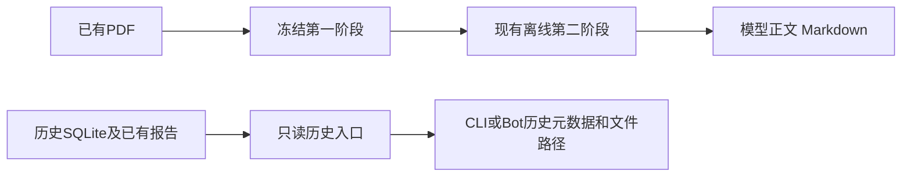

# 旧研究执行入口退役与历史只读边界（2026-10-24）

用户确认的范围：退役现行数据流程之外的旧研究入口，保留历史文件及必要读取能力。
本轮不接入LDA或其他统计模型，不调用付费API，不开发替代研究链路。

## 退役时的数据结构（2026-10-24）



退役时保留数据实现 `src/fundamental_data`、当时的数据命令、schema/prompt/示例、tokenizer及既有产物。当前提取、整合、摘要、交接与正式研究入口见[财报流程](../guide/financial_pipeline.md)及[正式研究指南](../guide/research_report.md)。
助手通用工具、技术策略、优化器、行情/PIT接口、回测和共享Pi桥保留，未按research名称批量删除。

## 删除与保留

| 范围 | 清理前 | 清理后 |
|---|---:|---:|
| `src/fundamental_quant` Python文件 | 110 | 4 |
| 包内物理行 | 58,562 | 198 |
| 正式旧研究/实验/补修/发布/调度脚本 | 32 | 0 |

包内107个旧文件物理删除；service/reporting改为只读，新增archive读取器。
剩余文件：archive.py 93行、service.py 53行、reporting.py 49行、__init__.py 3行。
完整依赖只使用标准库和包内只读archive，没有把旧引擎改名移到辅助包。
这不是新研究链路或此前五脚本研究框架的交付。

已移除纵向同行研究、整份比较、Pi研究包装、价格benchmark、补修/审查/发布、旧材料回填、旧模型适配器、worker和任务安装器等32个正式入口。
逐文件清单与删除证据：`.tmp/research_retirement_20261024_131928/deletion_plan.json`。
六份不再被代码引用的研究配置/提示文件一并归档后移除；当前配置和配置例子仅保留历史目录选项，其他配置值核对不变。

旧专属测试152个文件退役；8个混合数据/PIT测试文件只删除旧研究相关的12个函数和少量门槛/渲染断言，保留解析、缓存、缺失处理和PIT范围检查。
测试数据、历史PDF、报告、响应、SQLite和方法参考文档保留。

## 历史读取

旧status/query/report曾通过重验、ResearchStore初始化、写事务和报告渲染间接修改历史，同时导入模型及研究引擎。
现在SQLite通过`mode=ro`访问，不迁移、不重验、不撤回、不重写报告，也不将历史published状态解释为当前有效建议。

```powershell
python main.py --fundamental-quant-status
python main.py --fundamental-quant-report
```

以上只返回历史元数据、原状态、版本、数据库定位及已存在的报告路径。`/fundamental [代码|status]`保留同样的历史读取边界。
研究、旧混合材料和周通知CLI继续返回明确退役错误、非零退出，不调用模型或发送消息。
Bot不会把保存的过往结论作为新的投资建议输出；原始报告内容仍保存在历史文件中。

实际旧库只读核对：6,001家公司记录、6份纵向报告、3个旧PDF会话可读取，数据库SHA-256前后相同。
根目录已有index.html、report.json、report.csv、research_notes/index.html路径均可返回。

## 自动启动边界

核心调度器不再生成旧FQ日任务/周任务；旧配置即使enabled=true也不能恢复。
启动/重载会移除旧FQ任务，保留正常日报、简报、优化及其他独立任务。
旧任务ID、CLI参数或brief别名不能绕过入口退役。

本机发现的任务 `TradeEyesKeeper-FundamentalQuant` 已核对为仅执行本仓库旧worker：
先保存XML，再停用、结束并删除；后续查询确认不存在。旧worker PID5008当时无子进程，任务结束后确认无此入口进程。
未停止或重启主交易/助手服务，未执行部署；已加载旧源码的其他进程不据此宣称完成热更新。

## 验收与恢复

- 主回归387项通过，包括退役CLI、只读历史、Bot边界、调度、当前数据API/V2/模型正文及validation。
- 另对保留的8个混合数据/PIT套件运行135项通过；与主回归有重叠，不将二者相加。
- 完整tests目录收集无旧模块导入错误；其余Python源码静态解析无悬空旧研究导入。
- 第一阶段、现行第二阶段及已有数据产物1,669项SHA-256保护检查无变化。
- 除明确指定的调度和历史读取提示外，无其他生产源码变化；技术面实现不改。
- 所有删除前源码（包含原有未提交修改和未跟踪文件）已保存在可恢复ZIP中；未执行Git reset或广泛覆盖。

源码及测试原字节备份：`.trash/research_retirement_20261024_131928/before.zip`。
旧配置备份：同目录`retired_configuration.zip`；计划任务备份：`scheduled_task.xml`。
范围、哈希、依赖和JUnit记录位于`.tmp/research_retirement_20261024_131928/`。

## 统计模型的后续边界

统计方法可作为独立的本地相似段落候选筛选，不需要成为新服务或改变第一阶段契约。
是否引入应由已有样本上的重复识别效果决定。本轮未增加统计依赖、模型训练、向量库或自动删除逻辑。
正文中的确定重复仍应通过明确口径与原文复用处理；主题相近不能直接作为删除财务内容的依据。

## 文档合并清理（2026-10-29）

依据现存四个只读模块、CLI 退役分支及已删除执行脚本，移除以下八份被替代的模块说明：

| 原文档 | 合并原因 |
|---|---|
| `fundamental_quant.md` | 旧“当前入口”仍描述可写重验、报告生成和通知，与只读实现冲突 |
| `fundamental_research_skill_pi.md` | 专用 Pi 研究与独立复核执行器已移除 |
| `pdf_research_sessions.md` | 旧 PDF 会话执行链的退役边界统一由本页记录 |
| `ordinary_cash_research_chain.md` | 旧 EvidenceTools、现金桥工具及报告投影实现已移除 |
| `fr_material_packs.md` | 旧 build_fr_packs 入口已删除，数据解析归入现行数据流程 |
| `reference_review_automation.md` | 纵向研究自动引用复核与发布执行器已删除 |
| `fundamental_entrypoints_after_cleanup_20261023.md` | 10 月 23 日中间快照已被 10 月 24 日最终退役覆盖 |
| `design/fundamental_research_five_scripts.md` | 未实现的旧引擎收敛方案已被退役取代，不作为现行方案 |

删除前全部 Markdown 原文件保存于 `.trash/documentation_cleanup_20261029/before.zip`；相关现行链接已指向本页。历史验收、复盘、报告和模型响应保留原本含义。旧研究方法参考文件中遗留的工具名也不代表当前助手实际注册了这些工具；通用助手 Pi 桥仍独立保留。

本页记录的是旧研究模块退役。公共运行层已经部署、本机测试任务主动停用、旧测试源码尚待阶段二退役是另外的状态，见[公共层迁移记录](shared_runtime_migration.md)。

## 2026-10-30 保留争议源码的后续决定

用户最新要求保留仍在链路或有争议的旧基本面源码。源码合并因此保留55个线上旧文件并显式隔离旧渲染/纯助手接口；没有恢复当前main/runtime/Bot的旧研究执行、调度或外发，历史壳和blocked行为仍保留。本文原删除/退役记录是当时事实，不能据它声称这些争议文件现在物理不存在。详见[最新合并实施记录](local_preferred_merge_scope_20261030.md)。已明确终止的35个源码路径及无消费者旧optimizer.yaml仍删除。
