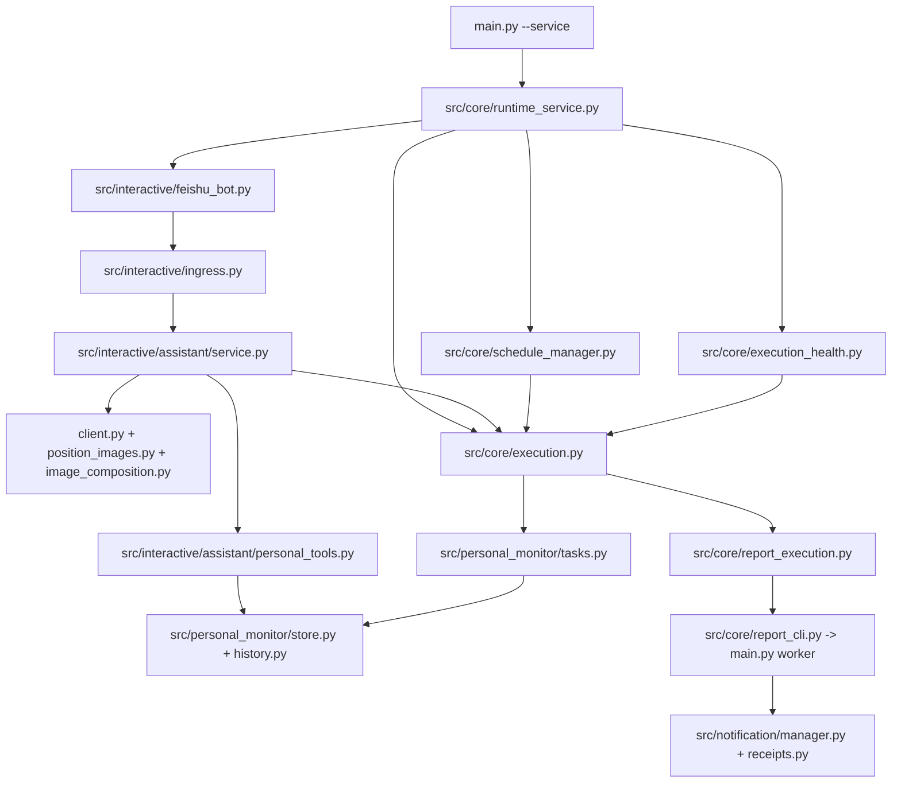

# Shared runtime migration — scoped release, 2026-10-28

## Release boundary

This release migrates real-time Feishu conversations, personal holdings/reminders,
daily reports and morning/afternoon briefs to a shared durable executor. Research,
collection, optimizer logic and production schedules retain their existing owners
and behavior. No external queue, management listener or permanent process is added.
Existing production overlays are merged by filename/hash rather than replaced by a
repository-wide checkout. The local working branch contains unrelated unpublished
work; the release commit is built directly on the published branch.

## Code dependencies

Before migration the bot consumer, monitor clocks and report launchers maintained
separate execution ownership. Afterwards SQLite records admission, ownership and
terminal results; memory events only wake the dispatcher. APScheduler supplies
scheduled instants to the same executor used by Bot and CLI entry points.

## Contracts

* Admission, incoming-message deduplication, conversation persistence and enqueue
  commit together in the assistant database. A failed transaction admits nothing.
* Two different conversations may execute concurrently; each conversation remains
  ordered. Turn context, harness, cancellation and image diagnostics are isolated.
* Report execution stays owned until the worker actually finishes. Results
  distinguish succeeded, skipped, failed, partial, unknown and data-not-ready.
* Already-written or sent work is not blindly replayed after owner death. Delivery
  receipts preserve uncertainty; a zero process exit is insufficient evidence.
* Disable fences admission and drains work. Failed configuration retains the active
  version. An unkillable Python thread retains its capacity until it returns or its
  process is proved dead. Service restart remains owned by the existing systemd unit.
* Holdings retain their business transaction/outbox and one-shot semantics. Thresholds
  are stored configuration, not hardcoded 5.5%/5%. Undo and redo create audited account
  versions; ambiguous screenshots require confirmation and cannot overwrite newer data.
* Health alerts use the originating conversation or an explicit health_alert_chat_id.
  A wildcard allow-list alone cannot select an alert recipient.

## Acceptance and evidence

The private acceptance ledger retains fixed M01–M18 identifiers. A check means an
actual recorded result with code paths, command, source hashes, time and evidence;
historical passes are not automatically inherited by a recomposed release. Failed,
interrupted, partial and unverified attempts remain open and retain their evidence.
Private account data, credentials, screenshots and acceptance databases are excluded
from Git. Deployment receipts are retained outside the published source tree.

Release-specific checks are recorded in the deployment evidence directory:
`data/acceptance/shared_runtime_20261025T022137Z/remaining_acceptance_20261025/deploy_20261028/`.
The source tree being tested is the isolated release assembly, not the unrelated
local working branch. Notification tests cover pre-submit failures, uncertain
post-submit outcomes, partial receipts, announcement/payment dates and PDF failure.
Real transport acceptance and a successful isolated test are reported separately.

The preexisting local-only portable generic email attachment API is outside this
release; its test is explicitly excluded. SMTP acknowledgement/uncertainty tests
remain included. No additional acceptance email is authorized by this release.

## Efficiency decision

The original Windows numeric CPU gate did not pass: one ordinary comparison was
1.328125 to 1.40625 CPU seconds (+5.882%); cold start plus work was 6.5 to 7.046875
seconds (+8.413%). These are historical measurements, not a new release benchmark.
Durable admission, ownership, recovery and health introduce expected SQL and logic
work. The exact cause of that individual CPU difference is not established.
On 2026-10-28 the user accepted explained overhead and waived the 5% gate. Do not
represent this as passing the original numeric gate or repeat performance tuning
without new evidence of a practical problem.

## Cutover and retirement

1. Freeze named source hashes and preserve the existing configuration and DB schema.
2. Back up exact production files and take a consistent SQLite backup.
3. Stop the old service and prove its process identities exited before changing files.
4. Apply only reviewed named files, then start the same systemd service.
5. Verify loaded hashes, execution ownership, scheduler registrations, fresh health,
   one Feishu SDK receiver, database integrity and preserved business rows.
6. Keep rollback backups; never start a competing receiver against the same App.

Old monitor watchdogs are not shipped or registered by this release. The test
launchers use the shared host through an explicit option. Code still used by other
businesses remains. No old private source is deleted merely because an offline
suite passes. Production Git HEAD alone is not evidence of the overlay version.
