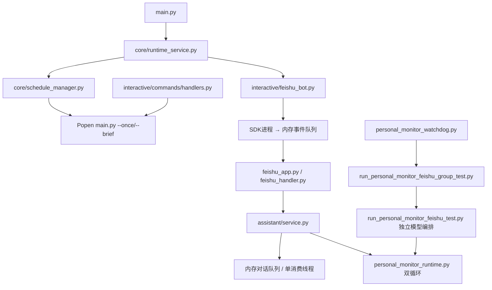
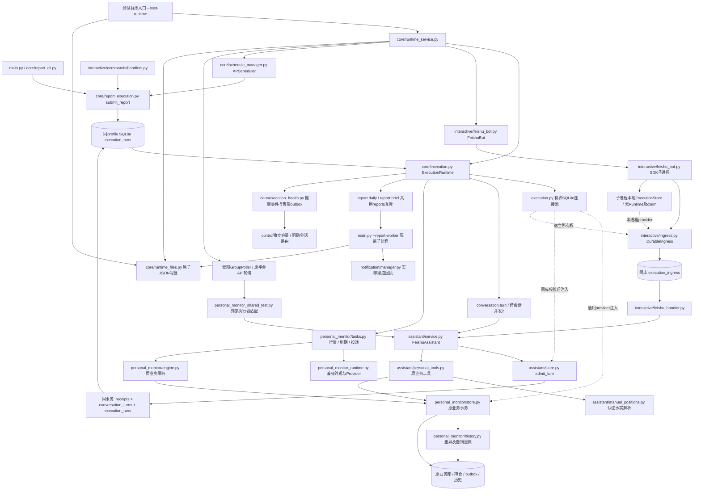

# 公共执行与健康管理层迁移及验收

状态：2026-10-29生产为整合公共层v1.18.0（6a55894，构建b7e30404）。用户确认今日三报后授权立即退役：本机七文件已替换为已发布薄入口/测试，三份旧实现文件已删除，旧任务已注销，三库前后完全一致，258项实际回归通过。M13真实对话补验仍单列；旧机器partial/性能结果保留。当前运行身份以data/deployment/release.json和固定build_info为准，详见[本次退役记录](shared_runtime_retirement_20261029.md)。

主文档：`docs/development/shared_runtime_migration.md`。与`docs/architecture.md`及`docs/llm/proj4llm.md`同步。

## 1. 范围、版本和证据

首批为实时对话、持仓监控、完整日报、早晚简报。继续使用RuntimeService、APScheduler、ConfigStore、SQLite和既有进程锁，不增加消息中间件、管理端口或常驻业务进程。研究、采集和优化保持原入口，本轮不迁移。

验收根目录：`data/acceptance/shared_runtime_20261025T022137Z/`。`baseline.json`冻结实施前102个相关脏工作区文件的**实际字节**，不是Git HEAD；`before/`为源码副本，`databases/`为2个SQLite一致性备份。`git_status.txt`记录其他未提交工作。个人截图、数据库和原始回执只保存在本地，不提交。

初始源码差异以验收根`scope_manifest.json`为历史记录，当前源码以本轮冻结及最终逐项记录为准；独立冻结点见`core_manifest.json`、`health_manifest.json`、`personal_adapter_frozen.json`、`reports/source_overlay_generation_04.json`。不同版本不混算。`document_initial.md`保留最初18项均未勾选版本。

`worktree_overlay.patch`为统一LF换行的逻辑审阅差异；`before/`、`after/`及manifest保留真实源码字节和换行。初版证据脚本在Windows写diff时重复转换CRLF，已修正，旧diff另存`worktree_overlay_before_newline_fix.patch`。该审阅差异不是可直接用于生产的发布包，不包含未列入范围的既有工作。

规则：`[x]`仅表示本次实际通过且有证据；`[ ]`包括未测、失败、阻塞或部分通过，必须说明状态。后续修改触及通过项时重新打开该项及依赖项，保留旧证据。重叠测试数量不累计。

## 2. 新旧模块及依赖

实施前的实际源码基线：

公共层当前代码的调用关系（生产限定部署、本机薄入口已退役旧分支，环境差异仍以最新发布记录为准）：

执行内核`execution.py`只依赖标准库、SQLite和注册接口；现有组合宿主`runtime_service.py`负责装配调度、Bot及业务适配器。可信Python代码注册handler和接收器工厂，配置不能指定任意代码路径。各业务适配器依赖执行内核。SDK继续使用原有隔离子进程。上图是已实现的新接线。本机原Task曾切到显式--host-runtime分支，现已于2026-10-29注销；旧独立业务循环和watchdog已退役，薄入口强制复用公共宿主。生产公共层已限定部署，其他实验未随同发布。原App测试群通过平台API轮询，与生产长连接隔离；独立验收App只允许test-1933，已实际收到该群的官方WebSocket事件，不建立第二条生产App连接。

## 3. 接口及失败语义

| 接口/状态 | 约定 | 实际代码 |
|---|---|---|
| ModuleSpec / JobSpec | 稳定ID、版本、lane、互斥key、超时、handler；运行表增补，不搬业务表 | src/core/execution.py |
| RuntimeService装配 | 可注入同profile执行器及可信Bot工厂；先取得数据库目录宿主锁、校验活所有者，再构造接收器；竞争失败方不得停掉已有所有者 | runtime_service.py、personal_monitor_shared_test.py |
| register / apply | 注册保留已持久停用状态；合法新版本原子替换，失败保留旧活动版本 | 同上 |
| disable / enable / unregister | 停接新单、移除旧触发器、排空在途；排队和数据保留；enable重建触发器 | 同上及适配器 |
| submit | request_id去重；手动请求独立ID；外部SQLite事务由调用方提交/回滚 | 同上 |
| admit_turn | 完整封套、去重、turn、执行入队同库同事务；队满/失败不消耗消息身份 | assistant/store.py |
| DurableIngress | SDK回调先提交原始入站；IPC只唤醒，丢唤醒可索引重扫；旧命令已开始不盲重放 | interactive/ingress.py |
| 执行隔离 | 跨(platform,app,chat,sender)并发2，同会话FIFO，等待32；每轮client/harness/context/cancel/OCR独立 | assistant/service.py |
| 容量 | 对话、报表、持仓行情、到期、投递、健康控制分别分配lane；所有报表共用reports互斥key | execution.py及适配器 |
| 超时/恢复 | 超时取消并标未知；不合作线程保持互斥直到实际退出；PID及出生身份核验后才回收所有权 | execution.py |
| 业务结果 | succeeded / skipped / failed / partial / unknown；空返回、缺失/不匹配回执、HTTP不确定不能推断成功 | execution.py、notification/receipts.py |
| 持仓事务 | 账户版本、规则、例外、截图来源、一次性提醒及outbox保留原库原事务；纠错历史、请求回执与持仓在同一事务提交 | personal_monitor/store.py、history.py、engine.py |
| 持仓纠错/撤销 | 手工当前事实只更新明确行；历史按用户、账户和会话隔离，CAS防覆盖；撤销/重做递增版本，不回滚已发提醒或一次性状态 | assistant/manual_positions.py、personal_tools.py、personal_monitor/history.py |
| 持仓唤醒 | 最早deadline+60秒只读校准；不逐tick写run；工具写入后wake；行情成功后才完成时点 | personal_monitor/tasks.py |
| SQLite连接复用 | 既有执行器最多缓存四个句柄；事务借用独占，空闲句柄可在同一数据库和事务模式下跨线程复用，不增加上限；嵌套/繁忙时独立临时借用，不是全部连接硬限四个。通用provider注入持仓、对话及宿主入站store；SDK只持有本进程ExecutionStore连接，不启动Runtime。对话每次借用启用外键，保持隐式事务提交/回滚、10秒超时及FULL同步；Ingress在构造时持久设置WAL，非每次重复设置。借用期间不回收，不在业务SQL或回调期间持池锁 | execution.py、personal_monitor/store.py、assistant/store.py、ingress.py、feishu_bot.py |
| 报表完成 | 等真实子进程结束和匹配结果文件，期间不释放互斥；部分/未知不整单重跑 | report_execution.py |
| 报表清理未知 | RunContext.interrupt复用原持有claim的中断状态；直接worker或已发现后代未确认退出时保留互斥，健康状态可见；父进程退出本身不代表全部清理完成 | execution.py、report_execution.py |
| 配置快照 | 固定非密钥业务配置，执行时只刷新凭据；max_tokens/token_budget保留；热改作废旧自动请求，保留手动请求 | report_execution.py、schedule_manager.py |
| 健康/告警 | 同库事件、发送意图、回执；失败有界重试，未知不重试；control独立容量；缺路由可见，无广播 | execution_health.py、runtime_service.py |
| JSON状态/结果 | 宿主、报表及测试接收器共用同目录唯一临时文件与有界Windows替换重试；永久失败显式上抛，保留原JSON序列化策略 | core/runtime_files.py |
| 计划停止 | request_service_stop仅写绑定owner、PID出生身份、started_at和时间的停止请求；宿主原循环验证并排空；旧请求不能停止下一代，不另建控制端口或守护 | runtime_service.py |

宿主正常退出只做本地停止和排空，不把模块持久停用。显式热停用经过公共接口，重启不能复活。停止顺序：停调度和新业务接单→执行器停止claim并排空→关闭对话client/Bot→回收SDK进程；暂停期间到达的原始SDK入站仍可持久保存供恢复。各资源清理分别尝试，诊断仅记录异常类型、阶段及安全栈位置，保留排空失败。进程级恢复继续依靠原OS监管，不为各业务新增专用守护。Windows Stop-ScheduledTask属于强制结束，不能当作优雅停机。首次退役的旧worker没有公共停止请求消费者：先禁用原触发器，在双SQLite写围栏、空闲及PID出生身份核验通过后作一次有界非优雅退出，不能伪造planned-stop业务标志；新宿主接管后才使用公共计划停止接口验证排空。没有外部存活观察者时，整进程死亡期间不能即时发通知；下一宿主验证旧PID出生身份后，以旧owner为稳定去重键持久投递一次中断恢复摘要，未知发送结果不重放。

## 4. 当前逐项清单

2026-10-28 v16：M03–M12已由当前2185项完整回归、151文件Ruff和13项独审核对；旧真实链路仅作限定组件桥接，不能冒充本版全部重跑。M13当前真实消息补验尚未完成。

本节是当前状态。旧版本的完整主文档、失败及中间结论保存在本轮`documentation_history/`和各证据目录，不能用其中的“最终”“通过”替代本表。逐项机器记录最终写入`remaining_acceptance_20261025/acceptance_results_current.json`，包含代码、条件、命令、结果、证据SHA、验证时间和源码版本；该记录与文档自检尚待本轮结束封口。

- [x] **M01 基线冻结**：保存相关脏工作区源码、一致性数据库快照、入口清单和资源基线。
- [x] **M02 文档落盘**：新旧图、接口、清单、历史版本及本次退役证据已落盘；2026-10-29同步架构、指南和项目记录，见shared_runtime_retirement_20261029.md。
- [x] **M03 公共宿主**：统一注册、配置版本、启停、排空及失效触发器管理。
- [x] **M04 公共执行器**：实现运行记录、互斥、超时、取消、退出结果和安全恢复。
- [x] **M05 持久入站队列**：消除“已去重但未入队”窗口，验证数据库提交失败和重启恢复。
- [x] **M06 对话并行**：两个会话同时执行，同会话顺序执行，结束或异常互不影响。
- [x] **M07 并发隔离**：验证上下文、OCR诊断、工具轨迹和账户修改不会串台或覆盖。（当前完整回归311个映射节点全通过，包含本轮状态展示、截图失败分阶段及共享执行隔离；Root审原始JUnit和621份现码。计数与其他清单项重叠，不相加。）
- [x] **M08 持仓任务接入**：替换双线程和时点循环，保留行情、提醒、例外及一次性语义。
- [x] **M09 报表接入**：统一定时、启动、Bot、CLI入口；实际业务结束前不释放互斥。（实际：最终同源完整回归与清理故障反例通过；两平台各90次真实原CLI/worker固定批量完成，实际结束、released receipt、内核资源及退出逐项核对通过。）
- [x] **M10 结果与健康**：区分成功、跳过、失败、部分投递、未知结果及数据未就绪。
- [x] **M11 故障注入**：覆盖入队、claim、业务提交、HTTP提交、进程退出和业务卡死。（实际：既有业务/HTTP未知/报表清理故障与原生空闲Host退出42恢复子项分别有证据；新PID及owner、一次恢复摘要和一次到期经官方正文GET核对。原生子项不冒充发送中崩溃或整机离线即时告警；详见native_host_restart_v13/独审。）
- [x] **M12 热插拔**：验证排空、恢复、配置回退、停用模块不复活，其他模块持续运行。
- [ ] **M13 真实对话链路**：完成截图、补充信息、持仓查询、提醒创建、到期投递和平台正文读回。（当前v15原群31项、独立App官方WS43项均实际核对；Root审95个原始文件引用及57份现码。截图/OCR、补充、纠错和撤销重做保留各自实测版本，以限定AST差异和4项当前失败分支测试桥接；不冒充新v15 OCR重跑。证据M13_current_v15/root_actual_adoption.json。）
- [ ] **M14 真实报表链路**：全量生成日报与简报，测试群实发；发送一封验收邮件并核对收件箱及附件。（实际：既有真实群发及两封已授权邮件INBOX/附件保留；当前47原加载源码/7模板桥接：邮件类AST及金融TeX生成保持，只有已审编译内存修复和延迟加载。两平台各90报告正文/30PDF285页通过；Telegram225条按冻结旧源六文档期望核对，不冒充旧null正文读回；Windows29份部署IP顺序单列，其他全部字节相同。未额外实发。）
- [x] **M15 效率验证**：按用户2026-10-28修订条件接受预期开销，停止性能优化与重复基准；原Windows普通第3对work CPU+5.882%、含启动CPU+8.413%仍记为原数值失败，绝不改成数值通过。当前v16中断的基准不算完整量测。证据closeout_20261028/M15_accepted_tradeoff.json。
- [x] **M16 回归检查**：本次实际Root七文件退役后258项定向回归全部通过，含validation，零跳过；七文件Ruff通过。执行时间/源码SHA/命令见runtime_retirement_20261029/pytest.xml、local_apply.json和verification.json。此前完整2178通过/7跳过保留为历史；不冒充本次重新全量运行。
- [x] **M17 旧实现退役**：2026-10-29用户确认今日三报并授权退役，按SHA应用七个已发布薄入口/测试、删除三份专用实现/安装/测试，备份后注销本机任务，无匹配进程或任务。保留业务/历史库、研究/优化器和必要传输；不再重启本机测试机器人补旧门槛。
- [x] **M18 最终核对**：本次三库物理/逻辑摘要不变，七文件逐字等于6a55894，旧业务调用入口缺席，本机任务/进程零；线上当前OS/status单公共宿主、无旧cron/timer/业务进程。文档同步，24项独审通过。明确保留inactive/PID0的health防复活mask及部署清理兼容；不宣称全库历史owner唯一或M13补验完成。证据runtime_retirement_20261029/。

### 已验证行为及边界

| 项目 | 涉及代码与实际通过条件 | 本轮证据（相对remaining_acceptance_20261025） |
|---|---|---|
| M01 | 102份实际脏源码、两份SQLite一致性备份；不能用HEAD或不含WAL的主文件代替 | 验收根`baseline.json`、`before/`、`databases/`、`git_status.txt`及原18项未勾选文档 |
| M03/M04/M12 | `runtime_service.py`、`execution.py`、`execution_health.py`：模块启停/版本回退/排空、各lane容量、超时取消、未开始恢复、产生副作用后不盲重放；真实Host计划退出回收SDK | `shared_final_regression_v9/`；`conversation/new_app_ws_m13/provider_reuse_real_v1/actual_delta_acceptance.json` |
| M05/M06/M07 | `ingress.py`、`assistant/store.py`、`assistant/service.py`、`feishu_bot.py`：入站/去重/turn/入队原子；两会话并行、同会话FIFO；每轮上下文/OCR/工具/账户隔离；借用外键和事务不变 | `shared_final_regression_v9/final.junit.xml`；`execution_perf/sqlite_provider_implementation_v1/`；真实WS同上 |
| M08 | `personal_monitor/tasks.py`、`personal_monitor_runtime.py`及原store/engine/history：原规则层级、例外、版本、水位和一次性outbox不变；按下一deadline唤醒，避免空闲逐tick扫描/写run | 原PM回归；`execution_perf/`各提醒正式case；最终效率仍单列M15 |
| M09 | `report_execution.py`、`report_cli.py`、`schedule_manager.py`、命令handlers、`main.py`：所有入口统一提交，固定业务快照；实际worker、匹配结构化回执及渠道结果决定完成 | `reports/`真实公共入口；`report_child_cleanup_fault_v1/`保留实际清理反例，未以旧通过覆盖 |
| M10/M11 | 公共健康、业务及投递outbox：成功/跳过/失败/部分/未知/未就绪；HTTP提交未知不重发；活心跳不等于业务成功；控制lane独立 | `shared_final_regression_v9/`；`server/proof_ttl_recovery_20261026_v1/`；原生恢复见`native_host_restart_v13/independent_review_v1/independent_native_m11_review.json` |
| M13 | 实际飞书UI→独立App官方WS→DurableIngress→公共执行器→业务事务→平台GET全文：两原图OCR、补单位、导入、更正/撤销/重做、查询、提醒及一次到期 | `conversation/new_app_ws_m13/M13_final_bound_v1/manifest.json`及`provider_reuse_real_v1/actual_delta_acceptance.json`；分阶段绑定实际源码，不把所有历史输入算作全部成功 |
| M14 | 公共入口全24标的日报/早晚报；8卡正文读回、15页表格120行全部单元格；修正版邮件INBOX、HTML和10页原始PDF字节一致 | `reports/corrected_email_v1/`；实际INBOX ID `1a172dcc6d123c73`，PDF SHA `f549445ab83b67f5e7472aee9748c535c32a4fa91f500272feb1ca263f914641` |
| M16 | v13 v3完整2220个唯一case，2211通过、9环境skip、零失败；原2177项完整保留，新增43项四模块渲染回归，36项validation通过；160项前后及255项实际加载源码与当前一致；151文件Ruff通过 | `shared_final_regression_v13_complete_v3/independent_acceptance.json`、`final.junit.xml`、`ruff_result.json`、`actual_loaded_source.json`；另见`execution_perf/report_lazy_renderers_v13_public/M16_complete_v3_readonly_review_v1/`。所有早前失败保留，不计为本轮通过 |

九项环境跳过为两项Node版本、六项Windows symlink权限、一项Linux专属进程组检查，不算通过。扩查未修改validation文件的既有20条Ruff问题原样保留，不宣称全仓Ruff通过。重叠定向集合不累加成新总数。

M13的provider增量实际为新查询、新提醒创建及唯一到期，44项核对通过，47个实际加载项目模块；本次没有重跑OCR，原图验收保留各自版本。旧图重发命中幂等，不冒充旧水位拒绝分支。四行更正最终账户版本9、十二行；原App测试profile的版本4和十二行是另一个身份范围，不能跨App自动合并。

最终清理修复后的M13增量见`conversation/new_app_ws_m13/core_cleanup_real_v1/actual_delta_acceptance.json`：46项核对通过，实际UI→独立App WS→持久入站→执行器→查询/提醒→平台正文GET→公共计划停止；两处core/report变更之外55份冻结文件不变，原App业务数据及既有截图/纠错记录保留。身份核验证明到期后已实际重新GET核对同四ID，仅更新工作区的证明哈希；首次拒绝启动记录保留。

启动意图优化后的M13又完成一次真实增量，见`conversation/new_app_ws_m13/claim_intent_real_v1/actual_delta_acceptance.json`：46项通过，两个新UI消息分别完成持仓查询和一分钟提醒，到期仅一次投递，公共计划停止实际排空并回收Host/SDK。仍为57份声明源，55份未变；持仓、历史、截图及原App业务数据未变。复用仍在24小时有效期内的同四ID认证证明，没有声称重新GET身份；分钟毫秒等式探针仍保留为失败，不以新一轮替代原始限制。

v13只推迟EmailNotifier三个日报绘图/PDF导入。实际阶段诊断、同名转发及冷简报边界见`execution_perf/report_lazy_renderers_v1/`；真实对话57份声明源、两平台既有对话/提醒的实际加载源码均未涉及该文件，原测量和哈希保留，源码桥接不冒充新报表测量。完整回归扩纳旧日报/简报测试后，旧PDF测试假编译器只写PDF、没有当前编译器要求的XDV，原失败完整保留；测试改在`_compile_pdf`边界捕获TeX，原附录断言全部保留。额外160文件Ruff扩查的5份未改validation文件有20条既有lint，独立哈希与v12相同，未改规则或抑制；受影响151文件另行实际通过。

v2的ownership失败另见`report_ownership_v13_failure_audit_v1/`：原数据库无遗留claim，系统Id1原XML证明墙钟回拨8.9531523秒；second.available_at比first.release晚5.612005秒，原五秒断言到不了执行时刻。v3同源完整复验通过，不代表已验证任意系统时钟跳变的延迟保证。外部wall/monotonic采样明确仅覆盖v3后半段，未注入测试时钟。

正式v13报表开跑前又发现离线捕获器把Telegram的`json=None,data=正文`记为`null`。旧225条空值只证明请求及本地ACK，不证明正文。新`execution_perf/report_lazy_renderers_v13_public/reports_capture_v2/`同时修三份公共fixture副本并重签清单，产品冻结不变；15项离线边界核对通过。Windows正式90次测量已完成，原协议128项和225条实际Telegram捕获完整性全通过；正文跨版本保真与字体归一仍独立验收，服务器正式90次也已通过。两平台各225条Telegram正文分别精确匹配已封六文档期望；Linux90HTML/225飞书/30内嵌PNG对旧Linux实际产物全字节一致。Windows61HTML原字节一致、29份仅唯一部署栏相同IPv4集合排序，源码确为list(set(...))直接连接；节点/OS及全部其他字节全等。原零排除oracle false与新限定语义独审并存，不宣称原始90HTML全等。两variant都计入完整正文捕获成本，旧null不作为正文对照，也不补写历史样本。

分钟提醒存在已观察到的精度限制：原消息15:17:02.944Z毫秒完整保存，模型传入秒精度due_at=15:18:03Z，比精确加60秒晚56毫秒；按该截止时间524.169毫秒后领取、一次投递成功。旧“精确加60秒至10微秒容差”探针本次为失败，见`strict_millisecond_probe.json`，不改绿；N天后的after_days仍由服务端按原消息同一时刻计算。该限制不是公共层时间丢失，不宣称实现了分钟的毫秒精确转换。

神华实际实施公告每股0.9800元，股权登记2026-10-23，除息/派息2026-10-26。港股现金币种合同缺失明确为`not_ready`，未伪造就绪。原快照BRK.B名称为分号，属于另行保留的上游元数据问题，本次不扩修。修正版邮件已用完用户追加的一封额度；发送未知不重发，后续性能通道全部禁用真实发送。

## 5. 性能协议、结果和限制

固定输入、相同实际基线，每平台至少三轮；空闲每轮600秒。执行树包括RuntimeService、Assistant、官方SDK及各短命业务子进程；Windows内核Job、Linux内核计数包括已退出子进程。常驻数按实际工作量记录：Windows报表为Host/SDK共2个，对话、提醒及空闲夹具为Host/SDK/conhost共3个；Linux夹具另有resource_tracker。不能将瞬时工作峰数当常驻数。

硬门槛逐对逐指标判定，不跨轮或跨业务抵消：常驻数不增加；空闲单核CPU百分点增量≤0.1；合计RSS、同工作CPU和报表耗时≤基线105%；吞吐≥基线95%；提醒延迟增量≤1秒；空闲持仓全表扫描至少减半，不逐tick写运行记录。

| 实际版本/工作量 | Windows | 服务器 | 当前用途 |
|---|---|---|---|
| provider v5普通对话、查询，各3对 | 已通过 | 已通过 | 原正式证据保留；报表清理最终源重新绑定/验证待完成 |
| provider v5提醒，100条×3对 | 600次唯一ACK通过 | 600次唯一ACK通过 | 同上；每条仍有独立业务状态与发送回执 |
| v8短报表，每case日报/两简报 | 第1/3对耗时+7.085%/+8.416%，失败 | 三对全部门槛通过，92项独审、57页像素/正文核验 | 仅对应各自源码，不抵消Windows失败 |
| v9短报表前置，仅一对 | 耗时+6.425%，失败 | 一对通过 | 非正式三对，不算M15通过 |
| v9候选空闲3×600秒 | 未启动 | 旧0a21源码三轮已完成，32项独审通过 | 历史组件结果；CPU均值约下降80.49%，RSS峰值约+1.122%，不能继承为新源码通过 |
| v11清理修复源码 | 对话、提醒分别279和197项独审通过，提醒另3项完整墙钟吞吐通过；报表前两对下午耗时+10.0474%/+11.2425%，第二对早报+7.1392%，首对总体+5.1617%，失败；第三对候选午夜输出变化失败 | 对话120、提醒78、报表204项核对通过；空闲第一轮穿23:59真实行情任务，零run断言失败，缺三轮 | 原失败和组件通过均保留，不抵消另一平台或另一指标 |
| v12对话 | 12case/280核对通过，36受测PID/birth退出 | 12case/123核对通过，50身份退出 | Windows `windows_public_v12_formal/conversation/`；服务器`server/start_intent_v12_conversation_formal/` |
| v12提醒清单修复版 | 启动前清单错误保留；仅两metadata文件另包修复，完整新6case600ACK、200核对及三对完整耗时吞吐通过；18身份退出 | 新6case600ACK/78核对通过，26身份退出 | `report_start_intent_v12_public/signed_reminders_manifest_v2/`；Windows `windows_public_v12_formal/reminders_manifest_v2/`；服务器`server/start_intent_v12_reminders_manifest_v2_formal/` |
| v12报表 | 全90实际执行及功能完成，整体指标过线但逐type失败，见M15；原128核对的argv读取错误另文件修复，复核原样本后唯一失败为性能总门禁 | 90执行/206核对及最终9项closure通过；30PDF285页对各variant历史同平台参考全文与逐页像素差异0；257身份退出 | Windows `windows_public_v12_formal/reports_batch5/root_independent_acceptance_argv_v2.json`；服务器`server/start_intent_v12_reports_formal/`；首次错误保留，未重跑case |
| v13 capture-v2报表 | 全90次/128原核对及225条真实Telegram正文捕获完整性通过；三对整体耗时较实际基线低7.165%/4.234%/5.870%，CPU低7.488%/8.147%/7.294%，RSS低约3.5%，常驻数不变；每种报表全部独立过线 | 全90次完成，235检查+9最终清理+5内容/证据通过；三对整体wall低12.658%/11.511%/11.527%，CPU低11.097%/11.494%/11.393%，RSS低13.32%/22.66%/22.59%，常驻数不增，全部type独立过线 | Windows `windows_public_v13_formal/reports_batch5/root_independent_acceptance_argv_v2.json`，SHA `8d39c3fddb23090cebe42ad2d4618e1c019807257eddff8b48b4c88051126d0f`；当前产品freeze `7c10e61c…`，M15仍未全部通过 |

旧v5/v6服务器报表RSS分别+27.705%和+13.17%的失败均保留。已用真实strace定位到两遍TeX的`extractbb --version`探测峰值，PDF管线改为两遍`-no-pdf`后独立`xdvipdfmx -q -E`转换，实际版本查询只供给精确命中的backend调用；保留其版本/颜色/链接选择、catcode及禁shell分支，不写假版本。当前金融模板及生成正文不变；无XDV、失败/超时、旧PDF不能返回成功。

短报表诊断显示持久提交和完成等待的开销，需要按原硬门槛验证。已预先固定较长协议为每case五组、每组日报/早报/晚报，共十五个实际独立worker，三对顺序保持baseline/candidate、candidate/baseline、baseline/candidate；相同源输入、缓存和资源预算。逐个、逐组、各报表种类分别披露耗时/CPU，整体及每种报表均须过门槛。不得用日报节省抵消简报回退，不宣称旧单次报表延迟已通过，不改变组数直到出现好结果。`public_final_v10_reports_batch5/`只是准备证据，尚未运行；安全修复后的重绑定另立新目录。

v11两处日期问题分别定位并保留：Windows本地跨到10月27日后，固定10月23日数据越过现有“近三天”边界，飞书/TG日报各从6段变4段；服务器23:57—00:07的名义空闲窗口经过夹具23:59行情时点，正确产生一个合法任务，因此不是纯空闲。下一报表协议将只在两边独立worker内固定业务展示时钟为2026-10-26T04:00Z，保留原24标的真实输入和日历过滤；真实计时、父Host、SQLite消息时间与邮件传输元数据不得冻结。空闲重测须另过整窗口无时点、无catchup的时间门禁，不放宽零run条件。

服务器使用独立`/tmp`目录、单核、nice19及既有内存/CPU上限、禁真实通道。新版开始资源保护为900MiB可用内存（原1000000000字节条件已明确修订，`report_observer_exit_fix_v1/server_start_guard_review.json`），运行最小可用160MiB、RSS900MiB、进程地址空间等预算不放宽；不清生产缓存、不换服务或配置。

## 6. 故障修复与退役顺序

清理反例使用真实ExecutionRuntime和临时SQLite，子进程由受控假对象代替：原第一份worker仍活、claim却已释放，第二份报表可开始；另查已发现后代尚活的情况。所有红测保留。实际修复限于报表清理异常路径，以及RunContext新增5行interrupt方法复用既有中断存储接口；其余执行内核AST不变，FULL同步和金融算法不变。实际源码200项定向检查通过，含23项故障测试、原名义报表测试及validation36；详见`report_child_cleanup_fault_v1/root_application_v1/focused_acceptance.json`。直接worker及已发现且身份可核实的后代未退出时保留互斥，健康可见为unknown；SQL诊断失败有界节流重试，未知枚举不能因父进程已退出而自动清除。psutil快照不能证明整个进程生命周期或早已丢失的后代，保留此边界，不把有限身份观察夸成完整进程树证明。

v12正常路径另有三处有界优化，不能再宣称整个执行内核只增加interrupt：`JobSpec.starting_side_effect`仅由报告声明，在同一claim FULL事务保存启动意图；同阶段mark先重新读取status/token/side_effect才省写，默认业务的重复副作用提交合同保留。报表phase文件即时记录，共享诊断进度最多每10秒保存一次；启动意图、取消及最终回执不合并或延后。CLI把已初始化的application显式传给worker，避免第二次初始化main。被claim但尚未spawn就发生request写入异常的报告更保守地标unknown，未claim队列恢复不变。原生受控子进程I/O诊断只定位落盘成本，不算金融或性能验收；实际182项定向、12项源范围核对见`execution_perf/report_start_intent_v1/`，无数据库schema或金融算法变更。

以下是阶段1/阶段2原设计及当时的证据边界，保留历史；2026-10-29用户确认三报后明确授权立即退役，本机原任务继续停用并最终注销，没有为旧控制器门槛复活机器人。本次实际离线退役及限定复验见文末和专项记录。

阶段1接管前核对当前M09功能、M13真实链路、M15双平台性能及M16回归；M11的原生恢复子项在阶段1完成，阶段2删除旧实现前必须通过。

1. 先沿原`TradeEyesPersonalMonitorTest`的同一Task切到当前已存在的`--host-runtime`路径；此阶段不删除源码。禁用原触发器、完整XML读回，双SQLite写围栏内验证空闲/业务哈希/完整历史/原三进程出生身份，五秒内受控结束旧所有者。随后持续持有原三锁和宿主锁，保持Task禁用，仅修改Action；核对原principal、分钟触发、IgnoreNew、Restart3/PT1M及源码后释放，再明确启用同一Task。
2. 原生链路实测公共Host和传输状态、真实平台查询正文、全Host故障由原OS拉起、一次稳定恢复摘要，以及公共计划停止/排空和恢复。整进程死亡期间没有外部存活观察者，不能保证即时外发；恢复后摘要通过公共outbox去重，未知发送不重试。
3. 原生链路通过后，禁用触发器、公共计划排空、确认无在途并保持租约，应用已审阅的薄入口及测试补丁，删除`personal_monitor_watchdog.py`、其专用installer和专属测试。保留其他业务仍用的组件及所有历史数据；旧三层强制退出器不得用于新Host。
4. 在真实最终源码跑154项退役闭包、受影响检查/validation/Ruff、最后真实平台查询，再核对Task/导入/调用/配置/测试/文档和无双调度。隔离副本154通过只是准备，不代替实际应用后的验收。

原profile的持仓12行、账户版本4、原规则/历史/去重/来源/消息时间及11月2/5日09:50滚存提醒均须保留。持续只读生产MainPID760395、SDK760403及处理器SHA，未部署、未改生产服务/配置/定时。原接收器曾因24小时生产过滤证明过期停接，已只读复核后续期原证明恢复唯一worker37852；未把该保护退出说成系统崩溃，也未建立第二条生产App长连接。

退役控制器独立假测及Windows ABI、历史/游标投影只读准备见`retirement_first_handover_controller_v1/`和`retirement_live_preflight_20261026/`。原生Task、退出/接管和恢复实测未完成前，M11/M17/M18不得勾选。每次失败保留证据；无隐藏旧实现自动回退分支。

## 7. 复核入口与交付

当前完整运行和限定范围复验见`shared_final_regression_v11/run_regression.py`、`verify_after_fixture_fix.py`及`validation_cache_isolation_final_v2/prove_and_validate.py`。原失败、修正前后源码、精确AST差异、确定性缓存串用复现、所有节点与9项跳过均保留；组合结果不冒充新的一次全绿完整运行。旧版本证据不覆盖，后续退役改动须写新结果目录。

最终交付按M01—M18列出通过、失败、阻塞、未验收，引用结构化记录与证据SHA；同一条记录包含实际验证时间和冻结源码。不将环境skip、准备脚本、API完成、退出0、活心跳或旧版通过当作整体成功。初始验收阶段规定先不部署；2026-10-28用户已另行授权，当前生产部署状态见最新部署记录。历史未部署记录按各自时间保留。

当前正文和实发桥接证据：Windows `execution_perf/windows_public_v13_formal/reports_batch5/root_windows_content_final_acceptance.json`（SHA `f4d3fe5d…`）及`root_windows_PDF_final_acceptance.json`（95项，SHA `6abcfff6…`）；服务器`server/lazy_renderers_v13_capture_v2_reports_formal/stage_disposition.json`（SHA `05e776fa…`）、`root_current_reports_phase_review.json`及`root_visual_review.json`；真实投递47源/7模板桥接见`reports/v13_real_delivery_source_and_compiler_bridge/receipt.json`（SHA `e8c924f4…`）。旧PDF编译源7b0869…与现1ba27b…的差异只限既有编译管线修复，金融TeX生成前缀/异常清理后缀及全部模板逐字节保持；不能笼统声称全部原源码未变。

### 本机原生接管的保留失败与补完边界（2026-10-27）

M15双平台全部实际门槛封口后，Root实际禁用了唯一的本机 `TradeEyesPersonalMonitorTest`，生产未变。第一轮 `native_v13_20261027_01` 在preflight以`BACKUP_INVALID`拒绝，没有终止、锁取得或Action变更；原因是Root人工普通只读复核WAL模式快照时生成空WAL/SHM，快照SHA未变，失败原件和sidecar保留。仅本轮独占新建而从未持有的`.service.lock`在实际fileID、原三角色、Task、无新Host和可独占等检查后清理；原三旧锁和数据库未修改。

第二轮 `native_v13_20261027_02` 使用不可变只读快照复核，通过原全部数据/历史/空闲检查，critical实际0.547秒。三角色退出请求后在`wait_exits`发生`WindowsHandleFailure`；双库均rollback、cleanup无错、未取得custody、未改Action，原失败保持`ABORTED_AFTER_PARTIAL_RETIREMENT`。Root后续实际核对三个旧PID均缺席、无同配置启动器，受保护业务摘要、12笔持仓和11月2/5日09:50两条提醒均保留。独立全新自然退出子进程复现同路径镜像查询竞态（error31），原第二轮未记录具体stage/error，因此不把复现码冒充原历史错误码。

以下保留的是第二次退出后的历史状态：Task当时disabled、Action旧值、旧三进程已退出。随后独立、显式Root批准的post-exit补完已完成（见下文）；当时约束为：不再kill、不重臂旧attempt、不复活旧实现；相同schema/domain/全部PRED/受保护digest，另对已退出后的全表typed原始摘要进行fenced逐值复核，旧health仅作历史事实。四把原fileID实锁连续custody，双库fence含rollback/close总计≤5秒；完整历史无新消息后释放fences保留leases，Root另行修改同disabled Task Action并原生读回，确认后才放锁、启原Task。补完及真实恢复链路未实际通过前M11/M17/M18保持未勾选。临时补完器隔离反例和复核见`retirement_first_handover_controller_v1/`，不是产品新增服务。

### 2026-10-27 事实回复边界重新打开

原生故障注入42、自动新宿主、一次恢复通知和跨重启到期提醒已实际完成，见`remaining_acceptance_20261025/native_host_restart_v13/readback_result.json`；旧持仓、历史及11月2/5日提醒一致。另一次模型持仓查询实际出现未经确认的逆回购单位与“最新价”错误，审计见`native_semantic_query_audit_v1/semantic_audit.json`。M13重新打开；修复触及service/personal_tools后M16及受影响M15重验，保留v13全部证据，不继承为改后通过。原生Task已临时停触发并经公共接口计划排空；未退役旧源码，生产未部署。

### 原生接管03与v15事实展示实际续验

`retirement_first_handover_controller_v1/root_native_operator_v13/native_v13_completion_03/`保存独立post-exit补完：原guard失败不改绿；1.829秒双库围栏、完整typed摘要、四把原fileID锁及92份源核验通过，Root同禁用Task只改Action并原生读回后才放锁、启用。原Task的principal、分钟trigger、IgnoreNew、Restart3/PT1M保留。旧三进程未复活，原43表业务库/历史/12仓revision4及未来提醒保留。

`native_host_restart_v13/readback_result.json`及独审c7309b…记录公共Host43356同句柄退出42；Root没有发起重启，原Task自动新Host17124、owner5d413e…，稳定host_recovered事件004339…经公共outbox仅发送一次；提醒ce2914…跨重启completed、唯一outbox/sent/attempt1、平台正文各一次。两条Nov提醒与六张保护表一致；无法由已有Task记录区别分钟trigger与RestartOnFailure谁触发，不猜。随后公共request_service_stop实际计划排空，禁止用旧三层退出器操作新Host。

v15当前两产品源为service cf600928…与personal_tools7176fd69…。真实原群失败反例394a4d…保留：模型曾补“张”并称“最新价”；修复让本轮仅实际调用status的模型路径采用存储事实展示，同时保留提醒/规则/例外与已知投递状态，多次成功scope均展示、后续读取失败清空前结果；写回执优先及混合工具原行为保持。这个界限不等同于任意混合工具自然语言已被全事实校验。原群两新turn56c5bb…/f6c382…经实际入站和官方GET，31项独审通过；2455字发送文与renderer逐字一致，平台2417字仅ASCII空白格式变化，所有事实字符及顺序相同。12仓rev4、两Nov pending、未知repo单位及49.22/50.2分列均保持。

退役审查新增共享路径四项回归：完整4片≤2800字拼接、逐片提交意图/回执、重启去重，以及下载/识别/校验三个失败阶段。初次三条诊断红例保留；v15以逐轮on_stage回调与现有conversation_events补持久安全阶段/原异常类链，原异常合同不变、不加共享可变状态，四项fresh通过（successors_current_v15/）。完整回归与受影响性能另行重验，未删旧源码、未部署。

## 2026-10-28 性能验收口径修订

公共层的额外成本来自必要的持久入站/入队、任务claim和互斥检查、结果与释放回执、健康及恢复检查。这些操作增加数据库读写和调用层次，用来消除消息丢失、重复执行和退出结果不明。仍复用现有SQLite、宿主与调度器，未增加外部队列或管理端口。

原失败样本是20条固定输入：工作CPU由1.328125秒增至1.40625秒（增加0.078125秒），含启动总CPU由6.5秒增至7.046875秒（增加0.546875秒）。这些数值不等同于生产每次对话延迟。诊断同时观察到SDK启动成本变化，因此不能把原增量全部归因于公共层，原精确原因仍未证明。

用户已明确接受这一取舍，5%数值门槛不再阻止交付。M15的勾选代表按修订条件接受，不代表旧数值测试通过；无双调度、事务/数据一致性、并发有界和实际收发检查继续保留。

## 2026-10-28 已授权发布与生产切换

原先“生产未部署”的阶段已结束。独立提交[c7d7656](https://github.com/Saltflow/trade_eyes_keeper/commit/c7d7656658b8c7a15cf77b097dee4f8b3a4ff89f)从已发布分支3d863f2构建，79个明确文件；没有推送本机未发布的其他研究/优化器提交，原HEAD/索引/脏源码保留。私人更正回归原文、数据库、截图和凭据不进入发布。

生产实际覆盖38个文件，保留34个其他main业务函数和三类简报准备的生产AST；38个受保护路径哈希未变。原生产Git HEAD保持8bd9484，不能用它推断部署源码。日报19:00、早盘09:50、收盘14:30、优化02:00均从新进程实际注册日志核对。只增加健康告警群配置；既有systemd on-failure/5秒策略不变，无新增管理端口或常驻进程。

当前发布定向回归最新结果去重1515通过、0失败、0跳过（包含validation）；另生产通知overlay82通过。中间2个跨模块导出兼容失败在最终82项复验修正，不冒充单次1515全量运行。Ruff功能错误规则通过，完整规则102条历史诊断保留且无新增。服务器隔离Python3.10、库副本schema/业务哈希和现有Pi bridge协议均通过。

首次切换检查过早读取SDK启动PID触发自动回滚，保留旧数据；修正部署等待条件后再次切换成功，错误及备份未覆盖。22:17:50主进程845757/SDK845765稳定412秒，唯一执行owner，4模块7任务，仍为宿主/SDK/tracker共3进程。原27轮会话、926条事件、31条去重和其余既有业务表哈希保留，数据库完整性ok。

健康告警测试群只发送一张部署卡片，并以user_card_content读回精确正文；默认GET兼容占位结果另存。没有另开同App WebSocket、另发邮件或部署时重跑日报。出站和存活不当作新人工入站补验。本机原测试profile/旧测试源码的退役继续按原M13/M17/M18边界，不据生产已切换自动勾选；本机私人验收持仓/截图/提醒保留原处，未自动导入生产。

证据：`data/acceptance/shared_runtime_20261025T022137Z/remaining_acceptance_20261025/deploy_20261028/deployment_summary.md`、`production_deployment_result.json`、`final_postflight.json`、`health_route_readback.json`。旧候选2178通过/7skip与当前过滤发布1515项为不同范围，不混算。

发布后补充：`5e5a22ae44f859498e8ffa2e732177c1ba820842`仅增加六条既有兼容导出的lint说明注释，已快进推送；与c7d7656模块AST完全一致，未更改生产overlay、业务逻辑或重启服务。当前发布树完整Ruff102条均为既有诊断。实际运行代码/生产哈希继续绑定上述c7d7656覆盖记录。证据`comment_only_followup.json`。

### 2026-10-28 用户要求先停本机弹窗测试进程

已按用户要求停止本机测试群轮询器，确认原PID28076退出、匹配测试进程0个；计划任务TradeEyesPersonalMonitorTest已Disabled，后续不得擅自恢复自动拉起。测试数据库3份完整性备份及原Task XML保留在data/deployment_audit/local_monitor_stop_20261028T143357Z/。生产服务器未操作，数据/源文件未删除。这是用户主动停用本机验收入口，不是生产故障或旧源码退役通过。

### 2026-10-29 19:19 线上版本复核

38源SHA全部匹配部署manifest；systemd D-Bus微秒启动时刻证明源文件均先于现存主进程启动。单owner/4模块7任务生效，今日3次报表和持仓检查已实际经公共执行器；31文件逐字等于c7d7656、7文件为已审生产保留合并，旧Git HEAD不是运行版本依据。三次报表均partial，原因为data_not_ready:delivery_acknowledged，不能算整体业务健康/退役通过；本轮仅只读核验，未重发/重跑/修改生产。详情见deploy_20261028/integrated_version_confirmation_20261029.md。

## 2026-10-29 v1.18.0 可核验版本标识已上线

已推送并按11明确文件覆盖部署6a55894，运行标签v1.18.0 · 6a55894 · 构建b7e30404，通用release.json覆盖实际276源/模板；不读旧Git HEAD冒充运行版本。日报、简报、PDF、Bot/help及service_status.build_info一致，启动时一次校验。独立静态56项、发布受影响136pass/1skip及后续类型校验、Linux实际覆盖29/29通过；真实独立进程与宿主版本和完整源码指纹核对通过，仍3进程，配置/unit不变、未发邮件或重跑报表。本机用户要求停用的测试Task未动。

首次切换触发原有30天会话清理，17条终态会话/455条关联事件过期删除；用未改旧store在备份副本重放与当前结果完全一致，完整原库备份保留，不隐瞒这项既有行为。保留策略未改、生产数据未回卷；第二轮切换的严格数据保护原样通过。当前新身份和这次实际结果见data/acceptance/build_version_20261029/delivery.md；旧部署/源码冻结均按历史版本解释。数据未就绪和原退役缺口仍未据版本上线打勾。

## 2026-10-29 20:17 用户授权后完成旧链路退役

用户确认今日三报无问题并明确要求立即下线冗余链路。本次应用已发布6a55894的七个薄入口/测试，按原SHA删除三份旧实现，备份后注销本机任务；三库一致性备份及源/逻辑摘要前后完全相同。实际Root定向258项通过、零跳过，Ruff七文件通过，24项独审核对通过；不重新跑性能或要求用户再发消息。线上只读核实单公共宿主/SDK及四模块，旧业务源/进程/cron/timer缺席，本次不改生产、不重启。保留inactive/PID0的health mask和部署清理兼容作为保护，不计作活链路。周末退役提醒已删除。M13历史真实链路版本边界和机器partial结果保留，今日三报采用用户确认，不冒充本轮新人工入站通过。详见[退役记录](shared_runtime_retirement_20261029.md)及data/acceptance/runtime_retirement_20261029/。
