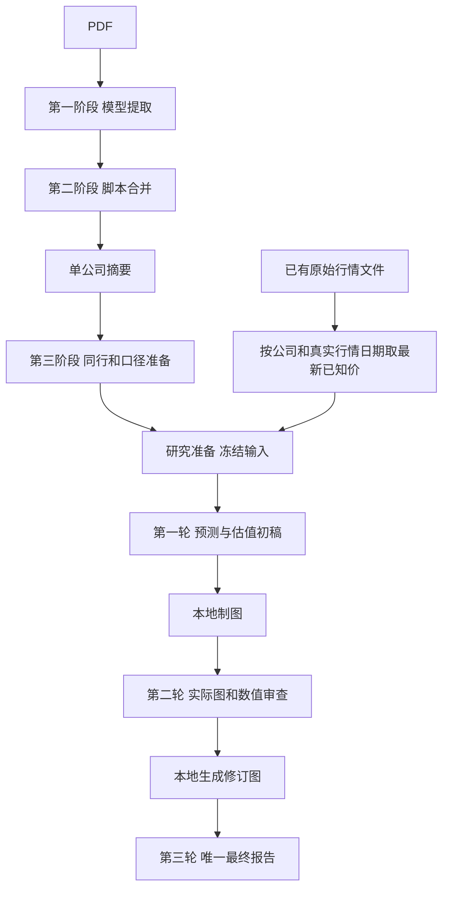

# 正式研究：一个入口，固定三轮

当前v5：实际收到几年的资料就展示几年，七年是完整研究的目标资料量，不能为未提供年份造空列或扩展坐标轴。未来五年情景单独标E。同指标、时间、单位和分母一起横比，工程深入，白酒机制参照。前面数据阶段与旧产物保持原字节。



## 离线准备及行情

默认仅准备，不读取API密钥、不联网、不发送请求：

```powershell
python -B -X utf8 scripts/research_report.py --source data/fundamental_data/peer_research_20261024_frozen/完整分析.md data/acceptance/financial_entrypoints_20261024/stage3_ready/模型输入.md --output data/fundamental_data/research_next_preview
```

已有stage3_input_v1的manifest.json提供公司清单，研究准备自动识别；纯Markdown无清单时可显式传 --companies 600039 600820 000568，不从正文猜公司身份。local_latest_price配置开启本地读取，关闭则不自动附价。当前适配已存在的A股tencent_raw_day JSON；它不导入旧研究模块或行情抓取器，不扩展多供应商/多市场格式猜测。

最新已知价按源记录的date取最新，不按文件名、抓取时间、缓存创建时间或价格高低选择；仅未复权原始日线，未来日期和不可用价格不作为现价。报价日期与财报日期分开。没有本地记录则该公司写未取得；同日不同价格原样并列，文件读取失败写局部注记，不拦截其他资料。缺市值/股数不从价格倒推。

行情快照.md与实际行情源文件、公司清单一起归档并冻结；模型只收到简洁行情表，不投递整段行情历史。三轮都沿用该冻结快照，执行时不重新读行情，旧材料中“行情未提供”不覆盖本轮快照。

--market-snapshot 已有行情.md 仍接受明确指定的快照，优先于本地自动读取；--feedback 可提供研究反馈，输出必须为新目录。目录输入只选一个标准正文及其已知图表侧车，不灌入整个历史目录。

## 研究形式与图表

共通约定research_basis_v3.md继续复用；新增的research_valuation_v5.md与draft/audit/final_v5.md约定实际历史、未来五年、FCFE/ROE、现价隐含回报、hurdle最高买价及反向条件。docs/design/research_report_example.md的完整示例进入三轮上下文。hurdle未指定时列具名敏感性，不冒充用户门槛；ROE不等于买入回报；现金分配与期末价值不重复计入。

第一轮完整初稿及chart块，第二轮读取固定证据、完整稿、图原数和真实PNG并给完整修订稿/图数据，第三轮回看修订PNG，只引用已生成图片，形成唯一最终报告。实际年份内的局部指标缺失仍可用null，不能为没有提供的年份补空。图表格式约定只要求前两轮chart，第三轮不新造图。

## 执行、冻结与预算

本轮未授权真实付费。未来获授权后，在全新目录按准备命令增加 --budget-limit-usd 本轮上限，再用 --execute 新目录 --paid 执行。执行不允许覆盖准备参数，恰好三轮，不自动重试/续写/追加。每次真实请求在发送前落盘冻结，源文件、prompt、参数、原文、实际PNG和依赖哈希保存；失败/截断已有内容保留。行情和其他新准备逻辑不增加付费轮数。

正文水位500k，实际图片计入容量与请求体限制；超限不裁尾。输出各131072含thinking。价格配置为带日期的旧假设，不等同实时价格；其他UTC日期执行前应另行核对并新建计划。usage未知就保留未知，模拟usage不算实际消费。

最终交付最终报告.html/.md，正文.md保留原响应；jobs/requests/views保留逐轮原文、思考、SSE、receipt、请求和图稿。局部图表失败只标注并保留原块，不新增金融语义拦截、补数或猜测修复。

## 本轮架构负担与验收

研究运行仍4个脚本，654→746行，净增92行：准备模块+83，入口参数+9，轮次交接与绘图模块不变。没有新增运行模块、第三方依赖、数据库、调度器或研究阶段。快照首轮输入增量193 tokens；主要维护点仅为显式现有行情格式和身份/日期/未复权语义。

本轮离线样例与受保护旧文件核对见data/acceptance/research_known_price_20261024。旧v4七年空列样例保留为历史记录，当前只显示实际三年。虚构U算例与真实公司隔离，形式验收不代表实际模型研究、预测合理性或七年资料完整验收。
