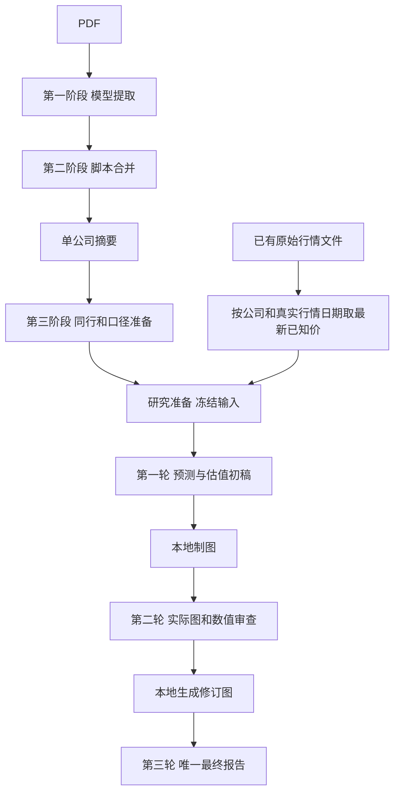

# 正式研究：一个入口，固定三轮

当前v6：公司数量、行业、比较组和参照角色由本轮公司清单、行业证据与用户研究重点确定，默认不指定固定行业组合或参照对象。多家公司按主题横比，单公司结合自身历史与情景；同指标、时间、单位和分母一起展示。实际收到几年资料就展示几年，不能为未提供年份造空列或扩展坐标轴，未来五年另标E。前面数据阶段与旧产物保持原字节。



## 离线准备及行情

默认仅准备，不读取API密钥、不联网、不发送请求：

```powershell
python -B -X utf8 scripts/research_report.py --source data/fundamental_data/peer_research_20261024_frozen/完整分析.md data/acceptance/financial_entrypoints_20261024/stage3_ready/模型输入.md --output data/fundamental_data/research_next_preview
```

已有stage3_input_v1的manifest.json提供公司清单，研究准备自动识别；纯Markdown无清单时可显式传 --companies 600039 600820 000568，不从正文猜公司身份。local_latest_price配置开启本地读取，关闭则不自动附价。当前适配已存在的A股tencent_raw_day JSON；它不导入旧研究模块或行情抓取器，不扩展多供应商/多市场格式猜测。

最新已知价按源记录的date取最新，不按文件名、抓取时间、缓存创建时间或价格高低选择；仅未复权原始日线，未来日期和不可用价格不作为现价。报价日期与财报日期分开。没有本地记录则该公司写未取得；同日不同价格原样并列，文件读取失败写局部注记，不拦截其他资料。缺市值/股数不从价格倒推。

行情快照.md与实际行情源文件、公司清单一起归档并冻结；模型只收到简洁行情表，不投递整段行情历史。三轮都沿用该冻结快照，执行时不重新读行情，旧材料中“行情未提供”不覆盖本轮快照。

--market-snapshot 已有行情.md 仍接受明确指定的快照，优先于本地自动读取；--feedback 可提供研究反馈，输出必须为新目录。目录输入只选一个标准正文及其已知图表侧车，不灌入整个历史目录。

## 研究形式与图表

默认配置加载research_basis_v4.md、research_valuation_v6.md、draft/audit/final_v6.md以及docs/design/research_report_example_v6.md，三轮都收到通用结构与完整的本轮证据。行业现金方法按实际业务选择，不把一种行业的CFO/投入/资本规则硬套给所有公司。hurdle未指定时列具名敏感性，不冒充用户门槛；ROE不等于买入回报；现金分配与期末价值不重复计入。

默认入口已解除对历史案例中固定公司和角色的依赖。旧版prompt和旧排版示例作为历史版本原字节保留，默认配置不再引用；测试中的历史案例仍可验证原数据/图像交接，但不能要求通用system携带该案例的公司或角色。新增通用性回归从默认CLI准备并模拟三轮，覆盖不同公司数量和主题，禁止联网。

第一轮完整初稿及chart块，第二轮读取固定证据、完整稿、图原数和真实PNG并给完整修订稿/图数据，第三轮回看修订PNG，只引用已生成图片，形成唯一最终报告。实际年份内的局部指标缺失仍可用null，不能为没有提供的年份补空。图表格式约定只要求前两轮chart，第三轮不新造图。

## 执行、冻结与预算

准备命令不产生付费请求。获得该批预算授权后，在全新目录按准备命令增加 --budget-limit-usd 本轮上限，再用 --execute 新目录 --paid 执行。执行不允许覆盖准备参数，恰好三轮，不自动重试/续写/追加。每次真实请求在发送前落盘冻结，源文件、prompt、参数、原文、实际PNG和依赖哈希保存；失败/截断已有内容保留。行情和模板更新不增加付费轮数。

正文水位500k，实际图片计入容量与请求体限制；超限不裁尾。输出各131072含thinking。价格配置为带日期的旧假设，不等同实时价格；其他UTC日期执行前应另行核对并新建计划。usage未知就保留未知，模拟usage不算实际消费。

最终交付最终报告.html/.md，正文.md保留原响应；jobs/requests/views保留逐轮原文、思考、SSE、receipt、请求和图稿。局部图表失败只标注并保留原块，不新增金融语义拦截、补数或猜测修复。

## v5行情接入的既有架构与验收

研究运行仍4个脚本，654→746行，净增92行：准备模块+83，入口参数+9，轮次交接与绘图模块不变。没有新增运行模块、第三方依赖、数据库、调度器或研究阶段。快照首轮输入增量193 tokens；主要维护点仅为显式现有行情格式和身份/日期/未复权语义。

v5离线样例与受保护旧文件核对见data/acceptance/research_known_price_20261024。当时的样本实际三年，旧v4七年空列样例只保留为历史记录，不决定其他批次的窗口。虚构U算例与真实公司隔离，形式验收不代表实际模型研究、预测合理性或资料完整验收。

## v6默认模板通用性修复

只新增版本化通用prompt/布局示例并更新默认配置指针，未增加或修改运行脚本。测试从未传--config的正式CLI准备，模拟三轮并验证system不包含历史案例公司、固定公司数量或固定行业组合，user材料与明确角色原字节保留。覆盖四家银行、两家保险、一家能源及用户明确指定参照角色的混合主题；历史案例测试继续验证数据/图表，不再把案例指令当通用契约。

已封存批次目录、请求、原响应及原版prompt/示例不迁移或覆盖。默认源配置的版本升级是显式修改；历史freeze中若引用该可变默认源路径，会显示这个外部源文件的演进，不能改写旧freeze来伪装源文件始终一致。新批次冻结v6实际输入和配置，旧批次禁止自动续跑。此次修复仅离线验收，不调用付费API，也不改已交付报告的财务数值或核验结论。
